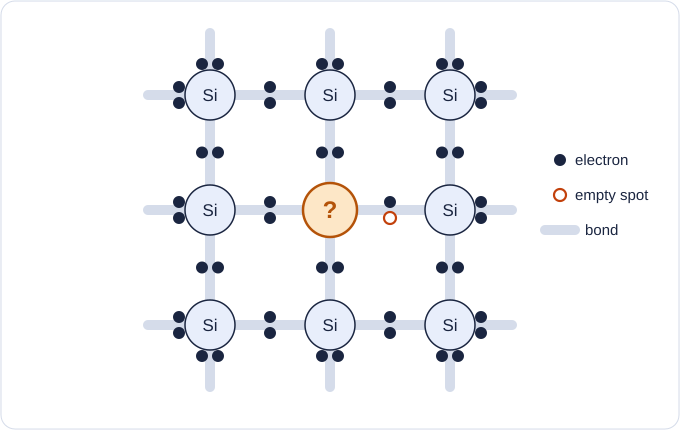
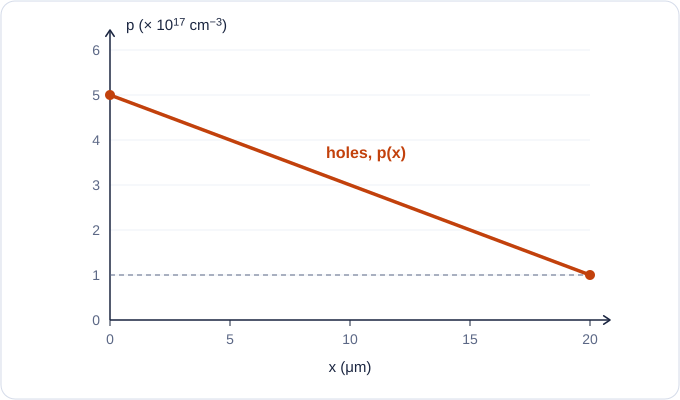
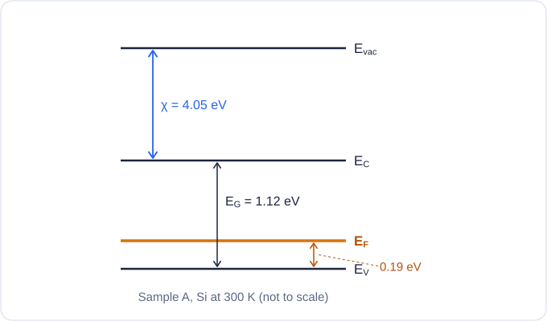
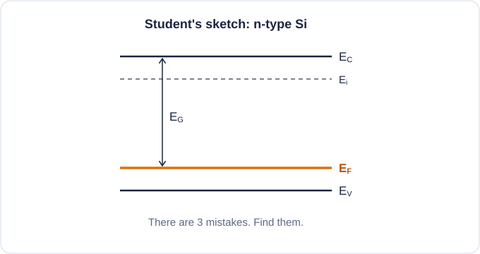
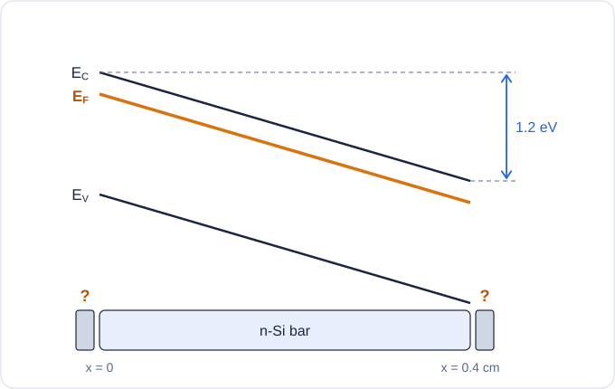
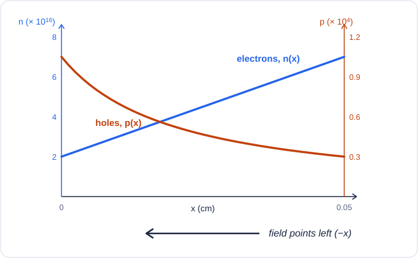
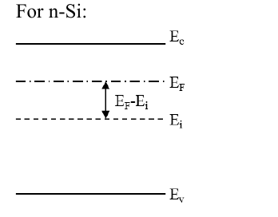
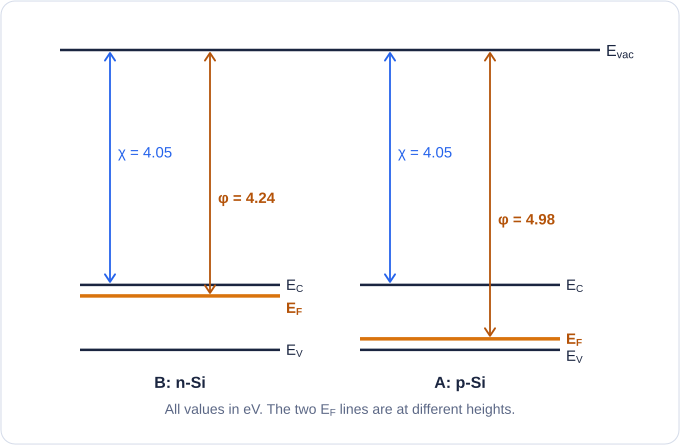

# Ch1 Wrap-up

**Covers:** Chapter 1 only (Topics 1–7, plus Ch2 Q1 from Topic 6).

Every question is a tutorial question (shown in brackets) with **new numbers** or a **new kind of diagram**: read a diagram, spot the mistakes, or work backwards.

**How to use it:**
- Do it on paper, closed book, with only the [formula sheet](../formula-sheet.md).
- The timer is 50 minutes. Ignore it if you just want to practise.
- Mark yourself with the model answers. Each one says which notes section to go back to.

**Constants (Si, 300 K):** $n_i$ = 1.45 × 10¹⁰ cm⁻³. $n_i^2$ ≈ 2.1 × 10²⁰ cm⁻⁶. kT = 0.026 eV. k = 8.62 × 10⁻⁵ eV/K. e = 1.6 × 10⁻¹⁹ C. $N_C$ = 3.2 × 10¹⁹ cm⁻³. $N_V$ = 1.8 × 10¹⁹ cm⁻³. $E_G$ = 1.12 eV. χ = 4.05 eV.

**Mobility table (from the graph, Topic 3 §4):**

| Doping (cm⁻³) | $\mu_n$ (cm²/Vs) | $\mu_p$ (cm²/Vs) |
|---|---|---|
| 10¹⁶ | 1200 | 400 |
| 10¹⁸ | 300 | 150 |

---

## Questions

### Q1. Bond model: mystery dopant (Ch1 Q1, Q2, Q3) — 8 marks

A student drew this Si lattice at 300 K. One atom is a dopant, marked **?**

a. How many outer electrons does the **?** atom have? Which group is it in? Is the Si n-type or p-type? (3)

b. A neighbouring electron jumps into the empty spot. What charge is the **?** atom left with? Can it move? (2)

c. True or false: "A hole is a place in the lattice where a Si atom is missing." (1)

d. Pure Si, no dopant. How is the lattice different at **0 K** and at **600 K**? (2)

---

### Q2. Finding n and p (Ch1 Q4, Q5) — 12 marks

a. Write charge neutrality for **n-type** Si. Cross out any term that is zero. (2)

b. Si is doped with **aluminium**, 4 × 10¹⁷ cm⁻³. Find n and p. (3)

c. Si is doped with **arsenic**, 5 × 10²¹ **m⁻³**. Find n and p. (3)

d. One region has boron at 3 × 10¹⁶ cm⁻³ **and** phosphorus at 1 × 10¹⁶ cm⁻³. Is it n-type or p-type? Find n and p. (4)

---

### Q3. Drift and resistance (Ch1 Q6, Q7) — 14 marks

a. Explain why $\mu_n$ drops from 1200 to 300 when the doping goes from 10¹⁶ to 10¹⁸ cm⁻³. (3)

b. Find the conductivity σ of each sample. Use the mobility table. (6)

| Sample | Doping |
|---|---|
| A | n-type, $N_D$ = 10¹⁸ cm⁻³ |
| B | p-type, $N_A$ = 10¹⁸ cm⁻³ |
| C | n-type, $N_D$ = 10¹⁶ cm⁻³ |

The doping in A is 100 times the doping in C. Is σ 100 times bigger? Why not?

c. Each sample is a resistor with W = 2 μm, t = 1 μm, and L = 50 μm (current flows along L). Find the resistance of each. (5)

---

### Q4. Diffusion from a graph (Ch1 Q8) — 8 marks

This is the hole concentration in a p-type layer at 300 K. $D_p$ = 12 cm²/s.

a. Find the gradient dp/dx in cm⁻⁴. Watch the units on x. (2)

b. Find the hole diffusion current density $J_p$. (3)

c. Which way do the holes flow? Which way does the current point? (1)

d. Now suppose the line was **electrons** instead, with $D_n$ = 36 cm²/s. Find $J_n$ and its direction. (2)

---

### Q5. Built-in field from uneven doping (Ch1 Q9, flipped) — 12 marks

An n-type Si layer is 0.05 cm long. This time the doping **rises** along x:

$$N(x) = 2\times10^{16} + 10^{18}\,x$$

(N in cm⁻³, x in cm.) No bias, open circuit.

a. Sketch n(x) and p(x) along the layer. Give the values at both ends. (4)

b. Derive the internal field ℰ(x). Your answer should only contain numbers and x. (6)

c. Which way does ℰ point? Find its value at x = 0. (2)

---

### Q6. Fermi–Dirac (Ch1 Q10, Q11) — 8 marks

A material has $E_F$ = 5.00 eV.

a. At what temperature is there a **5% chance** that a state at **5.20 eV** is **filled**? (5)

b. What is that chance at 300 K? (2)

c. What is the chance that a state at exactly $E_F$ is filled, at 300 K? (1)

---

### Q7. Read the diagram, work backwards (Ch1 Q12–Q16) — 14 marks

This is sample A, Si at 300 K.

a. Is sample A n-type or p-type? How can you tell from the diagram? (2)

b. Find the workfunction φ. (2)

c. Find the doping concentration. (3)

d. Find the minority carrier concentration using mass action. (2)

e. Show that $E_i$ sits just below midgap, and find its height above $E_V$. (2)

f. Find the minority carrier concentration a second way, using $n_i$ and $E_F - E_i$. Compare with part d. (3)

---

### Q8. Spot the mistakes (Ch1 Q12, Q14) — 6 marks

A student drew this for **n-type** Si.

Find the **3 mistakes**. For each one, say what the correct drawing should show. (6)

---

### Q9. Two samples, one axis (Ch2 Q1) — 8 marks

Sample B is Si doped with **arsenic**, $N_D$ = 2 × 10¹⁶ cm⁻³.

a. Find $E_C - E_F$ for sample B. (3)

b. Find the workfunction of sample B. (1)

c. Draw sample A (from Q7) and sample B on the **same** energy axis, before contact. Label $E_{vac}$, $E_C$, $E_F$, $E_V$, χ and φ for both. (3)

d. Which sample has the lower $E_F$? (1)

---

### Q10. Read the tilted bands (Ch1 Q17, Q18, reversed) — 10 marks

An n-type Si bar has a voltage across it. The contacts have no voltage drop. Its band diagram is:

a. Which end is +, and which end is −? (2)

b. Which way does the field ℰ point? (2)

c. What is the voltage across the bar? (1)

d. Find the size of ℰ in V/cm. (2)

e. Where on the diagram would you draw a **high-energy** electron, and a **high-energy** hole? (1)

f. Which way do the electrons drift? Which way do the holes drift? (2)

---

---

## Answers

Q1 answers

**a.** Count the dots around **?**: 3 bonds full, 1 bond with only 1 electron.

So **?** has **3 outer electrons**.

That is **group III**, like B or Al.

The empty spot is a hole, so the Si is **p-type**.

→ Topic 1 §6

**b.** The atom now holds an extra electron.

It becomes a **negative ion** (like B⁻).

It is locked in the lattice, so it **cannot move**. Only the hole moves.

→ Topic 2 §1

**c.** **False.**

Every Si atom is still there.

A hole is a **missing electron in a bond**. It acts like a positive carrier that moves.

→ Topic 1 §4

**d.** At 0 K: every electron is locked in a bond. No free carriers. It acts as an insulator.

At 600 K: many more bonds break. Each break gives 1 free electron + 1 hole. So many more carriers than at 300 K.

→ Topic 1 §2, §3

Q2 answers

**a.** Full version:

$$p + N_D = n + N_A$$

n-type, so $N_A$ = 0. Cross it out:

$$p + N_D = n$$

→ Topic 2 §2

**b.** Al is group III = acceptor = **p-type**.

p = $N_A$ = **4 × 10¹⁷ cm⁻³**

n = 2.1 × 10²⁰ ÷ 4 × 10¹⁷ = **525 cm⁻³**

→ Topic 2 §3, Equation 5

**c.** Convert first: 5 × 10²¹ m⁻³ ÷ 10⁶ = **5 × 10¹⁵ cm⁻³**.

As is group V = donor = **n-type**.

n = $N_D$ = **5 × 10¹⁵ cm⁻³**

p = 2.1 × 10²⁰ ÷ 5 × 10¹⁵ = **4.2 × 10⁴ cm⁻³**

→ Topic 2 §3, §6

**d.** $N_A$ = 3 × 10¹⁶ is bigger than $N_D$ = 1 × 10¹⁶. So it is **p-type**.

p ≈ $N_A - N_D$ = 3 × 10¹⁶ − 1 × 10¹⁶ = **2 × 10¹⁶ cm⁻³**

n = 2.1 × 10²⁰ ÷ 2 × 10¹⁶ = **1.05 × 10⁴ cm⁻³**

→ Topic 2 §7

Q3 answers

**a.**

$$\mu = \frac{e\,\tau}{m}$$

τ is the time between collisions.

More dopant ions = more scattering. So τ goes down, and μ goes down.

→ Topic 3 §3

**b.** Use σ ≈ e × (majority carriers) × μ.

A: σ = 1.6 × 10⁻¹⁹ × 10¹⁸ × 300 = **48 (Ω·cm)⁻¹**

B: σ = 1.6 × 10⁻¹⁹ × 10¹⁸ × 150 = **24 (Ω·cm)⁻¹**

C: σ = 1.6 × 10⁻¹⁹ × 10¹⁶ × 1200 = **1.92 (Ω·cm)⁻¹**

A ÷ C = 48 ÷ 1.92 = **25 times**, not 100.

The carriers went up 100×, but μ fell 4× (1200 → 300). So σ only rises 25×.

A beats B because electrons are more mobile than holes.

→ Topic 3 §4, Equation 8

**c.** Convert to cm: W = 2 × 10⁻⁴, t = 1 × 10⁻⁴, L = 5 × 10⁻³.

A = W × t = 2 × 10⁻⁸ cm²

$$R = \frac{L}{\sigma A} = \frac{5\times10^{-3}}{2\times10^{-8}}\times\frac{1}{\sigma} = \frac{2.5\times10^{5}}{\sigma}$$

| Sample | R |
|---|---|
| A | 2.5 × 10⁵ ÷ 48 = **5.2 × 10³ Ω** |
| B | 2.5 × 10⁵ ÷ 24 = **1.0 × 10⁴ Ω** |
| C | 2.5 × 10⁵ ÷ 1.92 = **1.3 × 10⁵ Ω** |

→ Topic 3 §6, Equation 9, §7

Q4 answers

**a.** Convert: 20 μm = 2 × 10⁻³ cm.

p falls from 5 × 10¹⁷ to 1 × 10¹⁷, a drop of 4 × 10¹⁷.

$$\frac{dp}{dx} = \frac{-4\times10^{17}}{2\times10^{-3}} = -2\times10^{20}\ \text{cm}^{-4}$$

→ Topic 4 §2

**b.**

$$J_p = -e\,D_p\,\frac{dp}{dx} = -1.6\times10^{-19}\times12\times(-2\times10^{20})$$

$J_p$ = **+384 A/cm²**

→ Topic 4 Equation 11

**c.** Holes flow downhill, from high to low: **to the right**.

Holes are +, so the current also points **right**. That's why $J_p$ is positive.

→ Topic 4 §2

**d.**

$$J_n = e\,D_n\,\frac{dn}{dx} = 1.6\times10^{-19}\times36\times(-2\times10^{20})$$

$J_n$ = **−1152 A/cm²**, so the current points **left**.

Electrons still flow right, but they are −, so the current is backwards.

→ Topic 4 Equation 11

Q5 answers

**a.** n-type, so n(x) ≈ N(x). A straight line **rising**:

n(0) = **2 × 10¹⁶**, n(0.05) = 2 × 10¹⁶ + 5 × 10¹⁶ = **7 × 10¹⁶ cm⁻³**

Holes from mass action, p = nᵢ² ÷ n. A curve **falling**:

p(0) = 2.1 × 10²⁰ ÷ 2 × 10¹⁶ = **1.05 × 10⁴**

p(0.05) = 2.1 × 10²⁰ ÷ 7 × 10¹⁶ = **3 × 10³ cm⁻³**

→ Topic 2 §3, Topic 4 §7

**b.** Open circuit, so $J_n$ = 0. Drift and diffusion cancel:

$$e\mu_n n\,\mathcal{E} + eD_n\frac{dn}{dx} = 0$$

$$\mathcal{E} = -\frac{kT}{e}\,\frac{1}{n}\,\frac{dn}{dx}$$

The slope is dn/dx = **+10¹⁸** (rising).

$$\mathcal{E}(x) = -0.026\times\frac{10^{18}}{2\times10^{16} + 10^{18}x}$$

Divide top and bottom by 10¹⁸:

$$\mathcal{E}(x) = -\frac{0.026}{0.02 + x}\ \text{V/cm}$$

→ Topic 4 §5, §7

**c.** ℰ is negative, so it points **left** (−x).

Check: doping is high on the right, so electrons diffuse **left**. The field must push them back **right**. Electrons move against ℰ, so ℰ points left. ✓

At x = 0: ℰ = −0.026 ÷ 0.02 = **−1.3 V/cm**

→ Topic 4 §7

Q6 answers

**a.** Filled chance f = 0.05. The state is 0.2 eV **above** $E_F$.

$$0.05 = \frac{1}{1 + e^{0.2/kT}}$$

$$1 + e^{0.2/kT} = 20 \quad\Rightarrow\quad e^{0.2/kT} = 19$$

0.2 ÷ kT = ln 19 = 2.944

kT = 0.2 ÷ 2.944 = 0.0679 eV

T = 0.0679 ÷ 8.62 × 10⁻⁵ ≈ **788 K**

→ Topic 5 §4, Equation 13

**b.** kT = 0.026 eV:

$$f = \frac{1}{1 + e^{0.2/0.026}} = \frac{1}{1 + e^{7.69}}$$

f ≈ **4.6 × 10⁻⁴** (0.05%). Colder means a much smaller chance.

→ Topic 5 Equation 13

**c.** **½.** f($E_F$) = ½ always, at any T and any doping.

→ Topic 5 §4

Q7 answers

**a.** $E_F$ is only 0.19 eV above $E_V$, so it sits close to $E_V$, below midgap. That means **p-type**.

→ Topic 5 §2

**b.** From $E_{vac}$ down to $E_F$:

φ = χ + $E_G$ − ($E_F - E_V$) = 4.05 + 1.12 − 0.19 = **4.98 eV**

→ Topic 6 §1, Equation 16

**c.** Majority carriers are holes:

$$p = N_V\,e^{-(E_F - E_V)/kT} = 1.8\times10^{19}\times e^{-0.19/0.026}$$

p = 1.8 × 10¹⁹ × 6.7 × 10⁻⁴ = **1.2 × 10¹⁶ cm⁻³**

So $N_A$ ≈ **1.2 × 10¹⁶ cm⁻³**.

→ Topic 5 Equation 14, Topic 6 Q16 method

**d.** Minority = electrons:

n = 2.1 × 10²⁰ ÷ 1.2 × 10¹⁶ = **1.7 × 10⁴ cm⁻³**

→ Topic 2 §3

**e.**

$$E_i = \frac{E_G}{2} + \frac{kT}{2}\ln\frac{N_V}{N_C}$$

$$E_i = 0.56 + 0.013\times\ln(0.5625) = 0.56 - 0.0075$$

$E_i$ ≈ **0.55 eV** above $E_V$. $N_V$ < $N_C$, so the log is negative, so $E_i$ is just below midgap.

→ Topic 5 §7

**f.** $E_F - E_i$ = 0.19 − 0.55 = −0.36 eV.

$$n = n_i\,e^{(E_F - E_i)/kT} = 1.45\times10^{10}\times e^{-0.36/0.026}$$

n = 1.45 × 10¹⁰ × 9.7 × 10⁻⁷ ≈ **1.4 × 10⁴ cm⁻³**

Close to part d (1.7 × 10⁴). The gap is rounding in $E_i$. Both routes are fine.

→ Topic 5 §7, Equation 15

Q8 answers

**Mistake 1:** $E_F$ is near $E_V$. For n-type it must sit **near $E_C$**, between $E_i$ and $E_C$.

**Mistake 2:** $E_i$ is near $E_C$. It should be dashed at about **midgap** (just below the middle).

**Mistake 3:** The $E_G$ arrow runs from $E_C$ to $E_F$. It must run from **$E_C$ to $E_V$**. $E_G$ is the gap between the bands, not to the Fermi level.

→ Topic 5 drawing checklist, §7

Q9 answers

**a.**

$$E_C - E_F = kT\,\ln\frac{N_C}{N_D} = 0.026\,\ln\frac{3.2\times10^{19}}{2\times10^{16}}$$

= 0.026 × ln 1600 = 0.026 × 7.38 = **0.19 eV**

→ Topic 6 §2

**b.** φ = χ + ($E_C - E_F$) = 4.05 + 0.19 = **4.24 eV**

→ Topic 6 Equation 16

**c.** One shared $E_{vac}$. Same χ on both, so both $E_C$ lines are at the same height.

Fun fact: A has $E_F$ 0.19 eV above $E_V$, B has it 0.19 eV below $E_C$. They are mirror images.

→ Topic 6 §4, drawing checklist

**d.** **Sample A** (p-type). Bigger φ means a lower $E_F$.

→ Topic 6 §4

Q10 answers

**a.** Bands are **higher at the left**.

Electrons have high energy near the − terminal.

So **left = −**, **right = +**.

→ Topic 7 §2

**b.** ℰ points **uphill for electrons**. $E_C$ rises to the left.

So ℰ points **left** (from + to −). ✓

→ Topic 7 Equation 17

**c.** The bands drop 1.2 eV. Divide by e: **V = 1.2 V**.

→ Topic 7 Equation 17

**d.**

$$\mathcal{E} = \frac{1}{e}\,\frac{dE_C}{dx} = \frac{1.2\ \text{V}}{0.4\ \text{cm}} = 3\ \text{V/cm}$$

→ Topic 7 Equation 17

**e.** High-energy electron: **higher up** in the conduction band, above $E_C$.

High-energy hole: **lower down** in the valence band, below $E_V$.

→ Topic 7 §1

**f.** Electrons roll **down** $E_C$, so they drift **right**, towards +. That's against ℰ.

Holes float **up** $E_V$, so they drift **left**, towards −. That's with ℰ.

→ Topic 7 §2, Topic 3 §5

