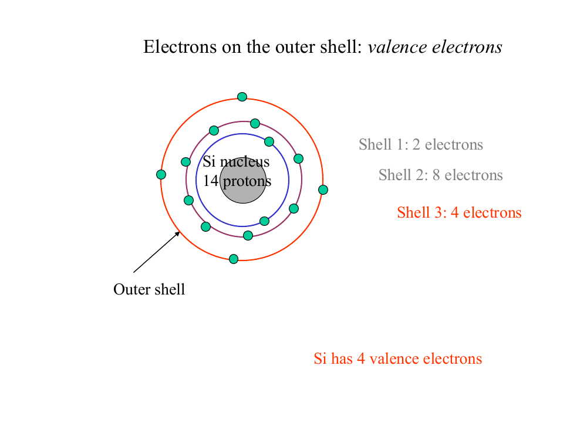
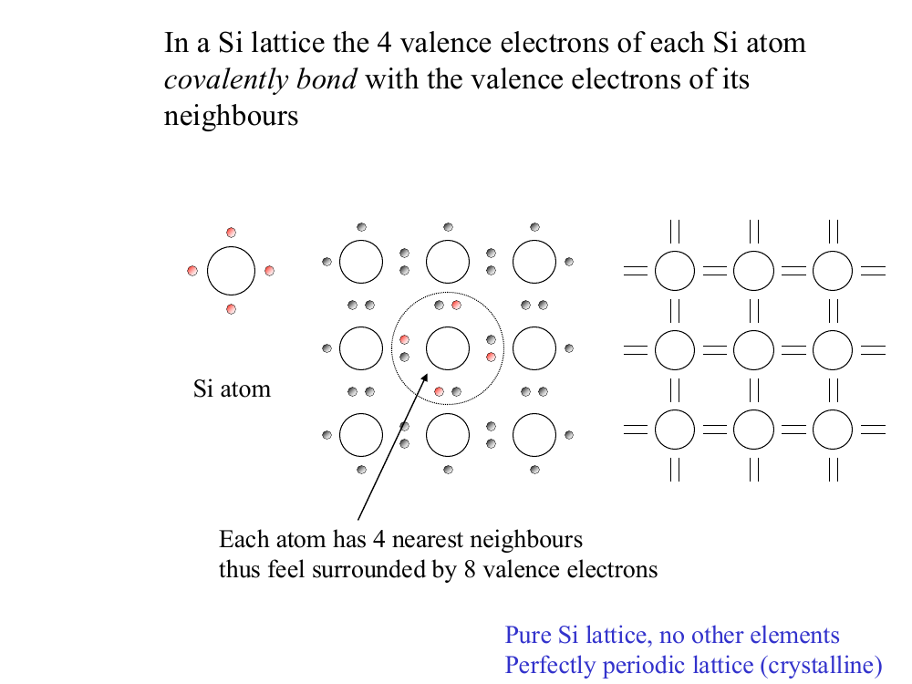
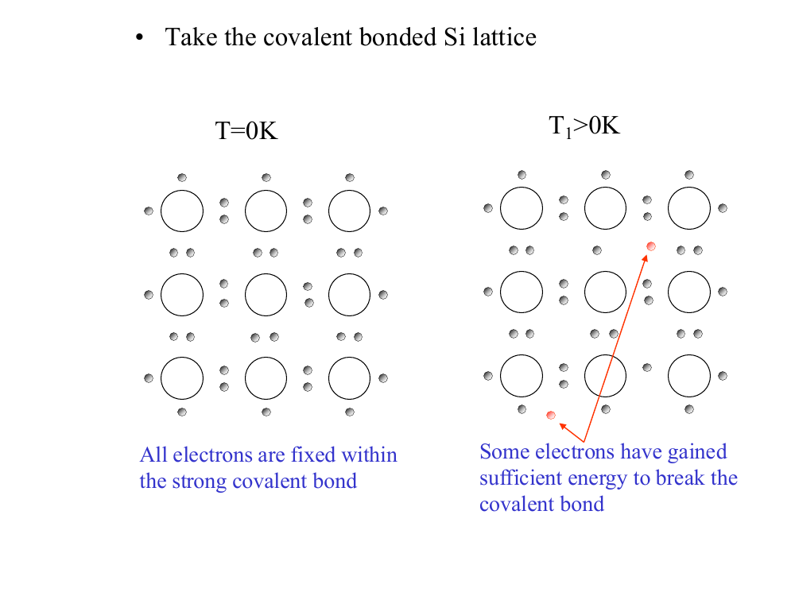
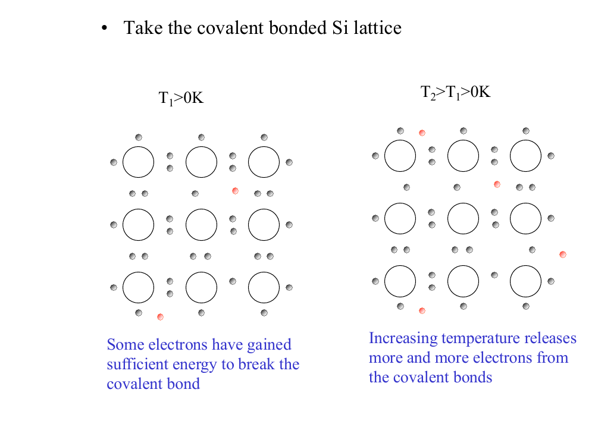
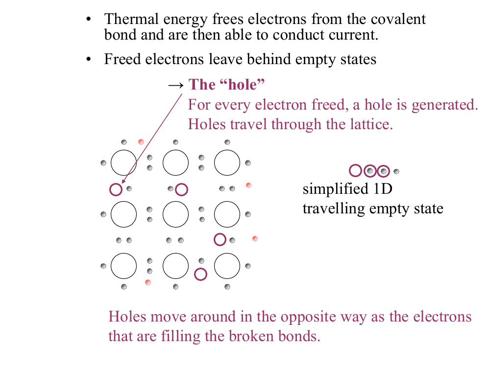
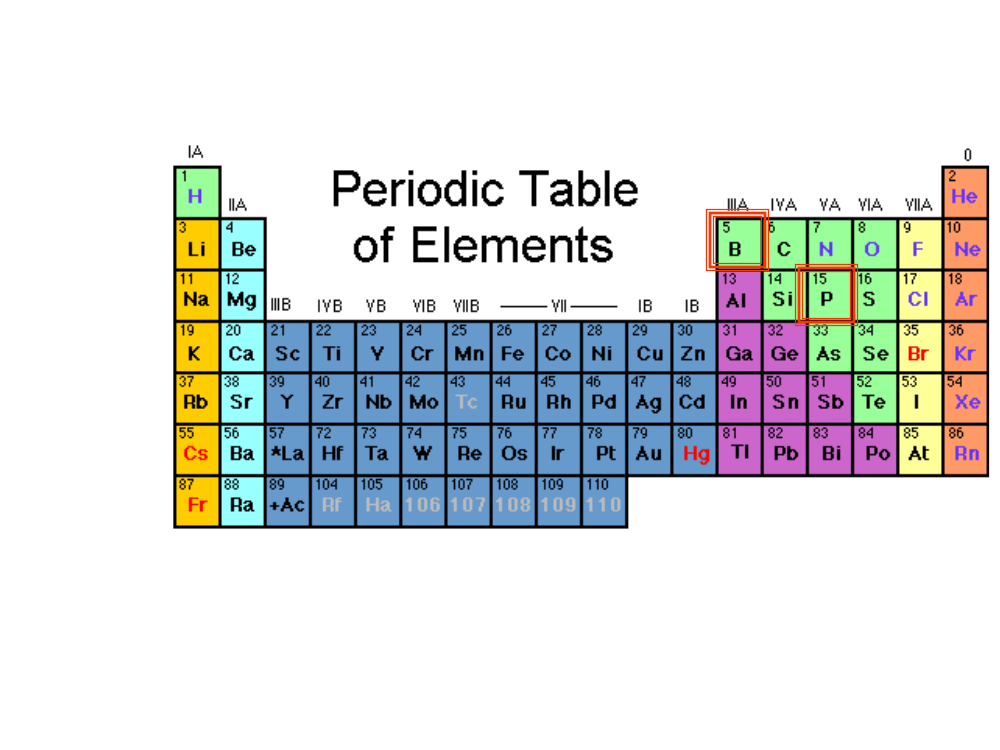
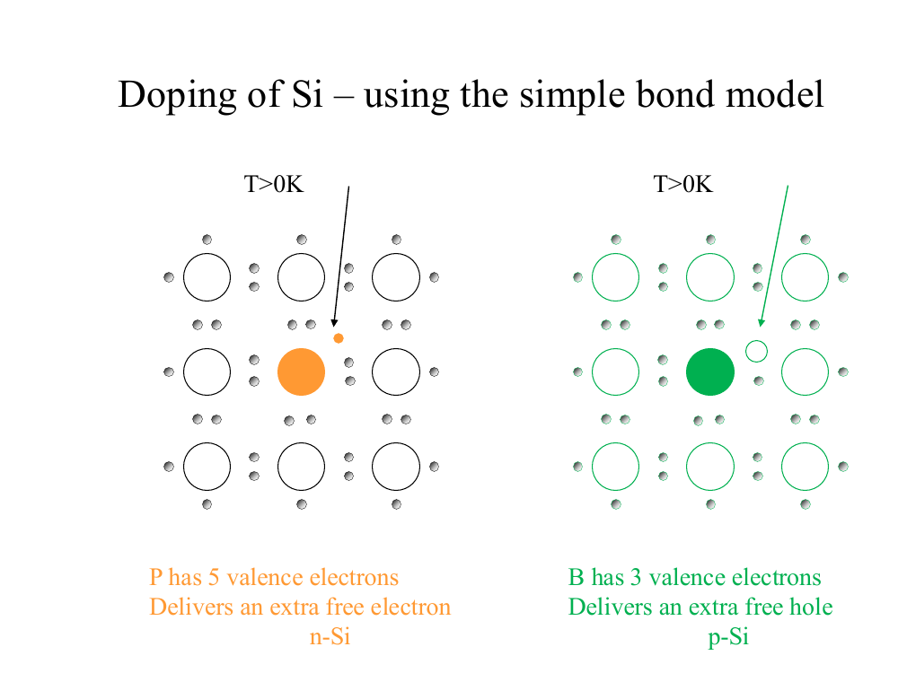

# Topic 1 — Bond model: electrons and holes

Tutorial questions: Ch1 Q1, Q2, Q3

Slides: SSD_1, pages 21 to 53

---

## The big idea

Heat breaks bonds in silicon.

Each broken bond makes **1 free electron** and **1 hole**.

Doping adds extra electrons or extra holes on purpose.

---

**How to use these notes:**
When you see 🧠, stop.
Answer it on paper first.
Then click to check.

---

## 1. Silicon has 4 outer electrons

Silicon has 14 electrons.

They sit in shells: 2, then 8, then 4.

Only the **4 outer ones** matter.

These are called **valence electrons**.

They are the ones that bond and break free.

 

**Rule:** same column in the periodic table = same number of outer electrons.

| Group | Elements | Outer electrons |
|---|---|---|
| III | B, Al | 3 |
| IV | C, Si, Ge | 4 |
| V | P, As | 5 |

 

### 🧠 Check
Germanium is in the same group as silicon.
How many outer electrons does it have?

Answer

4. Same group means the same number of outer electrons.

---

## 2. The lattice

Each Si atom sits next to **4 neighbours**.

It shares 1 electron with each neighbour.

A shared pair of electrons = **1 bond**.

So each atom feels **8 electrons** around it.

8 is a full shell, so the lattice is stable.

 

**How to sketch it:**
- Circle = Si atom
- 2 dots between two circles = 1 bond

 

### 🧠 Check
Each Si atom only owns 4 electrons.
Why does it feel 8?

Answer

It has 4 bonds.

Each bond has 2 electrons: one of its own, one from the neighbour.

4 × 2 = 8.

---

## 3. Heat breaks bonds

### 🧠 Predict first
At 0 K, how many electrons are free?
Is silicon a conductor or an insulator there?

Answer

Zero free electrons.

So it is an insulator.

 

**At 0 K:**
All bonds are whole.
No free electrons.
Silicon is an insulator.

**At 300 K (room temperature):**
A few bonds break.
Each break gives 1 free electron and 1 hole.

**Hotter = more broken bonds = more carriers.**

 

### Why silicon and metal behave opposite

Resistance depends on two things:
1. How many carriers there are
2. How easily they move

Heat does two things:

| What heat does | Silicon | Copper |
|---|---|---|
| Atoms shake more, carriers bump into them more | R goes up a little | R goes up |
| Bonds break, more carriers appear | R goes down a lot | Does not happen |
| **Result** | **R goes down** | **R goes up** |

Copper already has about 1 free electron per atom.
It has no bonds left to break.
So heat can't add carriers.

 

### 🧠 Check
You heat a silicon resistor and a copper wire.
Which way does each resistance go? Why?

Answer

Silicon: R goes down. More broken bonds, more carriers.

Copper: R goes up. Same number of carriers, but more bumping.

---

## 4. What a hole is

A hole is an **empty spot** where a bond electron is missing.

A nearby electron jumps into the empty spot.

That leaves a new empty spot behind it.

So the hole moves the **opposite way** to the electrons.

A hole acts like a **positive charge**.

 

**A hole is NOT:**
- a missing atom
- a proton

Holes only exist inside a lattice.

 

**Current direction:**
Current flows the same way holes move.
Current flows the opposite way to electrons.
Both carriers add to the current.

 

### 🧠 Check
Electrons hop to the left, one after another, to fill a hole.
Which way does the hole move?
Which way does current flow?

Answer

The hole moves right.

Current flows right.

---

## 5. Counting the carriers

**Intrinsic** means pure silicon, with no doping.

 

Three symbols to learn:

| Symbol | Means | Units |
|---|---|---|
| **n** | number of free electrons | per cm³ |
| **p** | number of holes | per cm³ |
| **nᵢ** | number of carriers in pure silicon | per cm³ |

"per cm³" is written as **cm⁻³**.

nᵢ for silicon at 300 K = **1.45 × 10¹⁰ cm⁻³**.

This number is on the [formula sheet](../formula-sheet.md). You look it up, you don't memorise it.

 

---

### 📐 Equation 1: pure silicon

$$n = p = n_i$$

**What it means:**
In pure silicon, electrons = holes.

**Why:**
Each broken bond makes one of each.

**Use it when:**
The question says "intrinsic" or "pure".

**Do NOT use it when:**
The silicon is doped.

---

### 📐 Equation 2: law of mass action ⭐ learn this

$$n \times p = n_i^2$$

**What it means:**
Electrons × holes always gives the same number.

**Why:**
Electrons and holes keep meeting and cancelling out.
Add more electrons, and more holes get cancelled.
The product stays the same.

**Use it when:**
You know one of n or p, and you need the other.

$$p = \frac{n_i^2}{n} \qquad\qquad n = \frac{n_i^2}{p}$$

**Do NOT use it when:**
A voltage or light is on the sample. That comes later, in Ch2.

**Handy number:**
nᵢ² for silicon at 300 K = (1.45 × 10¹⁰)² ≈ **2.1 × 10²⁰ cm⁻⁶**

---

 

### 🧠 Check
Pure silicon at 300 K has n = 1.45 × 10¹⁰ cm⁻³.
What is p?

Answer

It is pure, so use Equation 1.

p = n = **1.45 × 10¹⁰ cm⁻³**

 

### 🧠 Check
A silicon sample at 300 K has n = 10¹⁶ cm⁻³.
Find p.
Which equation do you use?

Tip: get nᵢ from the [formula sheet](../formula-sheet.md).

Answer

n is not equal to nᵢ, so the sample is not pure.

You know n and want p, so use Equation 2.

From the formula sheet: nᵢ = 1.45 × 10¹⁰ cm⁻³

So nᵢ² = (1.45 × 10¹⁰)² = 2.1 × 10²⁰

p = nᵢ² ÷ n

p = 2.1 × 10²⁰ ÷ 10¹⁶

p = **2.1 × 10⁴ cm⁻³**

That is very few holes.

---

## 6. Doping

Doping means swapping a few Si atoms for a different atom.

 

### 🧠 Predict first
Phosphorus has 5 outer electrons.
It replaces a Si atom.
It only needs 4 for bonds.
What happens to the 5th?

Answer

It is spare.

It breaks free and becomes a free electron.

That makes n-type silicon.

 

**How to read this diagram:**

- Big circle = atom
- Small grey dot = outer electron
- 2 grey dots between atoms = 1 bond

**Left (n-type):**
The orange atom is P.
Its 4 bonds each have 2 dots, so they're all full.
The small orange dot is P's 5th electron.
It has no bond to sit in, so it becomes a free electron.

**Right (p-type):**
The green atom is B.
Look at the bond on its right.
It has 1 grey dot and 1 small empty circle.
The empty circle is the missing electron = the hole.

**The arrows point at the extra carrier each dopant adds.**

 

**Phosphorus (P), group V:**
- Has 5 outer electrons
- 4 bond, 1 is spare
- The spare one becomes a free electron
- Makes **n-type** silicon
- P is called a **donor**
- Its amount is written **N_D**

**Boron (B), group III:**
- Has 3 outer electrons
- One bond is missing an electron
- That gap is a hole
- Makes **p-type** silicon
- B is called an **acceptor**
- Its amount is written **N_A**

 

**Memory trick:**
**P**hosphorus has **P**lenty.
**B**oron is **B**roke.

 

**The dopant atom is left as a fixed ion:**
- P becomes **P⁺**
- B becomes **B⁻**
- They can't move.
- They don't carry current.

 

### 🧠 Check
Boron's hole wanders away.
What charge is left on the boron atom?
Can it move?

Answer

B⁻. It gained an electron to finish its bond.

It can't move. It is locked in the lattice.

 

### 🧠 Check
You want n-type silicon.
You have B, Al, P and As.
Which can you use?

Answer

P and As. They are group V, with 5 outer electrons.

---

## Exam drawing checklist

1. Draw a 3 × 3 grid of circles. Label them Si.
2. Put 2 dots between each pair of neighbours.
3. **0 K:** all dots in bonds. Nothing free.
4. **300 K:** pull one dot out as a free electron. Draw an empty circle where it was. Label it h⁺.
5. **n-type:** make the centre atom P. Add 1 loose dot next to it.
6. **p-type:** make the centre atom B. Leave one bond with only 1 dot.

---

Next: [End-of-topic test](../questions/01-bond-model.md)
