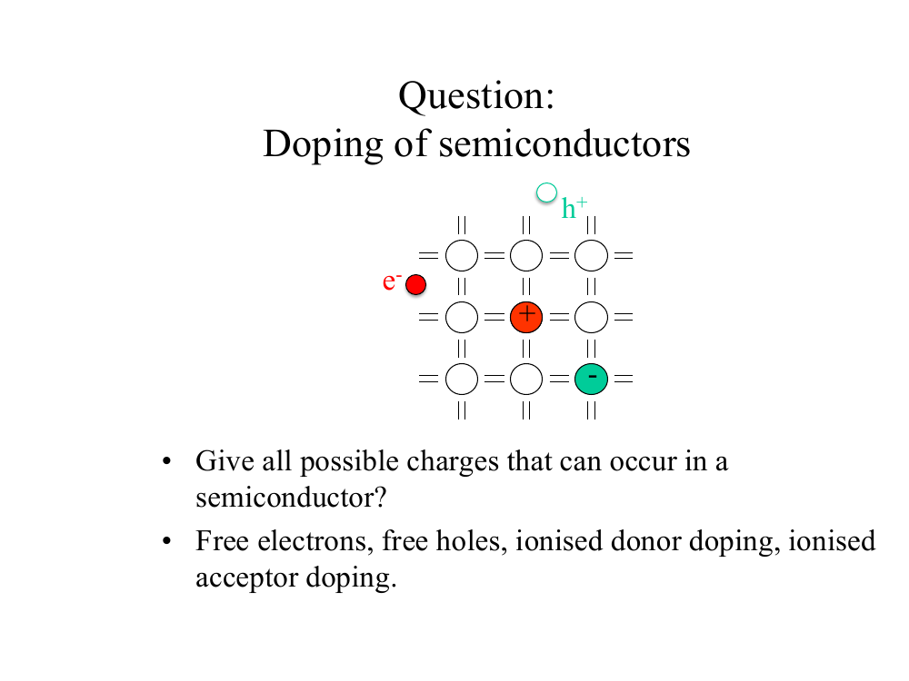
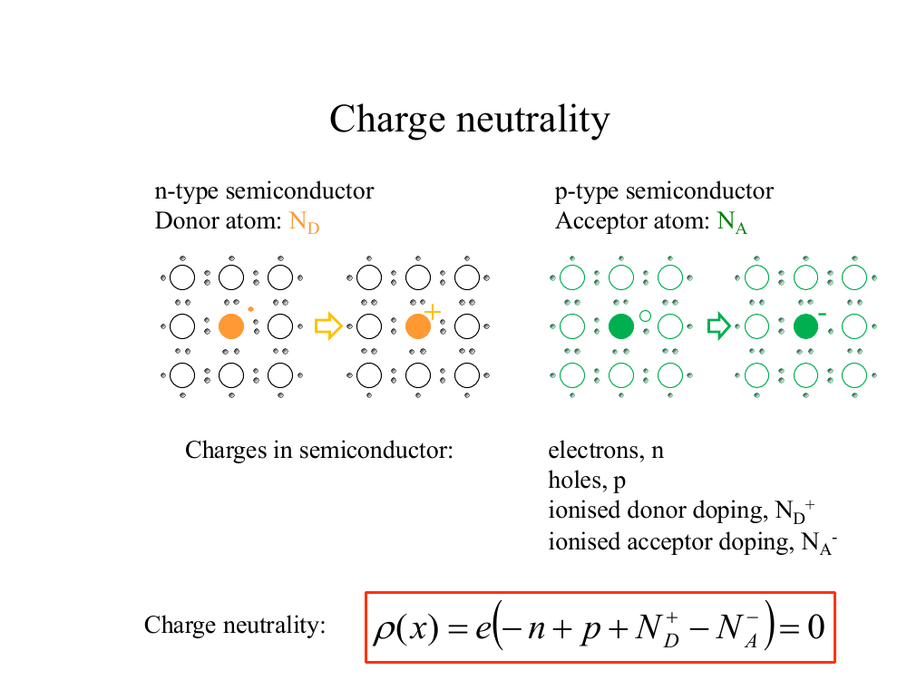
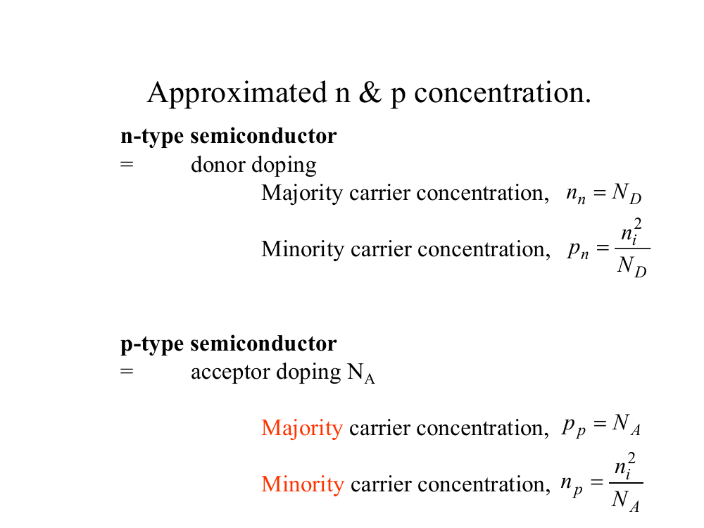
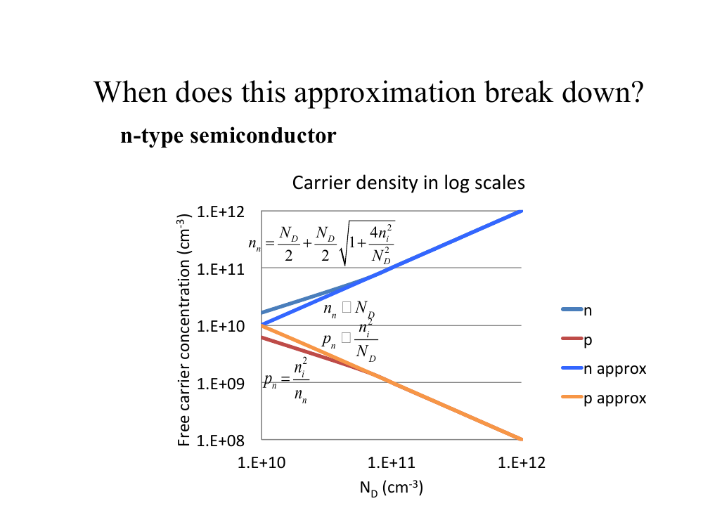
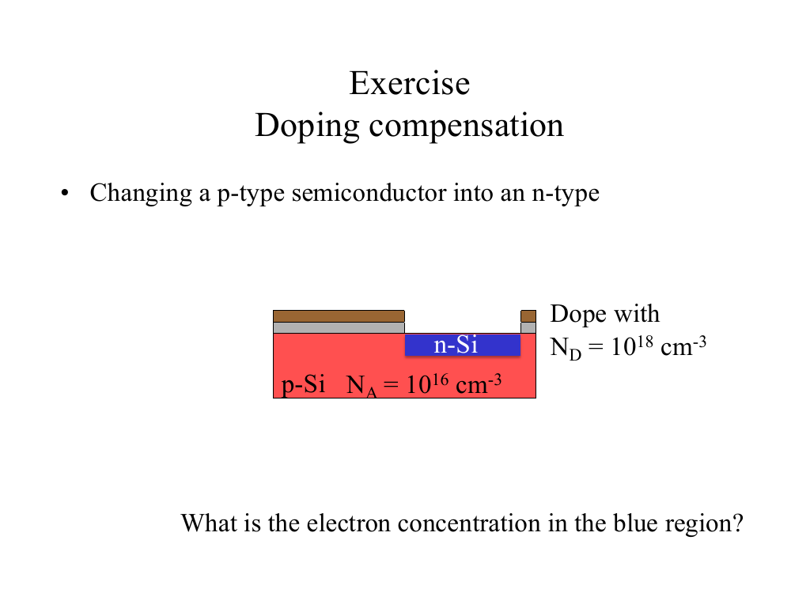

# Topic 2 — Doping: finding n and p

Tutorial questions: Ch1 Q4, Q5

Slides: SSD_1, pages 54 to 75

---

## The big idea

Doping changes how many electrons and holes there are.

Two equations let you calculate them:

1. **n × p = nᵢ²** (from Topic 1)
2. **Charge neutrality** (new)

Both are ⭐ learn by heart. They are NOT on the formula sheet.

---

**How to use these notes:**
When you see 🧠, stop.
Answer it on paper first.
Then click to check.

---

## 1. The 4 charges inside a semiconductor



**How to read this diagram:**

- Red dot with **e⁻** = free electron. It can move.
- Green circle with **h⁺** = free hole. It can move.
- Red atom with **+** = donor ion (P⁺). It is stuck.
- Green atom with **−** = acceptor ion (B⁻). It is stuck.

<br>

So there are 4 kinds of charge:

| Charge | Symbol | Sign | Can it move? |
|---|---|---|---|
| Free electrons | n | − | Yes |
| Free holes | p | + | Yes |
| Donor ions | N_D⁺ | + | No |
| Acceptor ions | N_A⁻ | − | No |

<br>

**N_D** = number of donor atoms per cm³.

**N_A** = number of acceptor atoms per cm³.

At room temperature, every dopant atom gives up its carrier.

So N_D⁺ = N_D and N_A⁻ = N_A.

<br>

### 🧠 Check
Which of the 4 charges carry current?

<details><summary>Answer</summary>

Only the free ones: electrons (n) and holes (p).

The ions are locked in the lattice.

</details>

---

## 2. Charge neutrality



**How to read this diagram:**

Left: a P atom (orange) gives away its electron. It becomes P⁺.

Right: a B atom (green) takes an electron. It becomes B⁻.

Every charge created has an equal and opposite partner.

So the whole piece of silicon stays neutral.

<br>

### Count it with real numbers

**Step 1.** Start with pure Si. No charge overall.

**Step 2.** Add 10 phosphorus atoms. Each gives away 1 electron.

```
10 P atoms  →  10 P⁺   (plus)
            →  10 e⁻   (minus)
```

10 plus, 10 minus. Balanced.

**Step 3.** Heat it. 3 bonds break. Each break gives 1 electron and 1 hole.

```
3 broken bonds  →  3 h⁺   (plus)
                →  3 e⁻   (minus)
```

**Step 4.** Count everything.

| PLUS side | MINUS side |
|---|---|
| holes: 3 | electrons: 10 + 3 = 13 |
| P⁺ ions: 10 | B⁻ ions: 0 |
| **total = 13** | **total = 13** |

The totals always match, because every charge is made together with its opposite.

**Write that table as an equation:**

```
holes + donor ions = electrons + acceptor ions
  p   +    N_D     =     n     +     N_A
```

<br>

---

### 📐 Equation 3: charge neutrality ⭐ learn this

$$p + N_D = n + N_A$$

**What it means:**
All the plus charges = all the minus charges.

Plus side: holes + donor ions.
Minus side: electrons + acceptor ions.

**Why:**
Doping adds no overall charge. Every carrier released leaves an ion of opposite sign.

**Use it when:**
You need to find n or p in doped silicon.
Always use it together with n × p = nᵢ².

**The slides write it like this.**
It is the same equation, with everything moved to one side so it equals zero:

$$-n + p + N_D^+ - N_A^- = 0$$

---

<br>

### 🧠 Check
n-type silicon has only donors, so N_A = 0.
Write charge neutrality for it.

<details><summary>Answer</summary>

Start with: p + N_D = n + N_A

No boron, so N_A = 0. Cross it out:

p + N_D = n

</details>

---

## 3. Majority and minority carriers

Two words you must know:

**Majority carrier** = the one there is lots of.

**Minority carrier** = the one there is very little of.

| Material | Majority | Minority |
|---|---|---|
| n-type | electrons | holes |
| p-type | holes | electrons |

<br>



**How to read this slide:**

The little letter at the bottom shows the material.

- n**ₙ** = electrons in n-type
- p**ₙ** = holes in n-type
- p**ₚ** = holes in p-type
- n**ₚ** = electrons in p-type

---

### 📐 Equation 4: n-type shortcut

$$n \approx N_D$$

$$p = \frac{n_i^2}{N_D}$$

**What it means:**
Electrons = number of donors.
Holes = found from mass action.

**Use it when:**
The silicon is n-type (doped with P or As).

---

### 📐 Equation 5: p-type shortcut

$$p \approx N_A$$

$$n = \frac{n_i^2}{N_A}$$

**What it means:**
Holes = number of acceptors.
Electrons = found from mass action.

**Use it when:**
The silicon is p-type (doped with B or Al).

---

**When are the shortcuts allowed?**

When the doping is much bigger than nᵢ.

Real doping is 10¹⁵ to 10²⁰ cm⁻³.
nᵢ is 10¹⁰ cm⁻³.

So in practice: **always use the shortcut**, unless the question says the doping is close to nᵢ.

<br>

### 🧠 Check
Si is doped with 10¹⁶ cm⁻³ of phosphorus.
Find n and p.

<details><summary>Answer</summary>

Phosphorus is a donor, so this is n-type. Use Equation 4.

n = N_D = **10¹⁶ cm⁻³**

p = nᵢ² ÷ N_D

p = 2.1 × 10²⁰ ÷ 10¹⁶

p = **2.1 × 10⁴ cm⁻³**

</details>

---

## 4. When the shortcut breaks



**How to read this graph:**

- Across the bottom: amount of doping, N_D.
- Up the side: number of carriers.
- Thin lines = exact answer.
- Thick lines = shortcut.

On the right, the lines sit on top of each other. The shortcut works.

On the left, where N_D is near nᵢ (10¹⁰), they split apart. The shortcut is wrong there.

<br>

You will almost never need this.
Just know: **shortcut only works when doping ≫ nᵢ.**

---

## 5. Deriving the shortcut (Tutorial Q4)

Q4 asks you to derive it, so learn these steps.

This is for **p-type**. n-type is the same with letters swapped.

<br>

**Step 1.** Write charge neutrality.

$$p + N_D = n + N_A$$

**Step 2.** p-type, so there are no donors. Set N_D = 0.

$$p = n + N_A$$

**Step 3.** Swap n using mass action: n = nᵢ² ÷ p.

$$p = \frac{n_i^2}{p} + N_A$$

**Step 4.** Multiply by p and tidy up. You get a quadratic.

$$p^2 - N_A\,p - n_i^2 = 0$$

**Step 5.** Solve with the quadratic formula. Keep the + answer, because p can't be negative.

$$p = \frac{N_A + \sqrt{N_A^2 + 4n_i^2}}{2}$$

**Step 6.** N_A is much bigger than nᵢ, so the square root ≈ N_A.

$$p \approx \frac{N_A + N_A}{2} = N_A$$

**Step 7.** Use mass action for the other carrier.

$$n = \frac{n_i^2}{N_A}$$

<br>

### 🧠 Check
In Step 6, why can we ignore the 4nᵢ² inside the square root?

<details><summary>Answer</summary>

N_A is something like 10¹⁶. nᵢ is 10¹⁰.

So N_A² = 10³² and 4nᵢ² is about 10²⁰.

10²⁰ is tiny next to 10³², so it makes no difference.

</details>

---

## 6. Units trap ⚠️

Questions sometimes give doping in **m⁻³** instead of **cm⁻³**.

nᵢ is in cm⁻³, so you must convert first.

1 m = 100 cm, so 1 m³ = 10⁶ cm³.

**To go from m⁻³ to cm⁻³: divide by 10⁶.**

<br>

### 🧠 Check
[P] = 10²⁴ m⁻³. What is that in cm⁻³?

<details><summary>Answer</summary>

10²⁴ ÷ 10⁶ = **10¹⁸ cm⁻³**

</details>

---

## 7. Both dopants at once (compensation)



**How to read this diagram:**

The red block is p-type, with N_A = 10¹⁶ cm⁻³.

The blue strip on top gets extra donors, N_D = 10¹⁸ cm⁻³.

So the blue strip has both dopants.

<br>

**Rule:** the bigger one wins, and the smaller one cancels part of it.

If N_D > N_A, it is n-type:

$$n \approx N_D - N_A$$

If N_A > N_D, it is p-type:

$$p \approx N_A - N_D$$

This comes from charge neutrality with the small carrier ignored.

<br>

### 🧠 Check
What is the electron concentration in the blue strip?

<details><summary>Answer</summary>

N_D is bigger, so it is n-type.

n ≈ N_D − N_A

n ≈ 10¹⁸ − 10¹⁶

n ≈ **9.9 × 10¹⁷ cm⁻³**

That is almost 10¹⁸, because 10¹⁶ is small next to 10¹⁸.

</details>

---

## 8. Why we dope

More doping = more carriers.

More carriers = higher conductivity = lower resistance.

That is the whole point of doping: we control how well silicon conducts, and whether it is n-type or p-type.

---

## Method: any "find n and p" question

1. **Convert units.** Is the doping in m⁻³? Divide by 10⁶.
2. **Pick the type.** Donor (P, As) = n-type. Acceptor (B, Al) = p-type. Pure = intrinsic.
3. **Majority carrier** = the doping. n = N_D, or p = N_A. If pure, n = p = nᵢ.
4. **Minority carrier** = nᵢ² ÷ majority.
5. **Sanity check:** majority should be huge, minority tiny.

---

Next: [End-of-topic test](../questions/02-doping-carrier-concentration.md)
