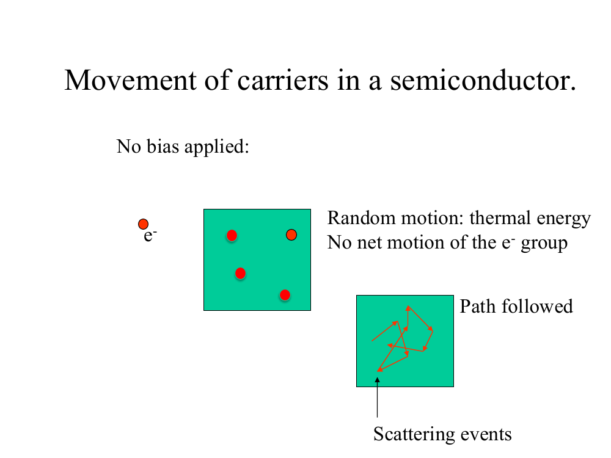
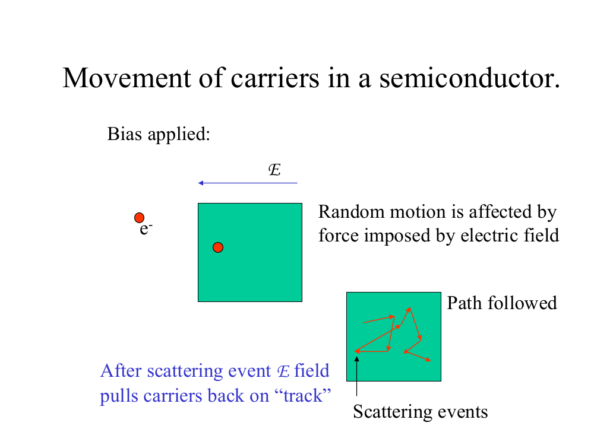
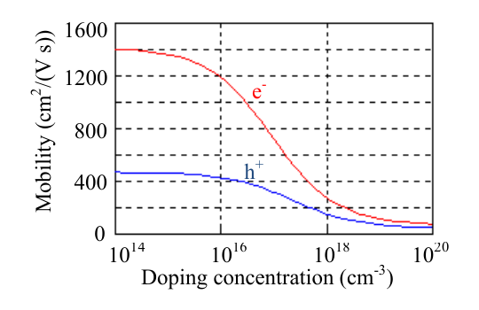
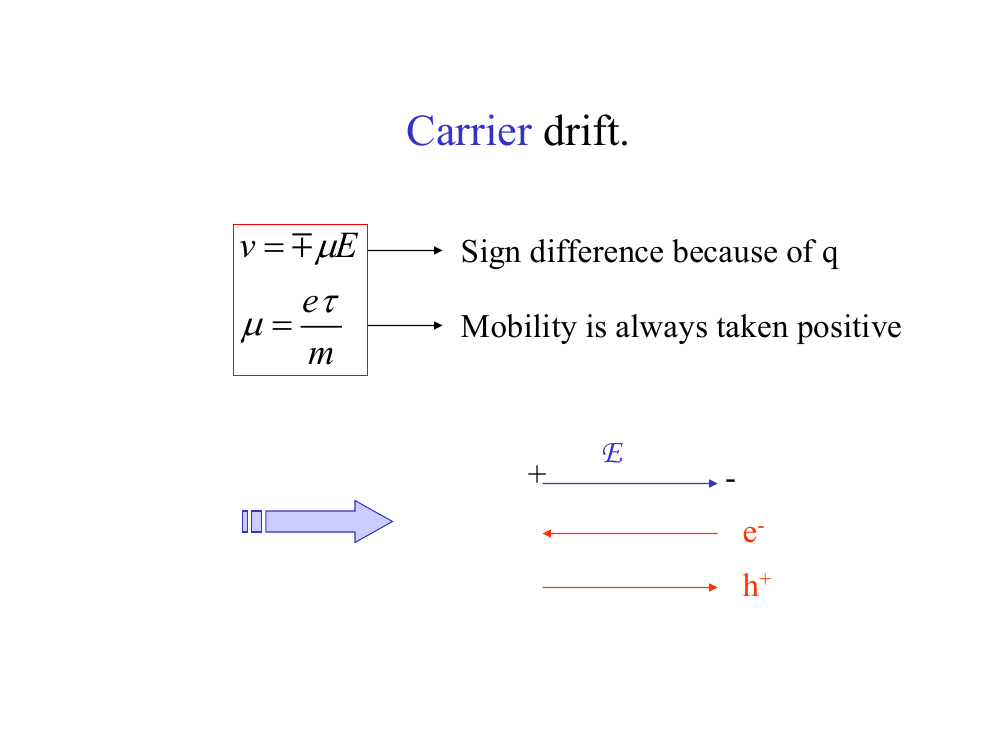
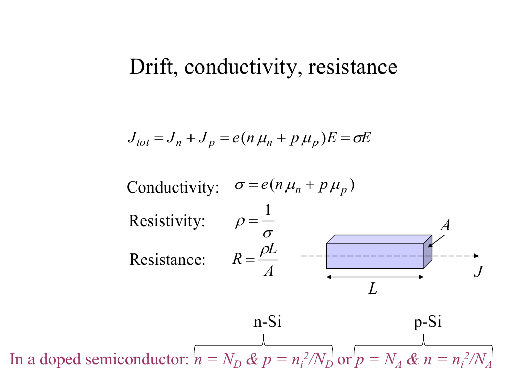
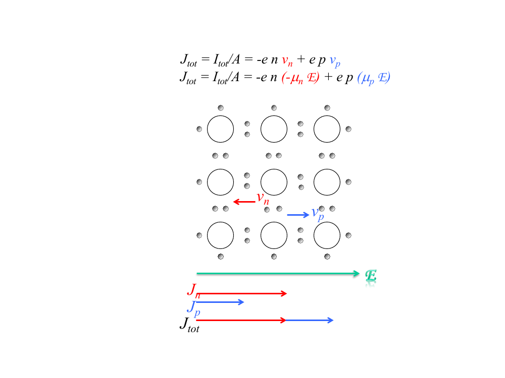

# Topic 3 — Drift: mobility, conductivity, resistance

Tutorial questions: Ch1 Q6, Q7

Slides: SSD_1, pages 76 to 95

---

## The big idea

Put a voltage across silicon.

That makes an electric field.

The field pushes the carriers along.

That flow is called **drift current**.

How much current you get depends on:
1. how many carriers there are (n and p, from Topic 2)
2. how easily they move (**mobility**, new)

---

**How to use these notes:**
When you see 🧠, stop.
Answer it on paper first.
Then click to check.

---

## ⭐ Learn by heart from this topic

Four equations:

$$v = \mu E$$

v is the drift velocity in cm/s. Electrons go against E (vₙ = −μₙE). Holes go with E (vₚ = +μₚE).

 

$$\sigma = e\,(n\,\mu_n + p\,\mu_p)$$

$$\rho = \frac{1}{\sigma}$$

$$R = \frac{L}{\sigma A}$$

ρ is resistivity, in Ω·cm. It is just the flip of conductivity.

 

And how to **derive σ**. Five lines. Cover the right-hand column and write them from memory.

| Step | Write this | Why |
|---|---|---|
| 1 | $J = e\,n\,v$ | current density = charge × how many × how fast |
| 2 | $J_n = e\,n\,\mu_n E$ | electrons: the two minus signs cancel |
| 3 | $J_p = e\,p\,\mu_p E$ | holes: charge and velocity are both positive |
| 4 | $J = J_n + J_p$ | the two currents add |
| 5 | $J = \sigma E$, so $\sigma = e\,(n\,\mu_n + p\,\mu_p)$ | match it to Ohm's law |

Full explanation: §6, "Where Equation 8 comes from".

 

**Memory hook:**
σ = charge × (how many) × (how easily they move). Do it for electrons, then for holes, then add.

---

## 1. Two kinds of current

Semiconductors have two ways to make current:

| Current | Caused by | Topic |
|---|---|---|
| **Drift** | a voltage / electric field | this one |
| **Diffusion** | more carriers in one place than another | Topic 4 |

---

## 2. Carriers bounce around

**How to read this diagram:**

The green box is a piece of silicon. The red dots are electrons.

The zig-zag line is the path of one electron.

Each sharp turn is a **scattering event**, where the electron bumps into something.

 

With no voltage, electrons zig-zag at random.

They go nowhere on average.

So there is **no current**.

 

**What do they bump into?**
- Atoms vibrating. More heat = more vibrating = more bumps.
- Dopant ions (P⁺, B⁻). More doping = more bumps.

---

**How to read this diagram:**

The blue arrow at the top is the electric field, **E**.

The electron still zig-zags.

But after every bump, the field pulls it back the same way.

So overall it **drifts** in one direction.

 

### 🧠 Check
With no voltage applied, the electrons are still moving fast.
Why is there no current?

Answer

They move in random directions.

On average they go nowhere, so there's no overall flow of charge.

---

## 3. Mobility

---

### 📐 Equation 6: drift velocity

$$v = \mu E$$

| Symbol | Means | Units |
|---|---|---|
| v | average speed the carriers drift at | cm/s |
| μ (say "mew") | **mobility**: how easily the carrier moves | cm²/(V·s) |
| E | electric field | V/cm |

**What it means:**
Stronger field = faster drift.
Higher mobility = faster drift.

**Use it when:**
You're asked for the drift velocity, or you need μ.

**Field from a voltage:** E = V ÷ L, where L is the length of the sample.

---

### 📐 Equation 7: what mobility depends on

$$\mu = \frac{e\,\tau}{m}$$

| Symbol | Means |
|---|---|
| e | charge of an electron, 1.6 × 10⁻¹⁹ C |
| τ (say "tau") | average time between bumps |
| m | effective mass of the carrier |

**What it means:**
More time between bumps (bigger τ) = higher mobility.
Heavier carrier (bigger m) = lower mobility.

**Use it when:**
You're asked to **explain** why mobility changes. You won't need to calculate with it.

---

 

**Why doping lowers mobility (Tutorial Q6):**

Dopant atoms break up the perfect pattern of the lattice.

So carriers bump into things more often.

So τ gets smaller.

So μ gets smaller.

 

**Electrons vs holes:**
Electrons have higher mobility than holes.
In Si, μₙ is about 2 to 3 times μₚ.

 

### 🧠 Check
You increase the doping in a Si sample.
What happens to τ and to μ? Why?

Answer

τ goes down, so μ goes down.

More dopant ions means more bumps, so less time between them.

---

## 4. Reading the mobility graph

You'll usually be given this graph and have to read μ off it.

**How to read this graph:**

- Across the bottom: total doping, in cm⁻³. Each grid line is ×100.
- Up the side: mobility.
- Red line = electrons (μₙ).
- Blue line = holes (μₚ).

**Steps:**
1. Find your doping on the bottom.
2. Go straight up to the right line: red for electrons, blue for holes.
3. Read across to the side.

 

**Values to use** (these are the ones the official answers use):

| Doping (cm⁻³) | μₙ (electrons) | μₚ (holes) |
|---|---|---|
| none (intrinsic) | 1400 | 500 |
| 10¹⁵ | ~1400 | 500 |
| 10¹⁶ | 1200 | 400 |
| 10¹⁸ | 300 | 150 |

Both lines drop as doping goes up, which is the "doping lowers mobility" rule.

 

### 🧠 Check
p-type Si has N_A = 10¹⁶ cm⁻³.
Which line do you read, and what is μ?

Answer

p-type, so holes are the majority carrier. Use the blue line.

μₚ ≈ **400 cm²/(V·s)**

---

## 5. Which way do they go?

**How to read this diagram:**

The blue arrow at the top is the field, E.

The red arrows underneath show the carriers:
- **e⁻ moves left**, against E, because it's negative.
- **h⁺ moves right**, with E, because it's positive.

 

But the **current from both points the same way: along E.**

An electron moving left carries current to the right.

So electron and hole currents **add up**. They don't cancel.

 

### 🧠 Check
The field points right.
Which way do electrons move?
Which way does the electron current point?

Answer

Electrons move left.

Electron current points right, along E.

---

## 6. Conductivity and resistance

---

### Where Equation 8 comes from ⭐ learn this derivation

You build σ from one idea:
**current is moving charge.**

 

**Step 1: current density from moving carriers**

Picture a flat window of area A inside the silicon.

Carriers drift through it at speed v.

In one second, every carrier within a distance v of the window gets through.

That is a volume of v × A.

So the number crossing per second is n × v × A.

Each carrier has charge e.

$$I = e\,n\,v\,A \qquad\Rightarrow\qquad J = \frac{I}{A} = e\,n\,v$$

 

**Step 2: electrons**

Electrons have charge −e.

They drift against the field: vₙ = −μₙE (Equation 6).

$$J_n = (-e)\,n\,(-\mu_n E) = e\,n\,\mu_n E$$

The two minus signs cancel. Electron current points **along E**.

 

**Step 3: holes**

Holes have charge +e.

They drift with the field: vₚ = +μₚE.

$$J_p = e\,p\,\mu_p E$$

 

**Step 4: add them**

$$J = J_n + J_p = e\,(n\,\mu_n + p\,\mu_p)\,E$$

 

**Step 5: match to Ohm's law for a material**

$$J = \sigma E$$

Compare the two lines. Whatever multiplies E is σ.

$$\boxed{\sigma = e\,(n\,\mu_n + p\,\mu_p)}$$

 

### 🧠 Check
In Step 1, what does n × v × A count?

Answer

The number of carriers that cross the window **every second**.

Multiply by the charge e on each one and you get current.

 

### 🧠 Check
Electrons are negative and move against E.
So why is Jₙ positive, along E?

Answer

Two minus signs.

Negative charge (−e) times negative velocity (−μₙE) gives a positive.

An electron moving left carries current to the right.

 

### 🧠 Check
Derive σ for **n-type** Si where holes are negligible. Write it in two lines.

Answer

$$J = J_n = e\,n\,\mu_n E \qquad\text{and}\qquad J = \sigma E$$

$$\sigma \approx e\,n\,\mu_n$$

---

### 📐 Equation 8: conductivity ⭐ the main one

$$\sigma = e\,(n\,\mu_n + p\,\mu_p)$$

| Symbol | Means | Units |
|---|---|---|
| σ (say "sigma") | conductivity: how well it conducts | 1/(Ω·cm) |
| e | 1.6 × 10⁻¹⁹ C | C |
| n, p | electrons and holes per cm³ (Topic 2) | cm⁻³ |
| μₙ, μₚ | mobilities (from the graph) | cm²/(V·s) |

**What it means:**
Conductivity = charge × (electron count × electron mobility + hole count × hole mobility).

**Shortcut:**
In doped Si, the minority carrier is tiny, so ignore it.
- n-type: σ ≈ e n μₙ
- p-type: σ ≈ e p μₚ

**Use it when:**
You're asked for conductivity, resistivity or resistance.

**Do NOT use the shortcut when:**
The silicon is intrinsic. Then n = p = nᵢ, so keep both terms.

---

### 📐 Equation 9: resistivity and resistance

$$\rho = \frac{1}{\sigma} \qquad\qquad R = \frac{\rho L}{A} = \frac{L}{\sigma A}$$

| Symbol | Means | Units |
|---|---|---|
| ρ (say "rho") | resistivity | Ω·cm |
| R | resistance | Ω |
| L | length the current flows along | cm |
| A | cross-section area the current flows through | cm² |

**Use it when:**
You're asked for the resistance of a piece of silicon.

⚠️ **Convert every length to cm first**, because σ is in 1/(Ω·cm).

 

**Where Equation 9 comes from (3 lines):**

Voltage across the sample: V = E × L

Current through it: I = J × A = σ E A

$$R = \frac{V}{I} = \frac{E\,L}{\sigma\,E\,A} = \frac{L}{\sigma A}$$

E cancels.

 

### 🧠 Check
A bar has its length L doubled and its area A halved.
What happens to R?

Answer

R = L ÷ (σA).

L ×2 doubles R. A ÷2 doubles R again.

R goes up by a factor of **4**.

---

### 📐 Equation 10: drift current density

$$J = \sigma E$$

| Symbol | Means | Units |
|---|---|---|
| J | current per unit area | A/cm² |
| E | electric field | V/cm |

**Use it when:**
You're asked for drift current. Then current I = J × A.

This is Ohm's law for a material.

---

**How to read this diagram:**

The green arrow at the bottom is the field, E.

In the lattice, vₙ (red) points left, because electrons go against E. vₚ (blue) points right.

Below that, Jₙ (red) and Jₚ (blue) **both point right**.

J_tot is the two added together.

 

### 🧠 Check
n-type Si: n = 10¹⁶ cm⁻³ and μₙ = 1200 cm²/(V·s).
Find σ.

Answer

n-type, so use the shortcut: σ ≈ e n μₙ

σ = 1.6 × 10⁻¹⁹ × 10¹⁶ × 1200

σ = **1.92 (Ω·cm)⁻¹**

 

### 🧠 Check
Why does intrinsic Si have such a tiny conductivity?

Answer

n and p are only 1.45 × 10¹⁰ cm⁻³.

Doped Si has around 10¹⁶ cm⁻³, about a million times more carriers.

---

## 7. Units trap ⚠️

σ is in **1/(Ω·cm)**, so all lengths must be in **cm**.

| Unit | To get cm |
|---|---|
| 1 m | 100 cm = 10² cm |
| 1 μm | 10⁻⁴ cm |
| 1 nm | 10⁻⁷ cm |

 

### 🧠 Check
t = 500 nm. What is that in cm?

Answer

500 × 10⁻⁷ = **5 × 10⁻⁵ cm**

---

## Method: any "find the resistance" question

1. **Find n and p** (Topic 2 method).
2. **Read μ** off the graph for the majority carrier, at that doping.
3. **Conductivity:** σ ≈ e × (majority carrier) × μ. If intrinsic, add both terms.
4. **Convert lengths to cm.**
5. **Area** A = the two sides the current does NOT flow along (for example t × W).
6. **Resistance:** R = L ÷ (σ × A).

---

Next: [End-of-topic test](../questions/03-drift.md)
