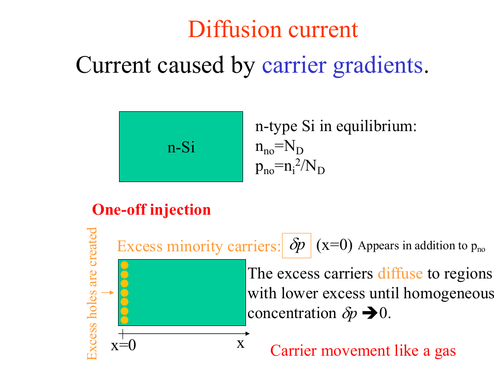
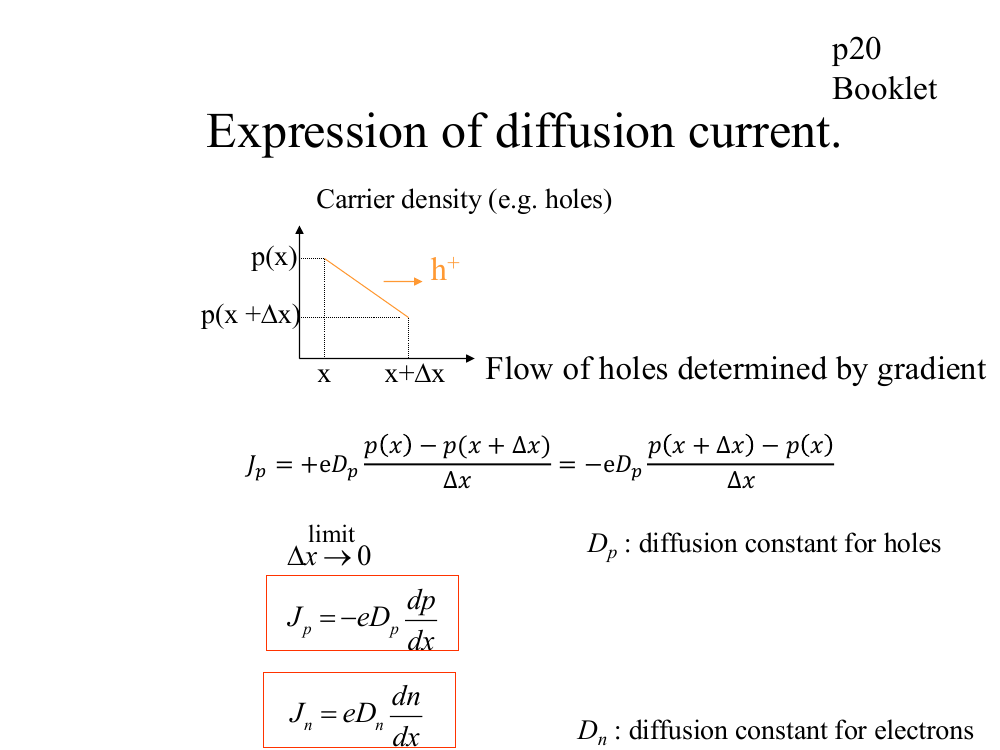
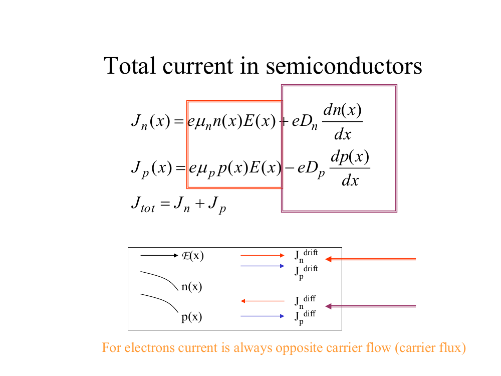
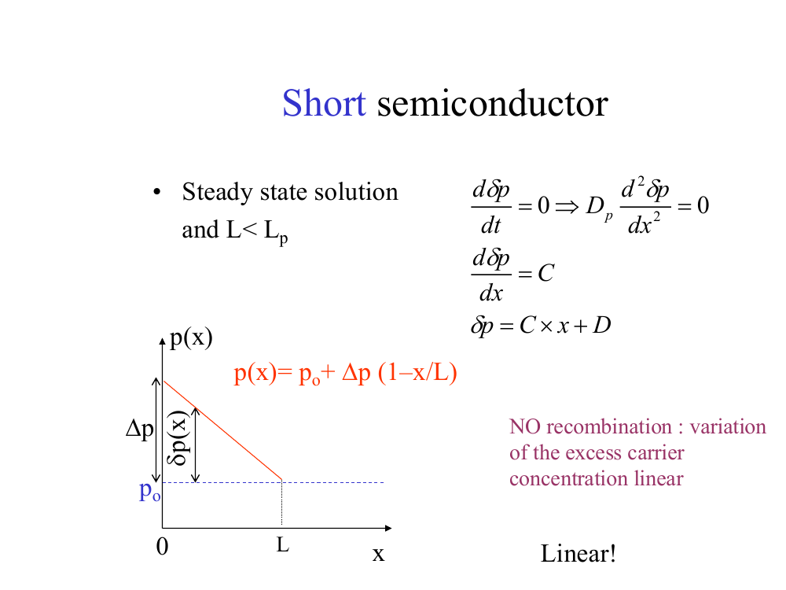

# Topic 4 — Diffusion current and the built-in field

Tutorial questions: Ch1 Q8, Q9

Slides: SSD_1, pages 96 to 122

---

## The big idea

Carriers spread out from where there are lots of them to where there are few.

Like a smell spreading across a room.

Moving charge = current. This one is called **diffusion current**.

It needs no voltage at all. It only needs a **difference in concentration**.

---

**How to use these notes:**
When you see 🧠, stop.
Answer it on paper first.
Then click to check.

---

## 1. Carriers spread out

**How to read this diagram:**

Top: a plain block of n-type Si. Carriers are spread evenly.

Bottom: extra holes (yellow dots) are pushed in at the left edge, at x = 0.

These extra holes spread out to the right, into the area with fewer holes.

They keep spreading until it's even again.

 

**Key word: gradient.**
A gradient is how fast the concentration changes as you move along.
Steep slope = big gradient = lots of diffusion.
Flat = no gradient = no diffusion.

 

### 🧠 Check
A sample has n = 10¹⁸ cm⁻³ everywhere.
Is there any diffusion current?

Answer

No.

The concentration is the same everywhere, so there's no gradient.

It doesn't matter how big n is. Only the slope matters.

---

## 2. Diffusion current equations

**How to read this diagram:**

The graph at the top shows hole density p falling as x goes right.

Holes are higher at x than at x + Δx.

So holes flow to the right, from high to low (orange arrow).

The boxed equations at the bottom are the two you need.

---

### 📐 Equation 11: diffusion current

$$J_n = e\,D_n\,\frac{dn}{dx} \qquad\qquad J_p = -\,e\,D_p\,\frac{dp}{dx}$$

| Symbol | Means | Units |
|---|---|---|
| Jₙ, Jₚ | diffusion current density for electrons, holes | A/cm² |
| e | 1.6 × 10⁻¹⁹ C | C |
| Dₙ, Dₚ | **diffusion coefficient**: how fast that carrier spreads | cm²/s |
| dn/dx, dp/dx | the gradient: change in concentration per cm | cm⁻⁴ |

**What it means:**
Current = charge × how fast they spread × how steep the slope is.

**Use it when:**
You're given a concentration that changes with x, and asked for current.

**If the change is a straight line:**

$$\frac{dn}{dx} = \frac{\text{change in } n}{\text{distance}}$$

---

**Why the minus sign for holes, but not electrons?**

Both carriers flow downhill, from high to low.

Holes are +, so current goes the same way they flow.

Electrons are −, so current goes the opposite way.

The minus sign on the hole equation sorts that out.

 

**In exams you'll often just want the size.** Work out e × D × slope and then think about the direction separately.

 

### 🧠 Check
Electrons flow from left to right by diffusion.
Which way does the electron current point?

Answer

Right to left.

Electrons are negative, so current is opposite to their flow.

---

## 3. Total current = drift + diffusion

These are on the formula sheet:

$$J_n = e\mu_n n E + eD_n\frac{dn}{dx}$$

$$J_p = e\mu_p p E - eD_p\frac{dp}{dx}$$

**How to read them:**
- First part (orange box) = **drift** (Topic 3). Needs a field E.
- Second part (purple box) = **diffusion** (this topic). Needs a gradient.

Total current = Jₙ + Jₚ.

 

**How to read the arrow box at the bottom of the slide:**

E points right. n(x) and p(x) both slope down to the right.

- Drift: Jₙ and Jₚ both point right, along E.
- Diffusion: Jₚ points right (holes flow downhill, to the right).
- Diffusion: Jₙ points **left** (electrons flow right, so their current points left).

---

## 4. Which carrier does what

| | Drift | Diffusion |
|---|---|---|
| Caused by | electric field | gradient |
| Depends on | **how many** carriers | **how steep** the slope is |
| Usually carried by | **majority** carriers | **minority** carriers |

 

**Why?**

Drift is proportional to n or p. The majority carrier has far more, so it wins.

Diffusion depends only on the slope. Minority carriers that are injected have big slopes.

 

### 🧠 Check
A voltage is applied to uniformly doped p-type Si.
Which current is biggest?

Answer

**Hole drift current.**

There's a field, so drift happens. Holes are the majority in p-type.

Uniform doping means no gradient, so no diffusion.

---

## 5. Einstein relation

### 📐 Equation 12: linking D and μ

$$D = \frac{kT}{e}\,\mu$$

| Symbol | Means | Value |
|---|---|---|
| kT/e | thermal voltage | **0.026 V** at 300 K, on the formula sheet |
| D | diffusion coefficient | cm²/s |
| μ | mobility | cm²/(V·s) |

**What it means:**
A carrier that moves easily in a field also spreads out easily.

**Use it when:**
You know μ and need D, or you know D and need μ.

**Or when you need to swap D/μ in an equation:**

$$\frac{D}{\mu} = \frac{kT}{e} = 0.026 \text{ V}$$

This is the trick that Q9 uses.

---

 

### 🧠 Check
μₙ = 1200 cm²/(V·s). Find Dₙ at 300 K.

Answer

Dₙ = 0.026 × 1200

Dₙ = **31.2 cm²/s**

---

## 6. Short samples: the straight-line rule

**How to read this diagram:**

The graph shows hole density p(x) through a short sample of length L.

At x = 0 there are extra holes: p₀ + Δp.

At x = L it's back to normal: p₀.

In between, it's a **straight line**.

 

**Rule:**
In a **short** sample (shorter than the diffusion length), the extra minority carriers fall in a **straight line**.

They don't have time to recombine.

You'll use this a lot in the diode topics (Topics 12 and 13).

 

**Notation you'll see:**
δp or Δp = the **extra** (excess) holes, on top of the normal amount.

---

## 7. Uneven doping makes a built-in field (Tutorial Q9)

What if the doping changes along the sample?

Then n changes along the sample too, so there's a gradient.

So electrons **diffuse** from high to low.

But nothing is connected, so **no current can flow overall.**

So an electric field must build up to push them back.

That field balances the diffusion exactly.

 

**Method: find the built-in field**

**Step 1.** No current, so Jₙ = 0:

$$e\mu_n n E + eD_n\frac{dn}{dx} = 0$$

**Step 2.** Rearrange for E:

$$E = -\frac{D_n}{\mu_n}\,\frac{1}{n}\,\frac{dn}{dx}$$

**Step 3.** Use the Einstein relation, D/μ = kT/e:

$$E = -\frac{kT}{e}\,\frac{1}{n}\,\frac{dn}{dx}$$

**Step 4.** In n-type Si, n = N_D(x). Put in the doping function and its slope.

 

**Direction:**

Electrons diffuse towards **low** doping.

The field must push them back towards **high** doping.

Electrons move against E, so **E points towards low doping.**

 

### 🧠 Check
In n-type Si, N_D is high on the left and low on the right.
Which way do electrons diffuse? Which way does the built-in field point?

Answer

Electrons diffuse right, towards low doping.

The field has to push them left. Electrons move against E, so E points **right**.

---

## Method: any diffusion current question

1. **Find the gradient.** Straight line: change in concentration ÷ distance. Check that both are in cm.
2. **Pick the equation.** Electrons: Jₙ = eDₙ dn/dx. Holes: Jₚ = −eDₚ dp/dx.
3. **Need D but have μ?** Use D = 0.026 × μ.
4. **Multiply** to get J in A/cm².
5. **Direction:** carriers flow high → low. Holes: current goes the same way. Electrons: current goes the opposite way.

---

Next: [End-of-topic test](../questions/04-diffusion.md)
