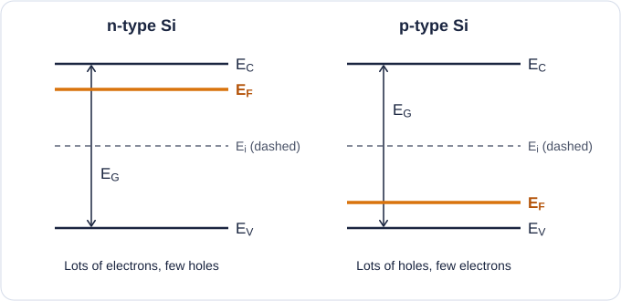
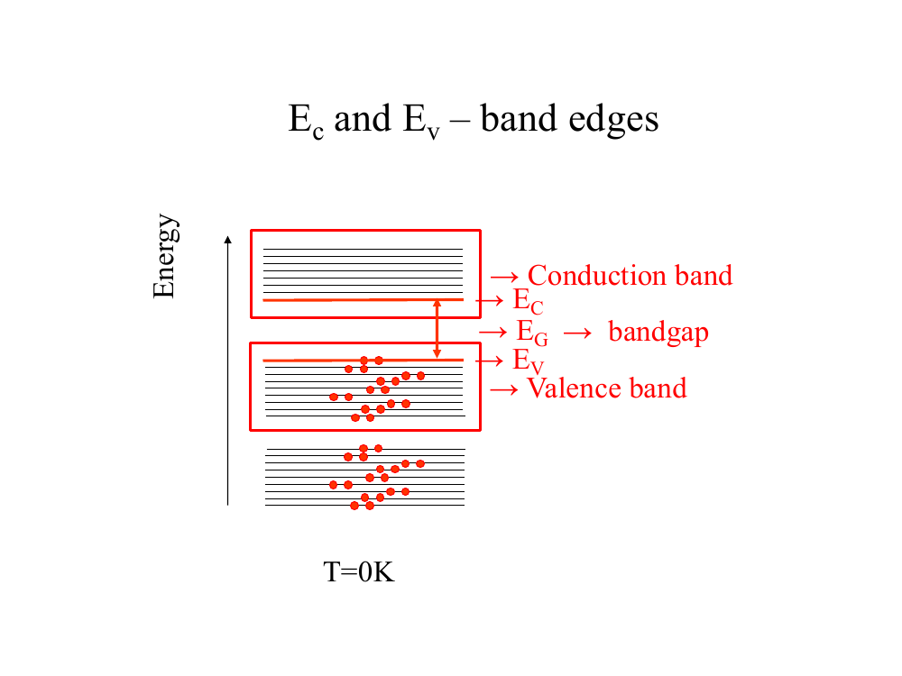
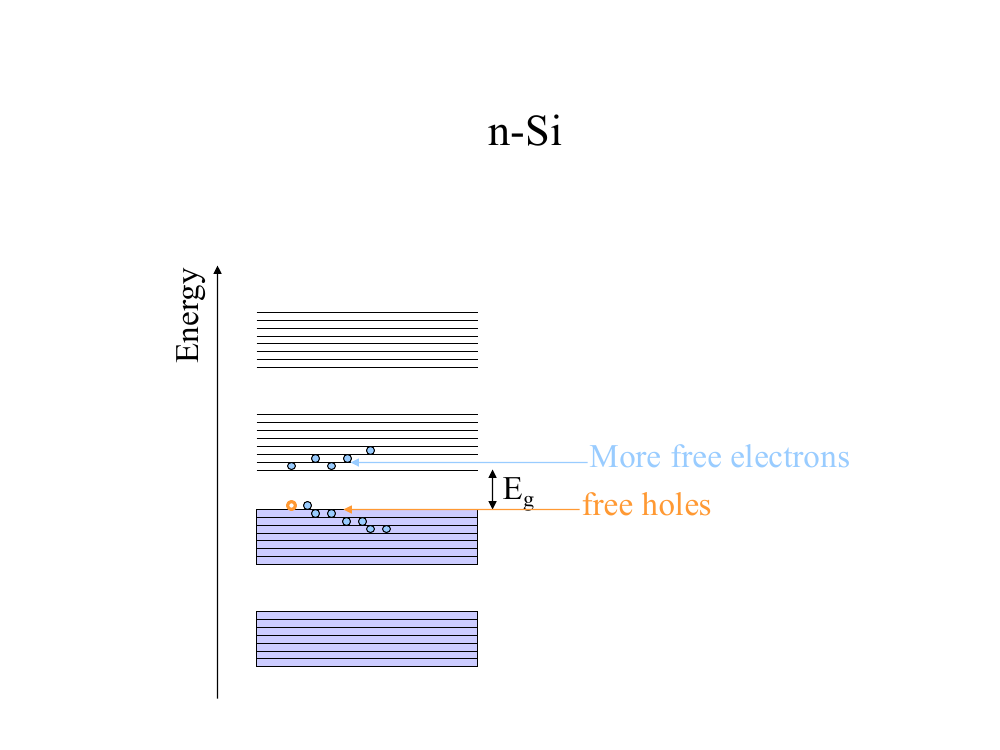
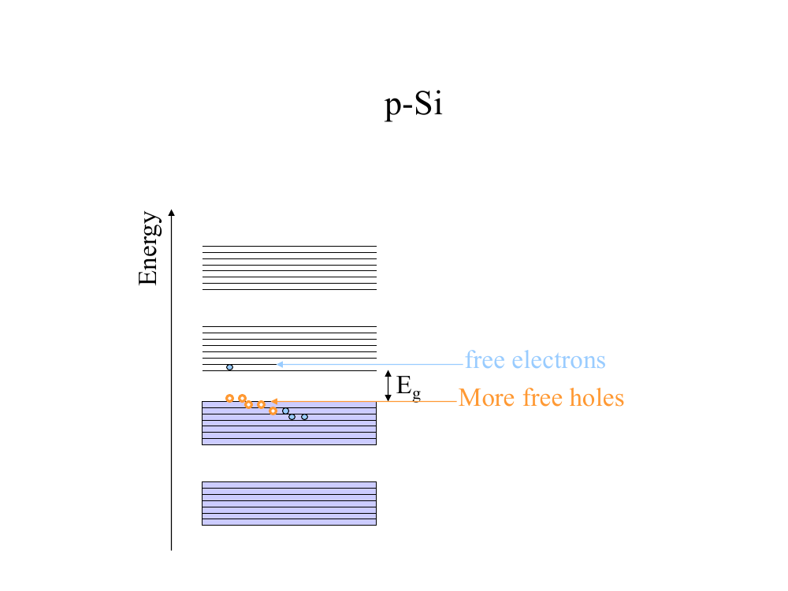
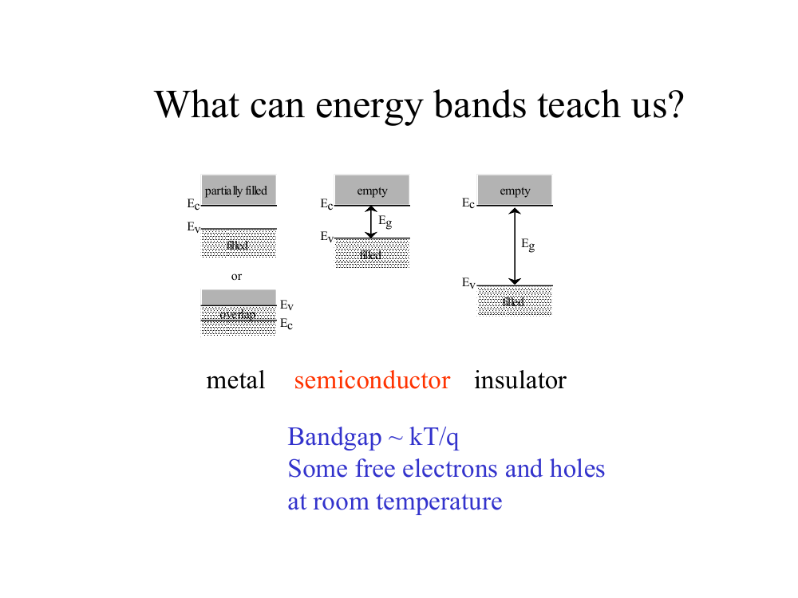
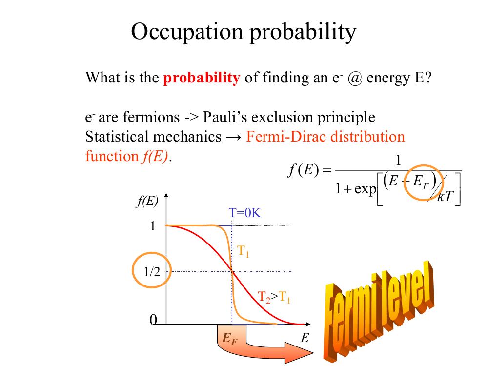
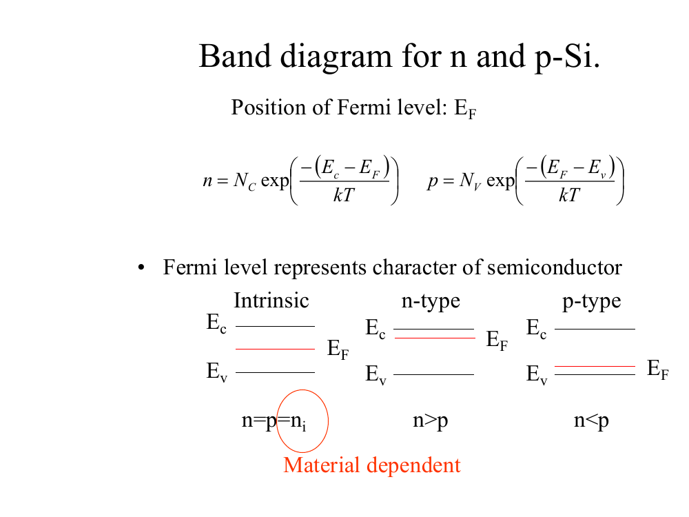
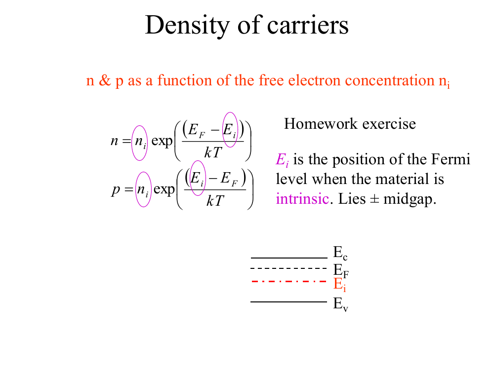

# Topic 5 — Energy bands and the Fermi level

Tutorial questions: Ch1 Q10, Q11, Q12, Q13, Q14, Q15

Slides: SSD_1, pages 136 to 169

---

## The big idea

Electrons can only have certain energies.

Those energies come in **bands**, with a **gap** in between.

The **Fermi level, E_F**, is a single line on the band diagram.

Where it sits tells you if the material is n-type, p-type or intrinsic.

From where E_F sits, you can **calculate n and p**.

---

**How to use these notes:**
When you see 🧠, stop.
Answer it on paper first.
Then click to check.

---

## ⭐ Learn by heart from this topic

**1. Derive the position of E_i (Tutorial Q15).** Cover the right-hand column and write the steps from memory.

| Step | Write this | Why |
|---|---|---|
| 1 | $n = p$, with $E_F = E_i$ | pure Si has equal electrons and holes |
| 2 | $N_C\,e^{-(E_C - E_i)/kT} = N_V\,e^{(E_V - E_i)/kT}$ | n and p from the formula sheet |
| 3 | $E_V = 0$, so $E_C = E_G$ | choose where energy starts |
| 4 | $\dfrac{N_V}{N_C} = e^{(2E_i - E_G)/kT}$ | rearrange, join the exponents |
| 5 | $\ln\!\left(\dfrac{N_V}{N_C}\right) = \dfrac{2E_i - E_G}{kT}$ | take logs |
| 6 | $E_i = \dfrac{E_G}{2} + \dfrac{kT}{2}\ln\!\left(\dfrac{N_V}{N_C}\right)$ | solve for $E_i$ |

**Numbers for Si:** $E_i = 0.56 + 0.013 \times (-0.575) \approx 0.55$ eV above $E_V$.

That is just below the middle of the gap. In sketches, draw it in the middle.

**Memory hook:**
Equal n and p, take logs, and you get half the gap plus a small nudge.

 

**2. Draw the band diagrams of n-type and p-type Si (Tutorial Q12).**

- Same bands, same $E_G$ and same dashed $E_i$ in both.
- Only $E_F$ moves: **near $E_C$ for n-type, near $E_V$ for p-type.**
- Label every line.

---

## 1. The band diagram

**How to read this diagram:**

- Up the side = energy. Higher = more energy.
- Each thin line = an energy an electron is allowed to have.
- The lines bunch into **bands**.
- Red dots = electrons.

 

You only need 3 lines:

| Line | Name | Meaning |
|---|---|---|
| **E_C** | conduction band edge | bottom of the **conduction band**. Free electrons live just above it. |
| **E_V** | valence band edge | top of the **valence band**. Bond electrons live here. Holes live just below it. |
| **E_G** | band gap | the gap between them, E_G = E_C − E_V |

 

For Si: **E_G = 1.12 eV** (on the formula sheet).

**No electron can sit inside the gap.** There are no allowed energies there.

 

**Link to Topic 1:**
Breaking a bond = an electron jumps from the valence band up to the conduction band.
It needs at least E_G of energy to do it.
It leaves a hole behind in the valence band.

 

### 🧠 Check
In n-type Si, where on the band diagram are the free electrons?
Where are the holes?

Answer

Free electrons: in the conduction band, just above E_C.

Holes: in the valence band, just below E_V.

---

## 2. n-type vs p-type on the band diagram

**How to read these diagrams:**

Purple shaded bands = full of electrons. Lines above = mostly empty.

**n-Si:** lots of electrons have moved up into the conduction band ("more free electrons").

**p-Si:** lots of empty spots in the valence band ("more free holes").

---

## 3. Metal, semiconductor, insulator

**How to read this diagram:**

| | Gap | Result |
|---|---|---|
| **Metal** | no gap, or bands overlap | always has free electrons |
| **Semiconductor** | small gap (~1 eV) | some free carriers at room temperature |
| **Insulator** | big gap | almost no free carriers |

---

## 4. The Fermi-Dirac function

---

### 📐 Equation 13: Fermi-Dirac distribution (on the formula sheet)

$$f(E) = \frac{1}{1 + e^{(E - E_F)/kT}}$$

| Symbol | Means | Value |
|---|---|---|
| f(E) | **probability** that a state at energy E has an electron in it | 0 to 1 |
| E | the energy you're asking about | eV |
| E_F | the **Fermi level** | eV |
| kT | thermal energy | **0.026 eV** at 300 K |
| k | Boltzmann constant | 8.62 × 10⁻⁵ eV/K |
| T | temperature | K |

**What it means:**
Below E_F: states are probably full.
Above E_F: states are probably empty.

**Use it when:**
You're asked for the probability a state is full or empty, or for the temperature.

**Probability a state is EMPTY:**

$$1 - f(E)$$

---

**How to read the graph:**

Across = energy. Up = probability of being full.

At **T = 0 K** (orange): a sharp step. Everything below E_F is full, everything above is empty.

At higher T (red): the step gets smoothed out.

**At E = E_F, f is always exactly ½**, at any temperature.

That's the definition of the Fermi level.

 

### 🧠 Check
Put E = E_F into the equation. What do you get?

Answer

The power becomes 0, and e⁰ = 1.

f = 1 ÷ (1 + 1) = **½**

 

### 🧠 Check
A state is 0.1 eV above E_F at 300 K.
What's the chance it has an electron?

Answer

(E − E_F) ÷ kT = 0.1 ÷ 0.026 = 3.85

e³·⁸⁵ ≈ 47

f = 1 ÷ (1 + 47) ≈ **0.02**, so about 2%

---

## 5. Where the Fermi level sits

**How to read this diagram:**

Three band diagrams. Each one has E_C (top), E_V (bottom) and E_F (red).

| Material | Where E_F sits | Carriers |
|---|---|---|
| **Intrinsic** | middle of the gap | n = p = nᵢ |
| **n-type** | **near E_C** (top) | n > p |
| **p-type** | **near E_V** (bottom) | n < p |

 

**Memory trick:**
E_F moves **towards** the carrier there's more of.
More electrons, so E_F moves up towards the conduction band.
More holes, so E_F moves down towards the valence band.

 

### 🧠 Check
E_F is just below E_C. What type is the silicon?

Answer

**n-type.** E_F sits near the band with lots of electrons.

---

## 6. Calculating n and p from E_F

---

### 📐 Equation 14: carriers from the band diagram (on the formula sheet)

$$n = N_C\, e^{-(E_C - E_F)/kT}$$

$$p = N_V\, e^{(E_V - E_F)/kT}$$

| Symbol | Means | Value for Si |
|---|---|---|
| N_C | effective density of states, conduction band | 3.2 × 10¹⁹ cm⁻³ |
| N_V | effective density of states, valence band | 1.8 × 10¹⁹ cm⁻³ |
| E_C − E_F | gap from E_F **up** to E_C | eV |
| E_F − E_V | gap from E_V **up** to E_F | eV |
| kT | | 0.026 eV |

**What it means:**
The closer E_F is to E_C, the more electrons.
The closer E_F is to E_V, the more holes.

**Use it when:**
You know where E_F is and need n or p.

---

**Flipped round: find where E_F is**

Take the log of both sides:

$$E_C - E_F = kT\,\ln\!\left(\frac{N_C}{n}\right) \qquad\qquad E_F - E_V = kT\,\ln\!\left(\frac{N_V}{p}\right)$$

**Use it when:**
You know the doping (so you know n or p) and need to place E_F on the diagram.

 

### 🧠 Check
p-type Si, N_A = 10¹⁶ cm⁻³. How far is E_F above E_V?

Answer

p = N_A = 10¹⁶

E_F − E_V = kT ln(N_V ÷ p)

E_F − E_V = 0.026 × ln(1.8 × 10¹⁹ ÷ 10¹⁶)

E_F − E_V = 0.026 × ln(1800)

E_F − E_V = 0.026 × 7.50 = **0.195 eV**

---

## 7. The intrinsic level, E_i

**E_i** = where E_F would be **if the silicon were pure**.

It sits very close to the **middle of the gap**.

It's drawn as a dashed line (red, dash-dot on the slide).

---

### 📐 Equation 15: carriers from E_F and E_i

$$n = n_i\, e^{(E_F - E_i)/kT}$$

$$p = n_i\, e^{(E_i - E_F)/kT}$$

**What it means:**
E_F above E_i → more electrons than nᵢ → n-type.
E_F below E_i → more holes than nᵢ → p-type.
E_F = E_i → n = p = nᵢ → intrinsic.

**Use it when:**
The question talks about E_i, or gives you E_F − E_i.

**Flipped round:**

$$E_F - E_i = kT\,\ln\!\left(\frac{n}{n_i}\right)$$

---

**How Equation 15 comes from Equation 14 (Tutorial Q13):**

**Step 1.** Equation 14 for any material:

$$n = N_C\, e^{-(E_C - E_F)/kT}$$

**Step 2.** Same equation for pure Si, where E_F = E_i and n = nᵢ:

$$n_i = N_C\, e^{-(E_C - E_i)/kT}$$

**Step 3.** Divide Step 1 by Step 2. N_C cancels:

$$\frac{n}{n_i} = e^{(E_F - E_i)/kT}$$

**Step 4.** Multiply by nᵢ. Done. Holes work the same way.

---

**Where exactly is E_i? (Tutorial Q15)**

**Step 1.** Pure Si, so n = p. Use Equation 14 with E_F = E_i:

$$N_C\, e^{-(E_C - E_i)/kT} = N_V\, e^{(E_V - E_i)/kT}$$

**Step 2.** Set E_V = 0, so E_C = E_G.

**Step 3.** Take logs and solve for E_i:

$$E_i = \frac{E_G}{2} + \frac{kT}{2}\ln\!\left(\frac{N_V}{N_C}\right)$$

**Step 4.** Put in numbers for Si:

E_i = 1.12 ÷ 2 + 0.013 × ln(1.8 ÷ 3.2)

E_i = 0.56 + 0.013 × (−0.575)

E_i ≈ **0.55 eV above E_V**

So E_i sits **just below the middle** of the gap. For sketches, put it at the middle.

 

### 🧠 Check
n-type Si has n = 10¹⁶ cm⁻³. How far is E_F above E_i?

Answer

E_F − E_i = kT ln(n ÷ nᵢ)

E_F − E_i = 0.026 × ln(10¹⁶ ÷ 1.45 × 10¹⁰)

E_F − E_i = 0.026 × ln(6.9 × 10⁵)

E_F − E_i = 0.026 × 13.4 = **0.35 eV**

---

## Drawing checklist: band diagram

1. Draw two horizontal lines. Top = **E_C**, bottom = **E_V**.
2. Mark the gap between them as **E_G**, with a double arrow.
3. Draw **E_i** as a dashed line in the middle.
4. Draw **E_F**:
   - n-type: between E_i and E_C, close to E_C
   - p-type: between E_V and E_i, close to E_V
   - intrinsic: on top of E_i
5. Label every line.

---

## Method: Fermi level questions

| You're asked for | Use |
|---|---|
| probability a state is full | f(E), Equation 13 |
| probability a state is empty | 1 − f(E) |
| n or p from E_F | Equation 14 (from E_C, E_V) or Equation 15 (from E_i) |
| where E_F is, from doping | flipped Equation 14 or 15 |
| what type the material is | where E_F sits (§5) |

---

Next: [End-of-topic test](../questions/05-fermi-level.md)
