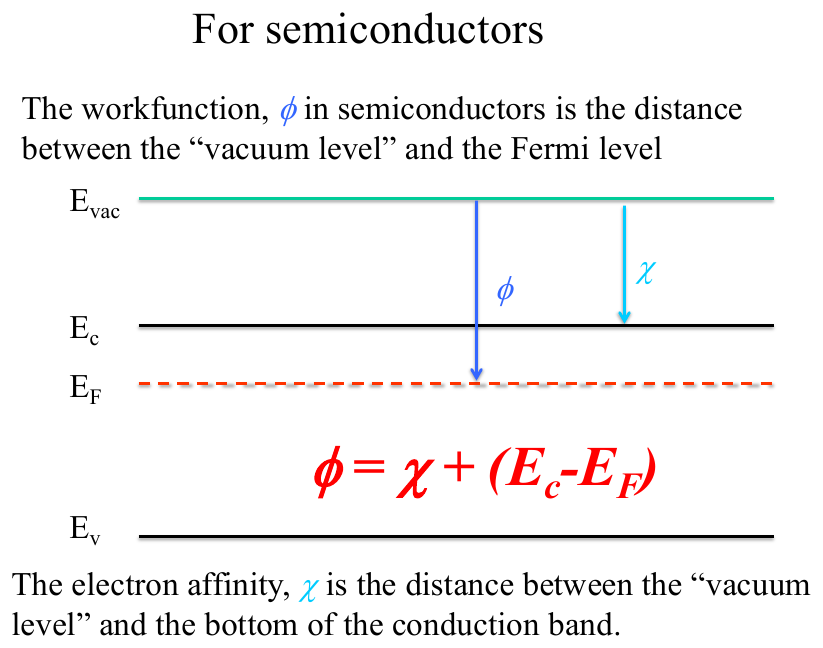
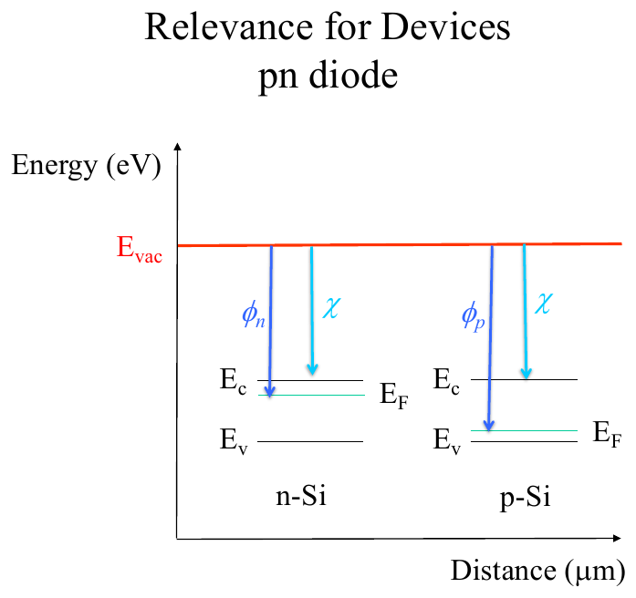

# Topic 6 — Vacuum level, electron affinity χ, workfunction φ

Tutorial questions: Ch1 Q16, Ch2 Q1

Slides: SSD_1, pages 170 to 176. Booklet §3.1 (page 37).

---

## The big idea

To draw two materials on **one** band diagram, you need a **common reference line**.

That line is the **vacuum level, E_vac**.

E_vac = the energy of an electron that has been pulled right out of the material.

Two distances from E_vac matter:

- **χ** (chi), the electron affinity: from E_vac **down to E_C**
- **φ** (phi), the workfunction: from E_vac **down to E_F**

---

**How to use these notes:**
When you see 🧠, stop.
Answer it on paper first.
Then click to check.

---

## 1. The two distances

**How to read this diagram:**

- Top line = **E_vac**. The reference.
- Blue arrow **φ** goes from E_vac down to **E_F** (the dashed red line).
- Blue arrow **χ** goes from E_vac down to **E_C**.
- E_V is at the bottom. E_G sits between E_C and E_V as usual.

 

| Symbol | Name | Measured from E_vac down to | Depends on doping? |
|---|---|---|---|
| **χ** | electron affinity | **E_C** | **No**. Fixed for Si: **4.05 eV** |
| **φ** | workfunction | **E_F** | **Yes**. E_F moves with doping, so φ moves |

 

**Why χ is fixed:** E_C is a property of the crystal. Doping doesn't move it.

**Why φ changes:** doping moves E_F (Topic 5 §5). n-type pushes E_F up, so φ gets **smaller**. p-type pushes E_F down, so φ gets **bigger**.

---

### 📐 Equation 16: workfunction (NOT on the formula sheet, but it's just reading the diagram)

$$\phi = \chi + (E_C - E_F)$$

| Symbol | Means | Value |
|---|---|---|
| φ | workfunction, E_vac to E_F | eV |
| χ | electron affinity, E_vac to E_C | **4.05 eV** for Si (given in the question) |
| E_C − E_F | gap from E_F up to E_C | eV, from doping (Topic 5 §6) |

**What it means:**
Going from E_vac down to E_F = going down to E_C, then a bit further down to E_F.

**Use it when:**
You're given χ and the doping, and asked for φ or to draw the diagram with E_vac.

**For a metal:** there's no gap, so E_F sits in a band. **φ = χ** for a metal.

---

### 🧠 Check
n-type Si has E_F 0.2 eV below E_C. χ = 4.05 eV. What's φ?

Answer

φ = 4.05 + 0.2 = **4.25 eV**

---

## 2. The method: find E_C − E_F from the doping

This is Topic 5 §6, flipped round.

**n-type:**

$$E_C - E_F = kT\,\ln\!\left(\frac{N_C}{N_D}\right)$$

**p-type** (first find n = nᵢ² ÷ N_A, then use it):

$$E_C - E_F = kT\,\ln\!\left(\frac{N_C}{n}\right) = kT\,\ln\!\left(\frac{N_C \, N_A}{n_i^2}\right)$$

Or go the other way on p-type, from E_V:

$$E_F - E_V = kT\,\ln\!\left(\frac{N_V}{N_A}\right)$$

Then E_C − E_F = E_G − (E_F − E_V).

---

## 3. Worked example: Tutorial Ch2 Q1

Si, χ = 4.05 eV, doped with P at N_D = 3 × 10¹⁷ cm⁻³. Draw E_C, E_V, E_F, χ, φ with respect to E_vac.

**Step 1.** P is a donor, so n-type. n = N_D = 3 × 10¹⁷ (Topic 2).

**Step 2.** Place E_F:

E_C − E_F = 0.026 × ln(3.2 × 10¹⁹ ÷ 3 × 10¹⁷)

E_C − E_F = 0.026 × ln(107) = 0.026 × 4.67 = **0.12 eV**

**Step 3.** Workfunction:

φ = χ + (E_C − E_F) = 4.05 + 0.12 = **4.17 eV**

**Step 4.** Draw it.

**Official answer:**

**How to read this diagram:**
- E_vac at the top.
- φ = 4.17 eV arrow goes all the way down to E_F (red).
- χ = 4.05 eV arrow stops at E_C.
- E_F is only 0.12 eV below E_C, so it's drawn very close to E_C. That's n-type.
- IE = 5.17 eV is χ + E_G = 4.05 + 1.12. The "ionisation energy" from E_V to E_vac. Not asked for, just extra.

---

### 🧠 Check
Same Si, but doped p-type with N_A = 5 × 10¹⁶ cm⁻³. Find φ. (This is Tutorial Ch2 Q2, the p-side.)

Answer

p-type. Electrons are the minority: n = nᵢ² ÷ N_A.

E_C − E_F = kT ln(N_C × N_A ÷ nᵢ²)

= 0.026 × ln(3.2 × 10¹⁹ × 5 × 10¹⁶ ÷ 2.1 × 10²⁰)

= 0.026 × ln(7.6 × 10¹⁵)

= 0.026 × 36.6 = **0.95 eV**

φ = 4.05 + 0.95 = **5.0 eV**

Check it makes sense: p-type, so E_F is near E_V, so φ is big. ✓

---

## 4. Two materials on one diagram

**How to read this diagram:**

- One E_vac line across the top. That's the shared reference.
- n-Si on the left: small φₙ, E_F near E_C.
- p-Si on the right: big φₚ, E_F near E_V.
- χ is the **same** on both sides. Same material, Si.
- The two E_F lines are at **different heights**. That's the whole point. Next topic (8) is what happens when you join them.

---

## Drawing checklist: band diagram with E_vac

1. Draw **E_vac** as a flat line across the top.
2. Drop down **χ = 4.05 eV** and draw **E_C**.
3. Drop down **E_G = 1.12 eV** from E_C and draw **E_V**.
4. Work out E_C − E_F from the doping (§2).
5. Draw **E_F** that far below E_C. Dashed line.
6. Draw the **φ** arrow from E_vac to E_F and label it with the number.
7. Draw the **χ** arrow from E_vac to E_C and label it 4.05 eV.

---

## Method: workfunction questions

| You're asked for | Do |
|---|---|
| φ from doping | find E_C − E_F (§2), then Equation 16 |
| the diagram | checklist above |
| which side has the bigger φ | the one with E_F lower down, so p-type |
| χ | it's 4.05 eV for Si, always |

---

Next: [End-of-topic test](../questions/06-workfunction.md)
