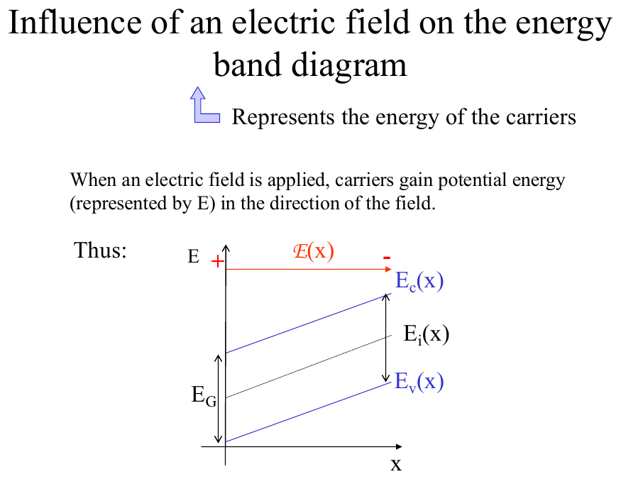
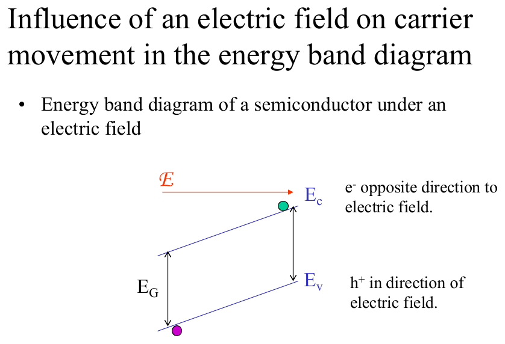
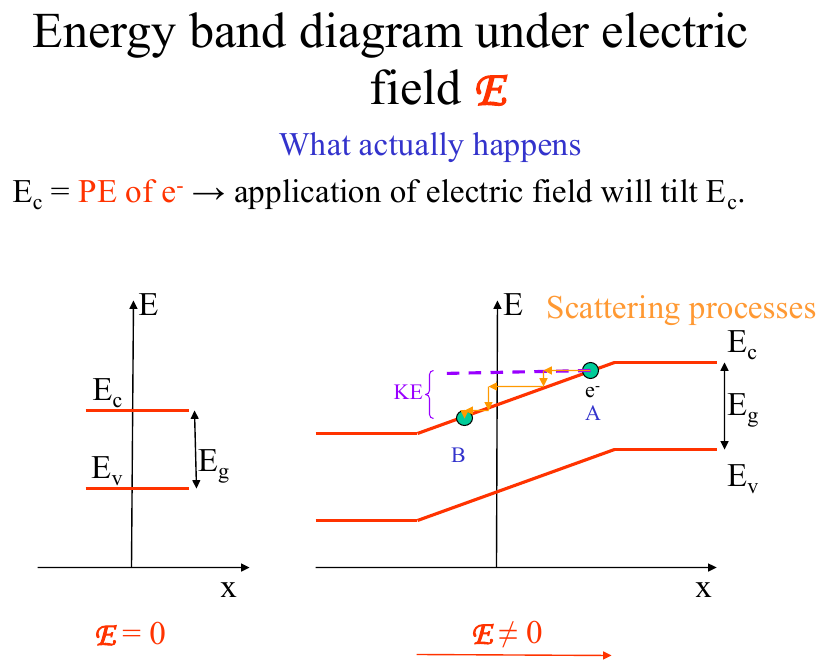
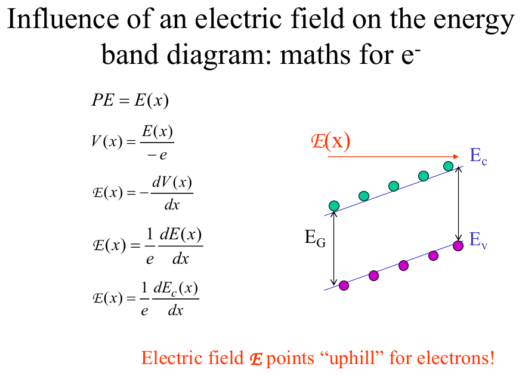
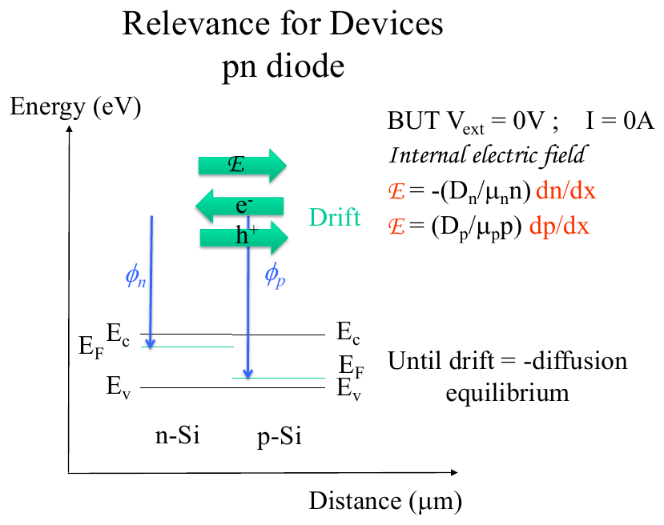

# Topic 7 — Band diagram under an electric field (bands tilt)

Tutorial questions: Ch1 Q17, Q18

Slides: SSD_1, pages 177 to 186. Booklet §2.9 (page 34).

---

## The big idea

The band diagram shows the **potential energy** of carriers.

Put an electric field across silicon, and the potential energy changes from one end to the other.

So the bands **tilt**.

Three things to remember:

1. **Electrons roll downhill** on E_C. (Like a ball.)
2. **Holes float uphill** on E_V. (Like a bubble.)
3. **The field points uphill** for electrons.

---

**How to use these notes:**
When you see 🧠, stop.
Answer it on paper first.
Then click to check.

---

## 1. Where the energy lives on the diagram

**How to read this diagram (official Ch1 Q17 answer):**

- Electrons live **above E_C**. The higher up, the more kinetic energy.
- Holes live **below E_V**. The **lower down**, the more kinetic energy.
- Hole energy is **upside down**. That's the thing people get wrong.

So the lowest-energy place for an electron is **right at E_C**.
The lowest-energy place for a hole is **right at E_V**.

Both carriers try to go to their lowest energy: electrons fall, holes float.

---

## 2. What a field does to the bands

**How to read this diagram:**

- Field E points **left to right** (+ on the left, − on the right).
- E_C, E_i and E_V all **tilt the same way**, parallel.
- They're **higher on the right**, where the − terminal is.
- E_G stays the same everywhere. The bands move together.

**Why higher on the right?**
Electrons are negative. Near the − terminal they're pushed away, so their potential energy is **high** there.

 

**How to read this diagram:**

- The green electron sits on E_C and rolls **down** the slope, to the left. That's **against** the field.
- The purple hole sits on E_V and floats **up** the slope, to the right. That's **with** the field.

That matches Topic 3: electrons move against E, holes move with E.

---

### 📐 Equation 17: field from the tilt (NOT on the formula sheet)

$$\mathcal{E}(x) = \frac{1}{e}\,\frac{dE_C}{dx}$$

$$V(x) = -\frac{E_C(x)}{e}$$

| Symbol | Means | Units |
|---|---|---|
| ℰ(x) | electric field at position x | V/cm |
| dE_C/dx | slope of the conduction band | eV/cm |
| e | electron charge | 1.6 × 10⁻¹⁹ C |
| V(x) | electrostatic potential (the voltage) | V |

**What it means:**
Steeper tilt = bigger field.
Flat bands = no field.
The voltage is the band diagram **flipped upside down** and divided by e.

**Use it when:**
You're told the field and asked which way the bands tilt, or shown a tilt and asked which way the field points.

**Shortcut:** the field points **uphill** for electrons. Find which way E_C rises, that's the direction of ℰ.

---

### 🧠 Check
E_C rises from left to right. Which way does the field point? Which way do electrons move?

Answer

Field points **left to right** (uphill).

Electrons roll **downhill**, so right to left. Against the field. ✓

---

## 3. What actually happens to a moving electron

**How to read this diagram:**

- Left: no field, bands flat.
- Right: field on, bands tilt.
- The electron starts at A on E_C, rolls down and picks up kinetic energy (the gap labelled KE above E_C).
- It hits something, loses the energy, drops back to E_C at B. Then it does it again.

That's drift. Lots of little falls and collisions. The average speed is v = μE from Topic 3.

---

## 4. The maths version

This is just Equation 17 again, with the picture.
Potential energy = E(x). Potential V = E ÷ (−e). Field = −dV/dx = (1/e) dE_C/dx.

Red line at the bottom is the one to remember: **"Electric field points uphill for electrons."**

---

## 5. Worked example: Tutorial Ch1 Q18

p-Si with a battery across it, + on the left. No voltage drop at the contacts. Draw the band diagram.

**Step 1.** Field points from + to −, so **left to right**.

**Step 2.** Bands tilt **up** to the right (higher at the − end).

**Step 3.** E_F is p-type, so it sits near E_V. Tilt it with the bands. (Strictly, E_F isn't well-defined where there's a field. For this module, just draw it parallel.)

**Step 4.** Total drop in E_C from one end to the other = **eV**. Label it.

**Official answer:**

**How to read this diagram:**
- Left: unbiased, flat bands.
- Right: biased. Everything tilts. The label eV marks how far the bands drop across the sample.
- Holes flow **left to right** (uphill on E_V, with the field, towards the − terminal).

---

### 🧠 Check
Same sample but flip the battery, so + is on the right. Which way do the bands tilt now? Which way do holes go?

Answer

Field points right to left.

Bands are higher on the **left** (the − end now).

Holes float uphill, so they go **right to left**. Still with the field. ✓

---

## 6. Where this is going: the pn diode

**How to read this diagram:**

n-Si and p-Si joined. Electrons diffuse from n to p (there are more of them on the n side). Holes diffuse p to n.

That diffusion sets up an **internal** electric field, with no battery at all.

The bands tilt in the junction region until drift exactly cancels diffusion.

That's the next three topics. For now, just see that **a tilt means a field**, whether a battery made it or diffusion made it.

---

## Drawing checklist: bands under a voltage

1. Find the field direction: **from + to −**.
2. Draw E_C and E_V **tilted**, higher at the **− terminal**.
3. Keep them parallel. E_G is the same everywhere.
4. Mark the total drop as **eV**.
5. Draw E_F in the right place for the doping, parallel to the bands.
6. Arrows: electrons roll **down**, holes float **up**.

---

## Method: tilt questions

| You're asked | Do |
|---|---|
| which way the bands tilt | higher at the − end |
| which way the field points | uphill for electrons, so towards where E_C is higher |
| which way electrons move | downhill on E_C |
| which way holes move | uphill on E_V |
| the size of the drop | eV across the sample |

---

Next: [End-of-topic test](../questions/07-bands-under-field.md)
