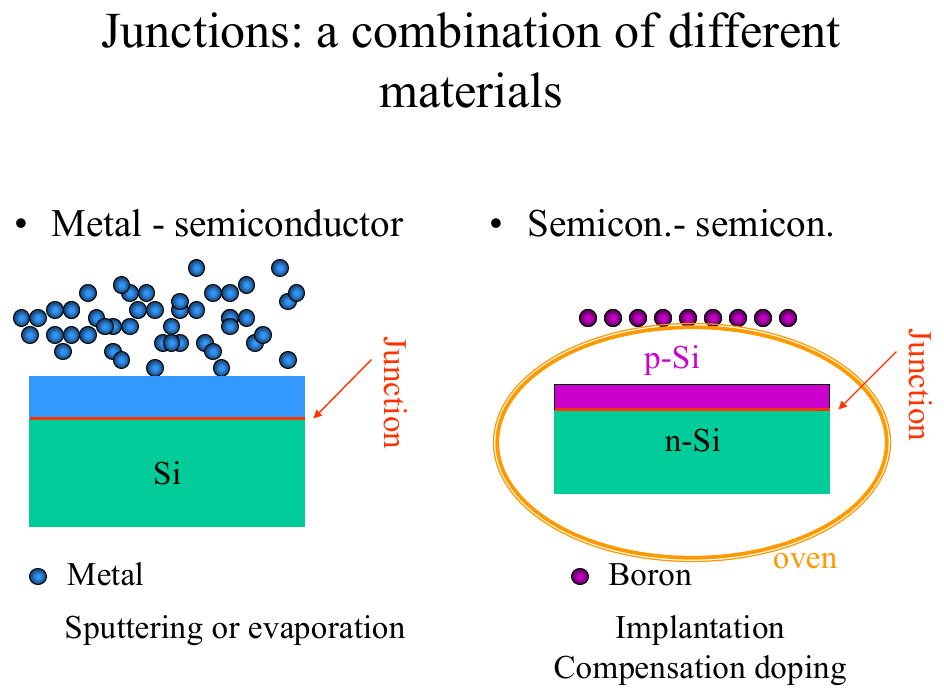
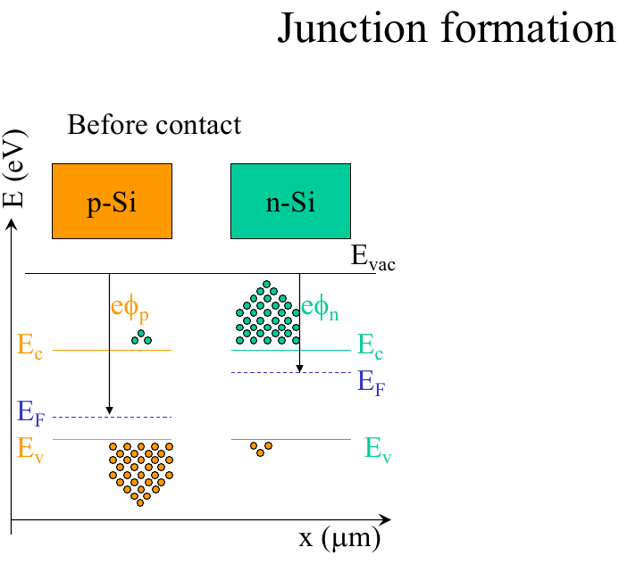
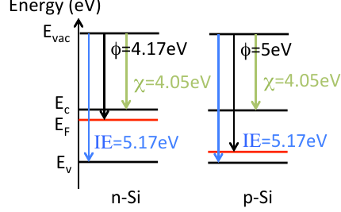
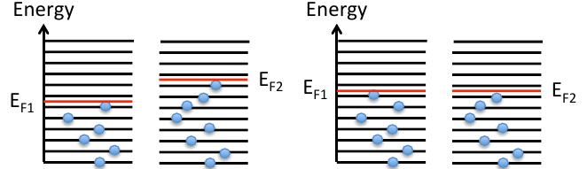
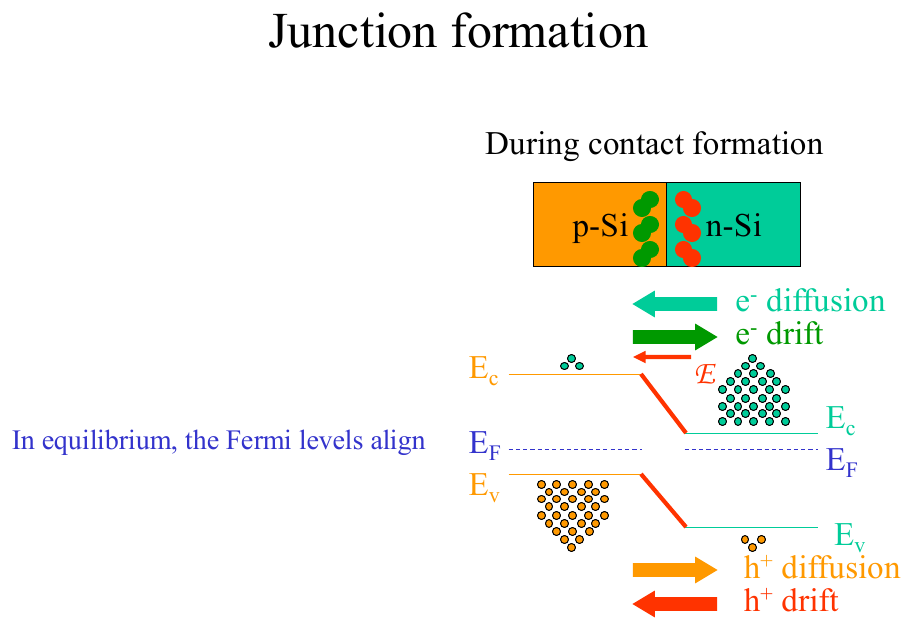
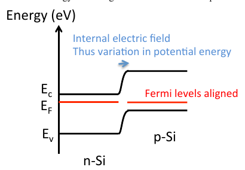

# Topic 8 — Bringing two materials into contact

Tutorial questions: Ch2 Q2, Q3, Q4

Slides: SSD_2, pages 3 to 11. Booklet §3.1 (pages 37 to 38).

---

## The big idea

Join two materials with different Fermi levels.

Electrons flow from the side with the **higher E_F** to the side with the **lower E_F**.

They keep going until the **Fermi levels line up**.

That flow leaves behind a charge, which makes an **internal electric field**, which **bends the bands** near the junction.

Three rules for any junction with no voltage applied:

1. **E_F is flat** across the whole thing.
2. Far from the junction, each side looks like it did before contact.
3. Near the junction, the bands **bend** to join the two sides.

---

**How to use these notes:**
When you see 🧠, stop.
Answer it on paper first.
Then click to check.

---

## 1. The two kinds of junction

**How to read this diagram:**

- Left: a **metal** on top of Si. Metal–semiconductor junction. Topic 9.
- Right: **p-Si** made inside **n-Si** by implanting boron. Semiconductor–semiconductor junction. The **pn diode**. Topics 10 to 14.

Same physics for both: Fermi levels line up, bands bend.

---

## 2. Before contact: draw each side on its own

**How to read this diagram:**

- One shared E_vac at the top (Topic 6).
- Left: p-Si. E_F near E_V. Big φₚ. Lots of holes (dots below E_V).
- Right: n-Si. E_F near E_C. Small φₙ. Lots of electrons (dots above E_C).
- The two E_F lines are at **different heights**. n-side E_F is **higher**.

This is Tutorial Ch2 Q2. Official answer:

**How to read this diagram:**
- n-Si: φ = 4.17 eV (from Q1, Topic 6).
- p-Si: φ = 5 eV (Topic 6 §3 check).
- Both: χ = 4.05 eV, IE = 5.17 eV. E_C and E_V are at the **same heights** on both sides. Only E_F is different.

---

### 🧠 Check
Which side has the higher E_F, n or p? Which way will electrons flow when you join them?

Answer

**n-side** has the higher E_F (smaller φ, so closer to E_vac).

Electrons flow from high E_F to low E_F: **n to p**.

---

## 3. What "Fermi levels line up" means

**How to read this diagram (official Ch2 Q3 answer):**

- Each black line = an allowed energy level. Blue dot = an electron in it.
- E_F marks the top of the filled levels (Topic 5 §4).
- **Left pair:** not in contact. Material 1 has E_F1 low. Material 2 has E_F2 high. Material 2 has electrons sitting above material 1's empty levels.
- **Right pair:** in contact. Electrons from material 2 dropped down into the empty levels in material 1. Now E_F1 moved **up** and E_F2 moved **down**, until they're **level**.

**Why it stops there:** once the Fermi levels match, there are no electrons on one side sitting higher than an empty level on the other side. Nothing more can drop down.

That's the whole reason for rule 1: **E_F is flat at equilibrium**.

---

## 4. During contact: diffusion, then a field

**How to read this diagram:**

- Electrons diffuse from n to p (green arrow, right to left). There are more of them on the n-side.
- Holes diffuse from p to n (orange arrow, left to right).
- They leave behind **fixed ions** (Topic 2 §1): B⁻ on the p-side, P⁺ on the n-side. That's the red/green stripe at the junction.
- Those ions make an **internal electric field ℰ**, pointing from + (n-side) to − (p-side).
- The field causes **drift** the opposite way: electrons back to n, holes back to p.
- The bands bend in the stripe region (Topic 7: tilt = field).

 

**How to read this diagram:**

At equilibrium:

- **Diffusion** of electrons n → p is exactly cancelled by **drift** of electrons p → n.
- Same for holes the other way.
- Net current = 0. Nothing flows out.
- E_F is one flat dashed line across the whole thing.
- The bands step **down** going from p to n. The p-side is higher.

**Why is the p-side higher?** Electrons are negative. The p-side has gained electrons, so it's negatively charged, so electron potential energy is high there. Same rule as Topic 7: bands are high at the negative end.

---

### 🧠 Check
At zero bias, is the current through the junction zero because nothing moves, or for another reason?

Answer

Another reason. Carriers are moving all the time.

Diffusion one way and drift the other way are **equal and opposite**. They cancel.

---

## 5. Worked example: Tutorial Ch2 Q4

Draw the band diagram of the n-Si and p-Si from Q2 when they're in contact.

**Step 1.** Draw E_F as one flat dashed line.

**Step 2.** Far left (n-Si): E_C is 0.12 eV above E_F. E_V is 1.12 below E_C.

**Step 3.** Far right (p-Si): E_F is 0.17 eV above E_V (E_G − 0.95). E_C is 1.12 above E_V.

**Step 4.** Join E_C to E_C and E_V to E_V with a smooth S-bend at the junction. The p-side is higher.

**Official answer:**

**How to read this diagram:**
- "Fermi levels aligned": the red E_F is flat.
- "Internal electric field, thus variation in potential energy": the bend. The field lives only where the bands bend.
- Left is n-Si (E_F near E_C), right is p-Si (E_F near E_V).

---

## Drawing checklist: two materials in contact, no bias

1. Draw a flat dashed **E_F** across the page.
2. On the **left** side, far from the junction, draw E_C and E_V at the right distances from E_F for that doping.
3. On the **right** side, same thing for the other doping.
4. The side with E_F closer to E_V (p-side) will have its bands **higher**.
5. Join the bands with a **smooth S-bend** at the junction. E_C and E_V bend together, parallel.
6. Label E_C, E_V, E_F, E_G and which side is n and p.

---

## Method: contact questions

| You're asked | Do |
|---|---|
| which way electrons flow at contact | from higher E_F to lower E_F (n to p) |
| why E_F is flat | §3: electrons drop into empty lower levels until none are left above |
| why there's a field | fixed ions left behind by diffusion (§4) |
| why current is zero | drift cancels diffusion (§4) |
| the diagram | checklist above |

---

Next: [End-of-topic test](../questions/08-contact.md)
