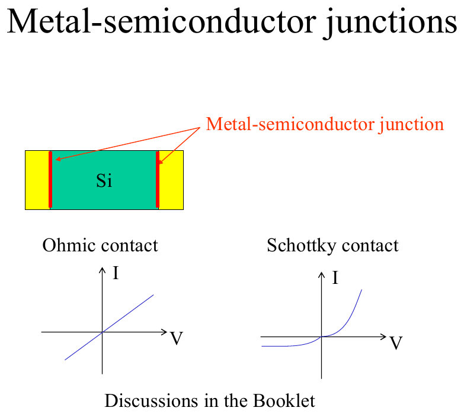
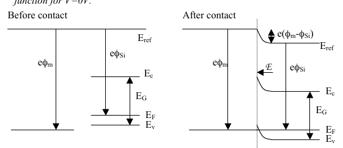
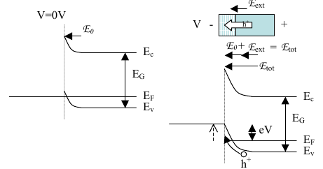
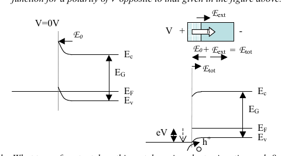
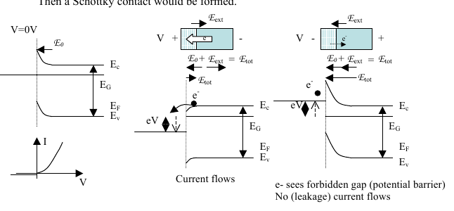

# Topic 9 — Metal–semiconductor contact: ohmic vs Schottky

Tutorial questions: Ch2 Q6 a–e

Slides: SSD_2, page 4 (it says "discussions in the booklet"). Booklet §3.1.1 and §3.1.2 (pages 38 to 41).

---

## The big idea

Put a metal on silicon. Two things can happen at the junction:

| Contact | What happens to the majority carriers at the junction | I–V curve | Used for |
|---|---|---|---|
| **Ohmic** | **more** of them pile up (accumulation) | straight line | wires onto a chip |
| **Schottky** | **fewer** of them (depletion), a barrier forms | one-way, like a diode | fast diodes |

Which one you get depends on **two things**:
1. Is the metal's φₘ bigger or smaller than the silicon's φₛ?
2. Is the silicon **n-type or p-type**?

---

**How to use these notes:**
When you see 🧠, stop.
Answer it on paper first.
Then click to check.

---

## 1. The I–V curves

**How to read this diagram:**

- Yellow blocks = metal contacts on a green Si bar.
- **Ohmic:** straight line through the origin. V = IR. Current flows both ways.
- **Schottky:** flat then shoots up. Current flows one way only. A rectifier.

---

## 2. The rule for which contact you get

Before contact, the electrons flow from **higher E_F to lower E_F** (Topic 8). Higher E_F = smaller φ.

| Si type | φₘ vs φₛ | Electrons flow | At the junction the Si gets | Contact |
|---|---|---|---|---|
| **n-type** | φₘ **<** φₛ | metal → Si | **more** electrons | **Ohmic** |
| **n-type** | φₘ **>** φₛ | Si → metal | **fewer** electrons | **Schottky** |
| **p-type** | φₘ **>** φₛ | Si → metal | fewer electrons = **more** holes | **Ohmic** |
| **p-type** | φₘ **<** φₛ | metal → Si | more electrons = **fewer** holes | **Schottky** |

 

**One-line version:**
**Ohmic** = the junction has **more majority carriers** than the bulk.
**Schottky** = the junction has **fewer majority carriers** than the bulk.

**Memory trick:** for n-type, a bigger metal workfunction sucks electrons out of the Si, so it's a barrier (Schottky). Swap the Si type and the answer flips.

---

### 🧠 Check
Metal with φₘ = 4.3 eV on n-Si with φₛ = 4.2 eV. Ohmic or Schottky?

Answer

n-type and φₘ > φₛ.

Electrons flow Si → metal. The Si loses electrons at the junction.

Fewer majority carriers, so **Schottky**.

---

## 3. How the bands bend

Topic 8 rules: E_F flat, far away looks like before, bend at the junction.

Extra rule for a metal: a metal is a perfect conductor, so **all the bending happens on the Si side**. The metal's E_F is just a flat line.

| Si type | Bands bend **up** towards the metal means | Bands bend **down** towards the metal means |
|---|---|---|
| n-type | E_C moves away from E_F, so **fewer electrons** → Schottky | E_C moves towards E_F, so **more electrons** → Ohmic |
| p-type | E_V moves towards E_F, so **more holes** → Ohmic | E_V moves away from E_F, so **fewer holes** → Schottky |

---

## 4. Worked example: Tutorial Ch2 Q6, part a

Metal on **p-Si**, with φₘ > φₛ. V = 0. Draw the band diagram.

**Step 1.** Before contact, draw both against a reference. φₘ bigger means the metal's E_F is **lower**.

**Step 2.** Electrons flow from the Si (higher E_F) to the metal (lower E_F).

**Step 3.** The Si near the junction loses electrons. In p-type that means **more holes**. Majority carriers go up, so this is **ohmic**.

**Step 4.** After contact: E_F flat. On the Si side the bands bend **up** towards the metal (E_V gets closer to E_F near the junction = more holes).

**Official answer:**

**How to read this diagram:**
- Left, before contact: eφₘ is a longer arrow than eφ_Si. Metal E_F is lower.
- Right, after contact: E_F is one flat line. The Si bands curve **up** as they reach the metal. The step at the top labelled e(φₘ − φ_Si) is the total bending.
- The arrow ℰ is the internal field, pointing into the Si. Drift due to ℰ balances diffusion, so I = 0.

---

## 5. Putting a voltage on it (Q6 b and c)

Same rule as Topic 7: the external field **adds to** or **subtracts from** the internal field.

- **Same direction:** more bending. More majority carriers pushed to the junction. More current.
- **Opposite direction:** less bending. Eventually the bands flip the other way.

Under bias, E_F is **no longer flat**. The two sides' Fermi levels are separated by **eV**.

**Q6b: V as in the figure (− on the metal, + on the Si).**

**How to read this diagram:**
- Left: V = 0, just the internal field ℰ₀.
- Right: external field ℰ_ext points the same way as ℰ₀. Total field is bigger. Bands bend more. The hole h⁺ floats **up** towards the metal and crosses. Current flows.
- The step eV between the two E_F levels is the applied voltage.

**Q6c: opposite polarity (+ on the metal).**

**How to read this diagram:**
- Now ℰ_ext opposes ℰ₀. Total field is smaller. Less bending.
- Holes still get through, just the other way (metal → Si). Current flows in both directions, so **ohmic**.

---

### 🧠 Check
Why does current flow in both directions for the contact in §4 and §5?

Answer

Because there's no barrier. Holes are piled up at the junction (accumulation).

Whichever way you push them, they can go. The I–V is a straight line.

---

## 6. Flip the Si type (Q6 d and e)

**Q6d:** what contact is this? **Ohmic.** The metal was chosen so the contact potential **increases** the majority carrier concentration at the interface.

**Q6e:** same φₘ > φₛ, but now **n-Si**. What happens?

Electrons still flow Si → metal. But now electrons are the **majority**. So the junction loses majority carriers. A **barrier** forms. **Schottky.**

**Official answer:**

**How to read this diagram:**
- Left: V = 0. The bands bend **up** towards the metal. For n-type that's a hill that electrons have to climb. The I–V in the corner is the one-way diode curve.
- Middle: + on the metal. The external field lowers the hill. Electrons roll over it. **Current flows.**
- Right: − on the metal. The hill gets taller. Electrons "see" the forbidden gap in front of them. **No current** (just a tiny leakage).

That's rectification. The Schottky contact is a diode.

---

## Drawing checklist: metal–semiconductor contact

1. **Before contact:** draw E_F for the metal and E_F, E_C, E_V for the Si against one reference. Bigger φ = lower E_F.
2. Decide which way electrons flow: from higher E_F to lower E_F.
3. Decide: does the Si at the junction gain or lose majority carriers? That tells you ohmic or Schottky.
4. **After contact (V = 0):** draw E_F flat. Metal side flat. Si side bends near the junction, flat far away.
   - Bands bend **up** towards the metal if the Si lost electrons.
   - Bands bend **down** if the Si gained electrons.
5. **Under bias:** split E_F by eV. Add ℰ_ext to ℰ₀. More bend or less bend.
6. Draw the carrier (h⁺ up, e⁻ down) and say whether it crosses.

---

## Method: contact-type questions

| You're asked | Do |
|---|---|
| ohmic or Schottky? | §2 table: does the junction gain or lose majority carriers? |
| which way the bands bend | lost electrons → up. Gained electrons → down. |
| what happens with a voltage | add or subtract the fields. Ohmic: current both ways. Schottky: one way. |
| what if the Si type changes | the answer flips (§6) |
| why a Schottky blocks | electrons face a hill + the forbidden gap (§6) |

---

Next: [End-of-topic test](../questions/09-metal-semiconductor.md)
