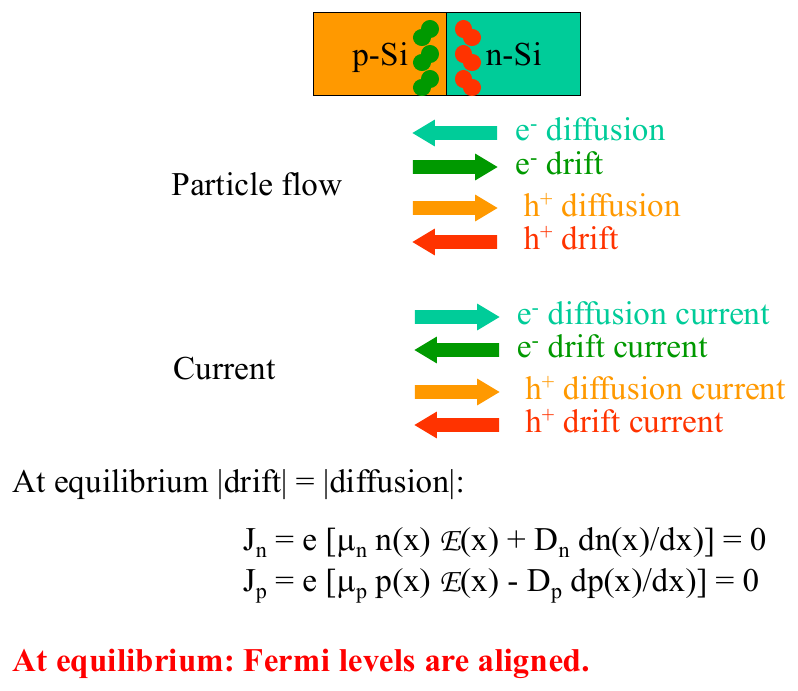
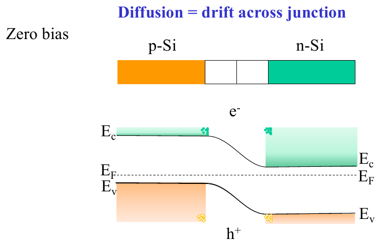
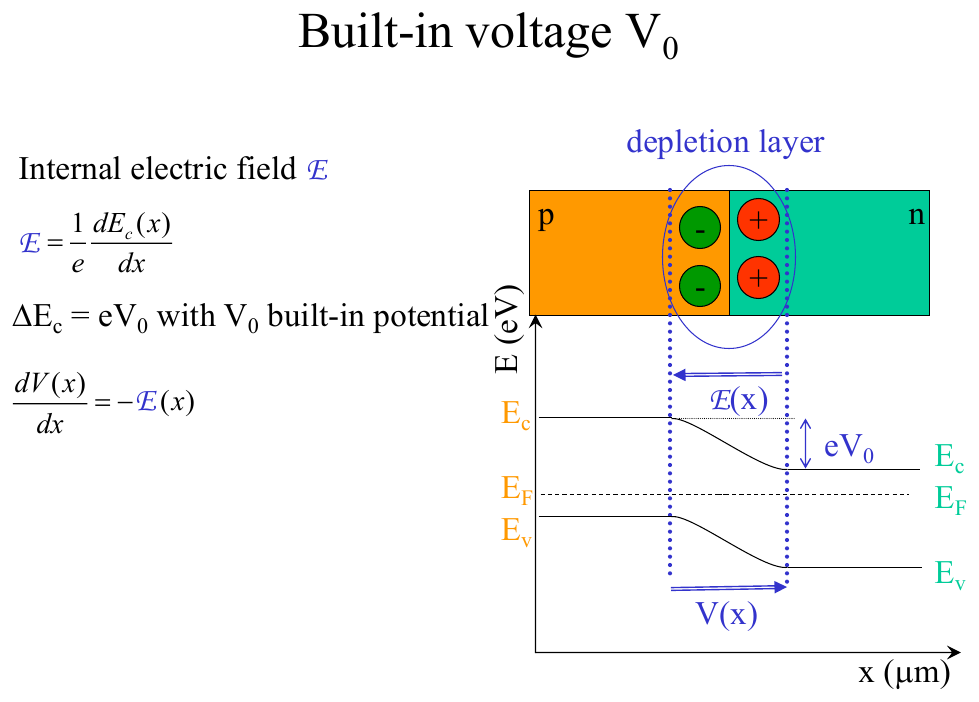
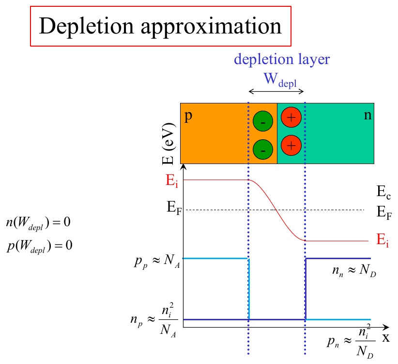
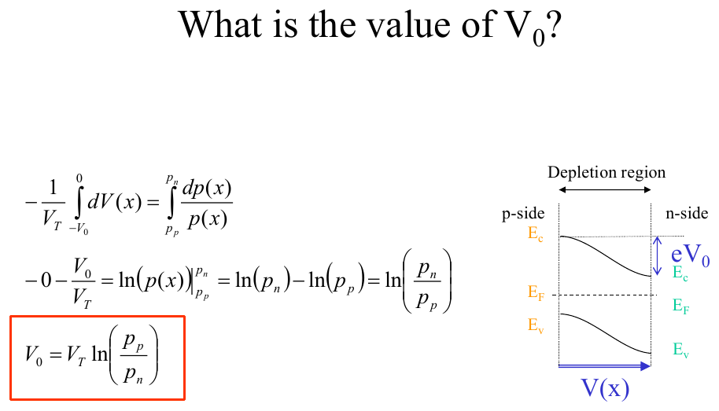
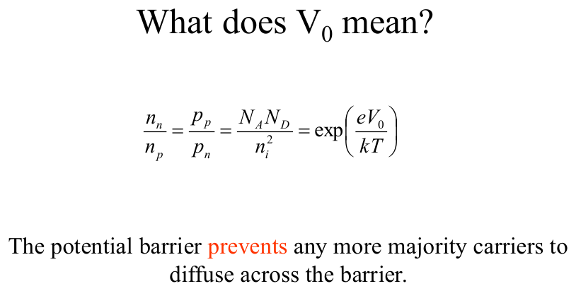
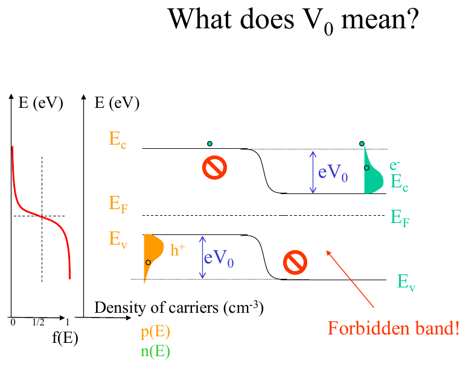
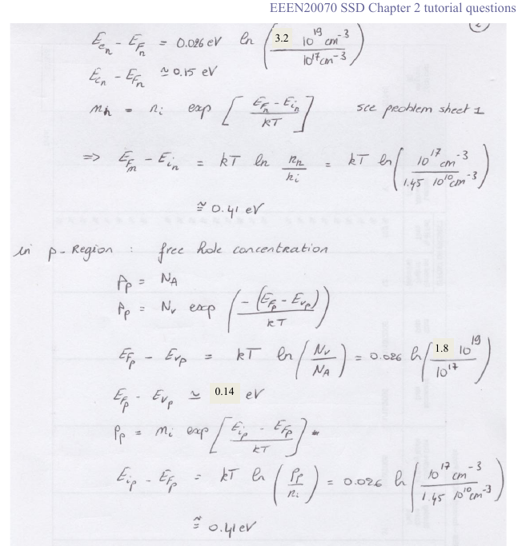

# Topic 10 — The pn diode at zero bias: built-in voltage V₀ and the depletion region

Tutorial questions: Ch2 Q5, Q11a

Slides: SSD_2, pages 6 to 24. Booklet §3.2.2 (page 42).

---

## The big idea

A pn diode = p-Si joined to n-Si. Topic 8 rules apply: E_F flat, bands bend at the junction.

Two new things to name:

1. **The depletion region.** A thin strip at the junction with **no free carriers**, only fixed ions. That's where the field is.
2. **The built-in voltage, V₀.** The size of the step in the bands, measured in volts. It's a **barrier** that stops the majority carriers from diffusing across.

$$V_0 = \frac{kT}{e}\ln\!\left(\frac{N_A N_D}{n_i^2}\right)$$

This is on the formula sheet as V_bi.

---

**How to use these notes:**
When you see 🧠, stop.
Answer it on paper first.
Then click to check.

---

## 1. What happens at the junction

**How to read this diagram:**

- Top half, **particle flow**: electrons diffuse right to left (n → p), drift left to right. Holes the opposite.
- Bottom half, **current**: remember electron current is opposite to electron motion (Topic 3). So all four currents are drawn, and they pair off.
- At equilibrium **|drift| = |diffusion|** for each carrier. Net current = 0.
- Bottom line in red: **Fermi levels are aligned.**

 

**How to read this diagram:**

- Top: the bar. p-Si orange on the left, n-Si green on the right. The white strip in the middle is the **depletion region**.
- Bottom: the band diagram. E_F flat. Bands step **down** from p to n.
- Green shading = electrons, piled up on the n-side above E_C.
- Orange shading = holes, piled up on the p-side below E_V.
- An electron on the n-side would have to **climb** the step to get to the p-side. Most can't. That's the barrier.

---

## 2. The depletion region

**How to read this diagram:**

- The dashed circle marks the **depletion layer**.
- Inside it: fixed **B⁻ ions** (green, p-side) and **P⁺ ions** (red, n-side). No free carriers.
- Those ions make the internal field **ℰ(x)**, pointing from + (n) to − (p). Arrow at the top.
- The field makes the bands bend. The total bend in E_C is **eV₀**.
- The voltage V(x) across the region is drawn underneath. It rises by V₀ from p to n.

**Why is it empty of carriers?**
Holes near the junction diffused into the n-side and were lost. Electrons near the junction diffused into the p-side. What's left is the ions with nobody to cancel their charge.

 

**How to read this diagram:**

This is the **depletion approximation**. We pretend:

- **Inside** the depletion region (width W_depl): **zero** free carriers. n = 0, p = 0.
- **Outside** it: normal doped Si. p-side has p = N_A, n = nᵢ²/N_A. n-side has n = N_D, p = nᵢ²/N_D.
- The blue line for carrier density drops to nothing inside the strip.

That's what makes Topic 14 (Poisson) easy.

---

### 🧠 Check
In the depletion region of a diode with N_A = 10¹⁷ and N_D = 10¹⁵, what is the charge density on each side?

Answer

p-side: −e × N_A = −e × 10¹⁷ (the B⁻ ions).

n-side: +e × N_D = +e × 10¹⁵ (the P⁺ ions).

No free carriers, so only the ions count.

---

## 3. The built-in voltage V₀

---

### 📐 Equation 18: built-in voltage (on the formula sheet, as V_bi)

$$V_0 = \frac{kT}{e}\ln\!\left(\frac{N_A N_D}{n_i^2}\right)$$

| Symbol | Means | Value |
|---|---|---|
| V₀ | built-in voltage, the barrier height in volts | V, typically 0.6 to 0.9 V for Si |
| kT/e | thermal voltage, also written V_T | **0.026 V** at 300 K |
| N_A | acceptor doping, p-side | cm⁻³ |
| N_D | donor doping, n-side | cm⁻³ |
| nᵢ² | | **2.1 × 10²⁰ cm⁻⁶** |

**What it means:**
More doping on either side = bigger barrier. But only by a log, so it changes slowly.

The step in the band diagram is **eV₀** (in eV). The number is the same, just the units change: V₀ = 0.8 V means a step of 0.8 eV.

**Use it when:**
You're asked for V₀, V_bi, the built-in potential, or the barrier height. Or when you need V₀ for the depletion width (Topic 14).

---

### Where it comes from (slide 19, the derivation)

**How to read this diagram:**

Start from hole current = 0 at equilibrium (drift = diffusion):

$$e\mu_p p\,\mathcal{E} = eD_p\frac{dp}{dx}$$

Use ℰ = −dV/dx and Einstein D/μ = kT/e (Topic 4). Integrate across the depletion region. You get:

$$V_0 = V_T\,\ln\!\left(\frac{p_p}{p_n}\right)$$

p_p = holes on the p-side = N_A. p_n = holes on the n-side = nᵢ²/N_D. Put those in and you get Equation 18.

**Same answer the easy way:** V₀ is just the gap between the two Fermi level positions before contact.

eV₀ = (E_F − E_i) on the n-side + (E_i − E_F) on the p-side.

Each of those is kT ln(N/nᵢ) from Topic 5 Equation 15. Add them and you get Equation 18.

---

### 🧠 Check
N_A = 10¹⁶, N_D = 10¹⁶. Find V₀.

Answer

V₀ = 0.026 × ln(10¹⁶ × 10¹⁶ ÷ 2.1 × 10²⁰)

= 0.026 × ln(4.8 × 10¹¹)

= 0.026 × 26.9 = **0.70 V**

---

## 4. What V₀ means for the carriers

$$\frac{n_n}{n_p} = \frac{p_p}{p_n} = \frac{N_A N_D}{n_i^2} = e^{eV_0/kT}$$

**How to read this:**

The ratio of majority to minority (across the junction) is set by V₀.

n_n = electrons on the n-side (majority, = N_D).
n_p = electrons on the p-side (minority, = nᵢ²/N_A).

This is the same statement as Equation 18, flipped. You'll use it in Topic 12.

 

**How to read this diagram:**

- Left: the Fermi-Dirac curve f(E) turned on its side.
- Electrons on the n-side (green blob) are mostly sitting just above E_C. Only the very top few have enough energy to clear the eV₀ step.
- Holes (orange blob) same story, going down.
- The red circles with lines: carriers **can't** go straight across, because the gap is forbidden. They have to go over the top.

That's why the barrier works: almost no carriers have the energy to climb eV₀.

---

## 5. Worked example: Tutorial Ch2 Q5

Si np diode, N_A = N_D = 10¹⁷ cm⁻³. Take E_G ≈ 1 eV. Sketch the band diagram at zero bias. Find E_C, E_F and E_i relative to E_V on each side, and V₀.

**Step 1. n-side.** Electrons: n = N_D = 10¹⁷.

E_C − E_F = kT ln(N_C/n) = 0.026 × ln(3.2 × 10¹⁹ ÷ 10¹⁷) = **0.15 eV**

E_F − E_i = kT ln(n/nᵢ) = 0.026 × ln(10¹⁷ ÷ 1.45 × 10¹⁰) = **0.41 eV**

**Step 2. p-side.** Holes: p = N_A = 10¹⁷.

E_F − E_V = kT ln(N_V/p) = 0.026 × ln(1.8 × 10¹⁹ ÷ 10¹⁷) = **0.14 eV**

E_i − E_F = kT ln(p/nᵢ) = **0.41 eV**

**Step 3. V₀.**

V₀ = 0.026 × ln(10¹⁷ × 10¹⁷ ÷ 2.1 × 10²⁰) = 0.026 × 31.5 = **0.82 V**

Check: 0.41 + 0.41 = 0.82. ✓ The two E_F-to-E_i gaps add up to eV₀.

**Step 4. Draw it.** E_F flat. n-side on the left here (it's "np"), bands low. p-side on the right, bands 0.82 eV higher.

**Official answer:**

**How to read this diagram:**
- n-region on the left, p-region on the right.
- E_F is one flat line.
- Left side: E_C is 0.15 above E_F, E_i is 0.41 below E_F, E_V is 1 eV below E_C.
- Right side: E_V is 0.14 below E_F, E_i is 0.41 above E_F.
- The dashed vertical lines mark the depletion region. All the bending is between them.

---

## Drawing checklist: pn diode at zero bias

1. Flat dashed **E_F** across the page.
2. **p-side:** E_V a bit below E_F (kT ln(N_V/N_A)). E_C = E_V + E_G. E_i dashed, near the middle.
3. **n-side:** E_C a bit above E_F (kT ln(N_C/N_D)). E_V = E_C − E_G. E_i near the middle.
4. The p-side bands are **higher**. Join with an S-bend.
5. Two vertical dashed lines for the **depletion region** edges.
6. Label the step as **eV₀**.
7. Draw ℰ pointing from n to p (+ to −) inside the depletion region.

---

## Method: zero-bias diode questions

| You're asked for | Use |
|---|---|
| V₀ | Equation 18 |
| the band diagram | checklist above |
| E_C, E_F, E_i positions on each side | Topic 5 §6 and §7 |
| the step in the bands | eV₀ |
| why no current flows | drift = diffusion (§1), barrier eV₀ (§4) |
| what's in the depletion region | fixed ions only (§2) |

---

Next: [End-of-topic test](../questions/10-pn-zero-bias.md)
