# Topic 11 — The pn diode under forward and reverse bias

Tutorial questions: Ch2 Q7, Q8

Slides: SSD_2, pages 25 to 48. Booklet §3.2.4.1 and §3.2.4.2 (pages 49 to 52).

---

## The big idea

Put a battery across the diode. Nearly all the voltage drops across the **depletion region** (it's the resistive bit, with no carriers).

So the battery changes the **barrier height**:

| Bias | Battery | Barrier | Depletion width | Diffusion across junction | Current |
|---|---|---|---|---|---|
| **Forward** | + on p, − on n | **V₀ − V** (lower) | thinner | allowed, lots of it | **big** |
| **Reverse** | − on p, + on n | **V₀ + \|V\|** (higher) | wider | blocked | **tiny** |

**Forward:** majority carriers pour over the lower barrier. That's the current.
**Reverse:** only minority carriers get swept across by drift. There are hardly any, so the current is tiny.

---

**How to use these notes:**
When you see 🧠, stop.
Answer it on paper first.
Then click to check.

---

## 1. Where the voltage goes

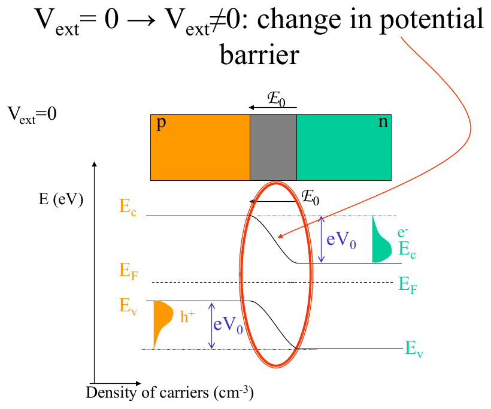

**How to read this diagram:**

- Top: the bar. The grey strip is the depletion region. V_ext drops across it.
- Bottom: the zero-bias band diagram with the barrier eV₀ circled.
- The red circle is the bit that changes when you apply a voltage.

**Rule:** the external field ℰ_ext **adds to or subtracts from** the internal field ℰ₀ (same as Topic 9).

---

## 2. Forward bias

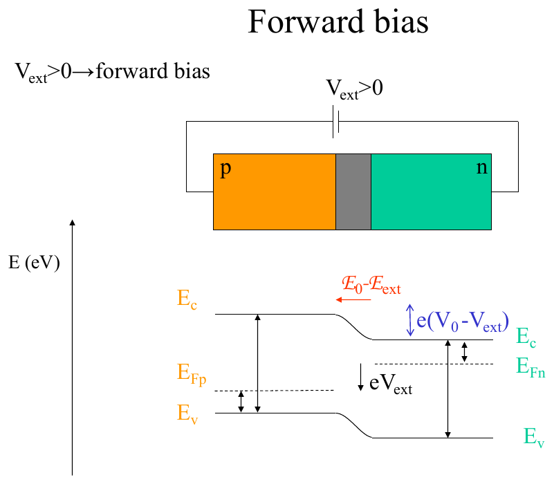

**How to read this diagram:**

- Battery: **+ on p** (left), **− on n** (right).
- ℰ_ext points left to right. ℰ₀ points right to left (from n to p). They **oppose**. Total field is smaller.
- Smaller field = less bending. The step in E_C is now **e(V₀ − V_ext)**.
- E_F is **split**: E_Fp on the left, E_Fn on the right, separated by **eV_ext**. (Under bias there's no single E_F. These are "quasi-Fermi levels".)
- The n-side is pulled **up** towards the p-side.

 

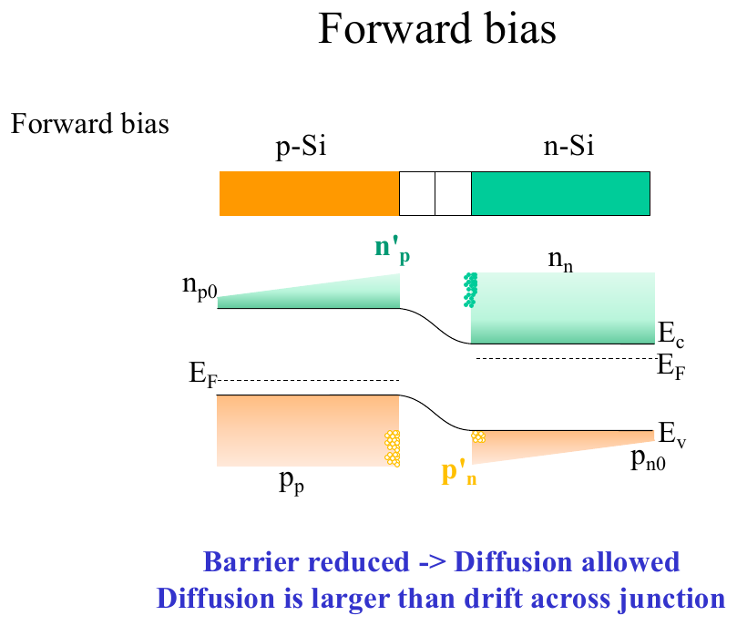

**How to read this diagram:**

- Barrier is lower, so **diffusion is allowed**. Electrons spill from n to p (green). Holes spill from p to n (orange).
- The green wedge on the p-side labelled **n'_p** = electrons that made it across. They're now **minority carriers injected** into the p-side.
- The orange wedge labelled **p'_n** = holes injected into the n-side.
- Blue text: "Diffusion is larger than drift across junction." That imbalance is the current.

 

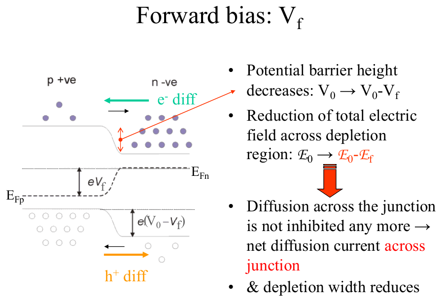

Three things happen in forward bias:
1. Barrier height drops: V₀ → V₀ − V_f.
2. Field across the depletion region drops: ℰ₀ → ℰ₀ − ℰ_f.
3. Depletion width **shrinks**.

---

### 🧠 Check
Forward bias of 0.5 V on a diode with V₀ = 0.8 V. What's the barrier now?

Answer

V₀ − V = 0.8 − 0.5 = **0.3 V**. So the step in the bands is 0.3 eV.

---

## 3. Reverse bias

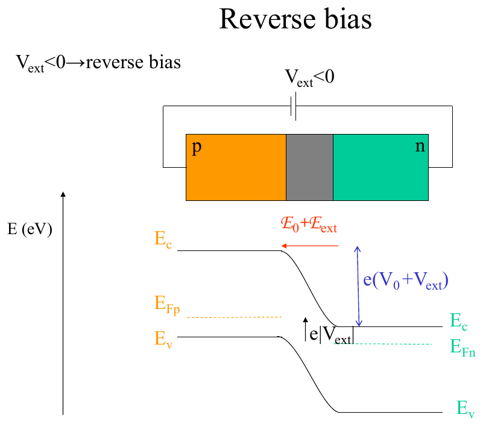

**How to read this diagram:**

- Battery: **− on p**, **+ on n**.
- ℰ_ext now points the **same** way as ℰ₀. Total field is bigger.
- Bigger field = more bending. The step is now **e(V₀ + V_ext)**.
- E_F split again by e|V_ext|, but the other way round.

 

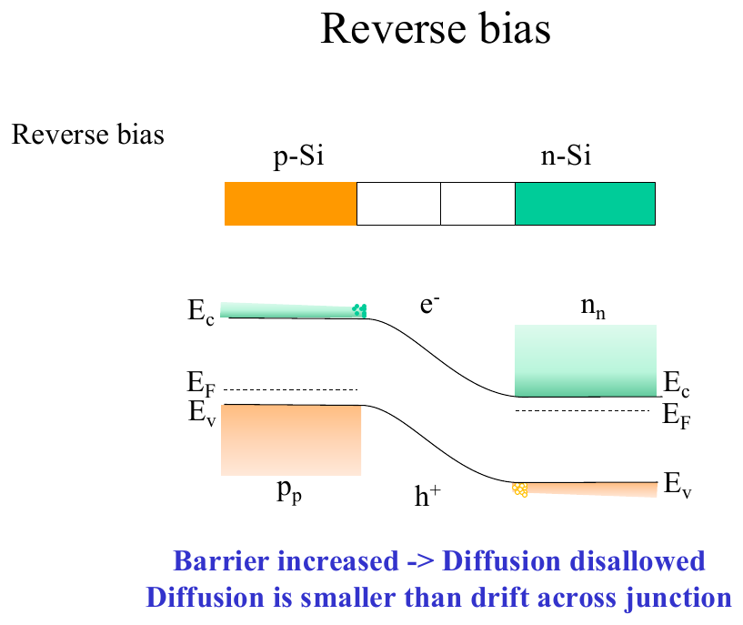

**How to read this diagram:**

- Barrier is higher, so **diffusion is blocked**. Majority carriers can't climb it.
- But any **minority** carrier that wanders near the junction gets swept across by the strong field. Electrons on the p-side slide down to n. Holes on the n-side float up to p.
- There are very few minority carriers (nᵢ²/N), so this is a **tiny** current.
- Blue text: "Diffusion is smaller than drift across junction."

 

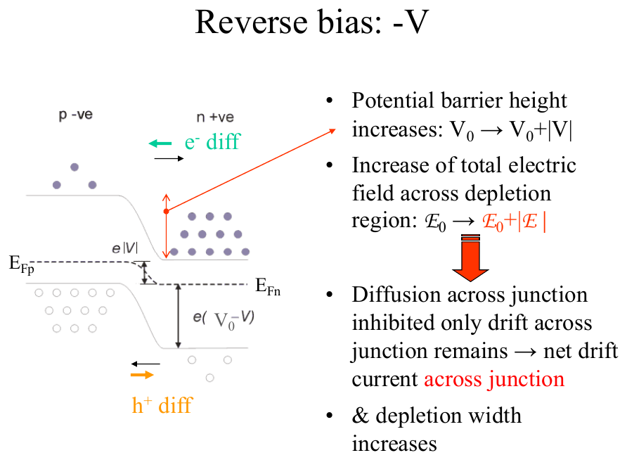

Three things happen in reverse bias:
1. Barrier height rises: V₀ → V₀ + |V|.
2. Field across the depletion region rises.
3. Depletion width **grows**.

---

### 🧠 Check
Why doesn't a bigger reverse voltage give a bigger reverse current?

Answer

The reverse current is made of minority carriers being swept across.

How many there are is fixed by the doping (nᵢ²/N_A and nᵢ²/N_D), not by the voltage.

A bigger field sweeps them faster, but there aren't any more of them to sweep. So the current stays flat at a tiny value.

---

## 4. All three together

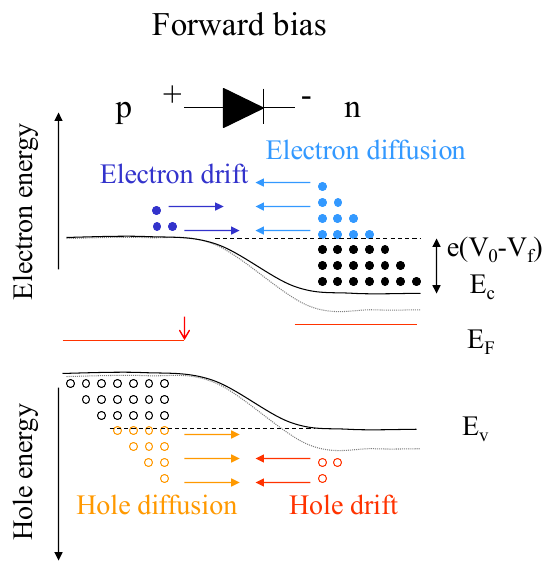

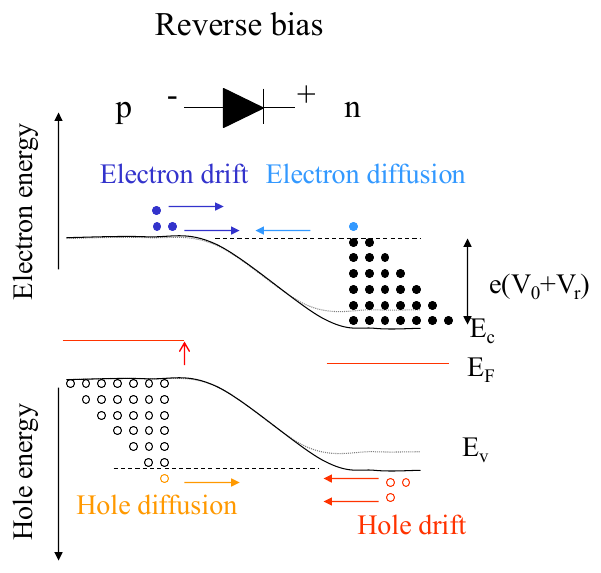

**How to read these diagrams (plus slide 42 for no bias):**

Each one has electron energy on top (E_C) and hole energy underneath (E_V, drawn so holes "float up").

- **No bias:** electron drift and electron diffusion arrows are equal and opposite. Same for holes. Barrier eV₀.
- **Forward:** barrier e(V₀ − V_f). Diffusion arrows are bigger than drift. Electrons flow n → p, holes p → n.
- **Reverse:** barrier e(V₀ + V_r). Diffusion arrows nearly gone. Only drift of the few minority carriers.

---

## 5. The depletion region changes width

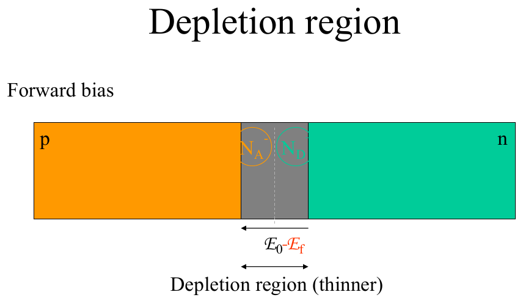

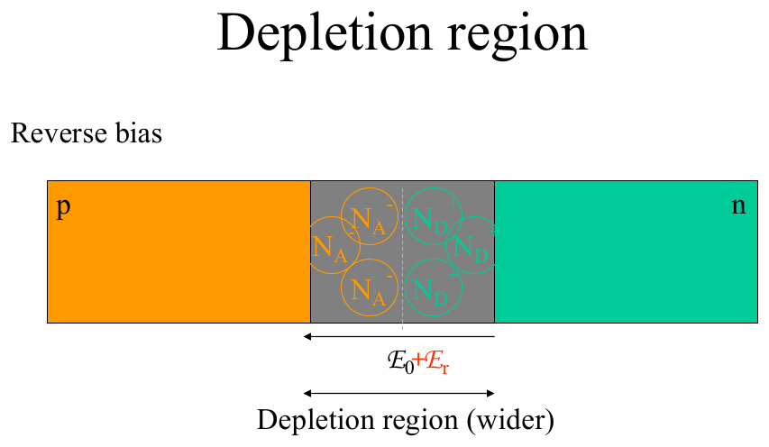

**How to read these diagrams:**

- Forward: the grey strip is **thinner**. Field ℰ₀ − ℰ_f.
- Reverse: the grey strip is **wider**. Field ℰ₀ + ℰ_r.

**Why:** the ion charge has to produce the total field. A bigger field needs more ions, so the region has to be wider to include more of them. Topic 14 does the maths.

---

## 6. Worked example: Tutorial Ch2 Q7

On a schematic of a pn diode, draw the direction of hole and electron flow across the junction under forward bias.

**Answer:**
- Holes go from **p to n**.
- Electrons go from **n to p**.
- Both are diffusion. Both are majority carriers leaving their home side.
- Conventional current flows from p to n (holes with it, electrons against it, same current direction).

**Official answer:**

Note on the official sketch: "the flux of carriers due to diffusion is larger (substantially) than the drift flux in the opposite direction."

---

## 7. Worked example: Tutorial Ch2 Q8

Why is the current in a reverse-biased pn diode small? Explain in terms of the carrier type injected across the junction.

**Answer, in four lines:**

1. Most of the applied voltage drops across the depletion region. It's very resistive (no carriers).
2. The field there sweeps carriers across: **holes from n to p**, **electrons from p to n**.
3. Those are **minority carriers**. On each side there are only nᵢ²/N of them. Very few.
4. So only a few are available to cross. The current is tiny, and it doesn't grow with voltage.

**Official answer:**

---

## Drawing checklist: diode under bias

1. Start from the zero-bias diagram (Topic 10 checklist).
2. Decide: forward (+ on p) or reverse (− on p).
3. **Forward:** reduce the step to e(V₀ − V). Make the depletion region narrower.
   **Reverse:** increase the step to e(V₀ + |V|). Make the depletion region wider.
4. Split E_F into E_Fp and E_Fn, separated by eV. In forward bias E_Fn is **above** E_Fp. In reverse it's below.
5. Arrows: forward, majority carriers diffuse across. Reverse, minority carriers drift across.

---

## Method: bias questions

| You're asked | Answer |
|---|---|
| what forward bias does to the barrier | lowers it to V₀ − V |
| what reverse bias does to the barrier | raises it to V₀ + \|V\| |
| which carriers cross in forward bias | majority (holes p→n, electrons n→p) by diffusion |
| which carriers cross in reverse bias | minority (holes n→p, electrons p→n) by drift |
| why reverse current is small | few minority carriers (§7) |
| depletion width | forward thinner, reverse wider (§5) |

---

Next: [End-of-topic test](../questions/11-pn-under-bias.md)
