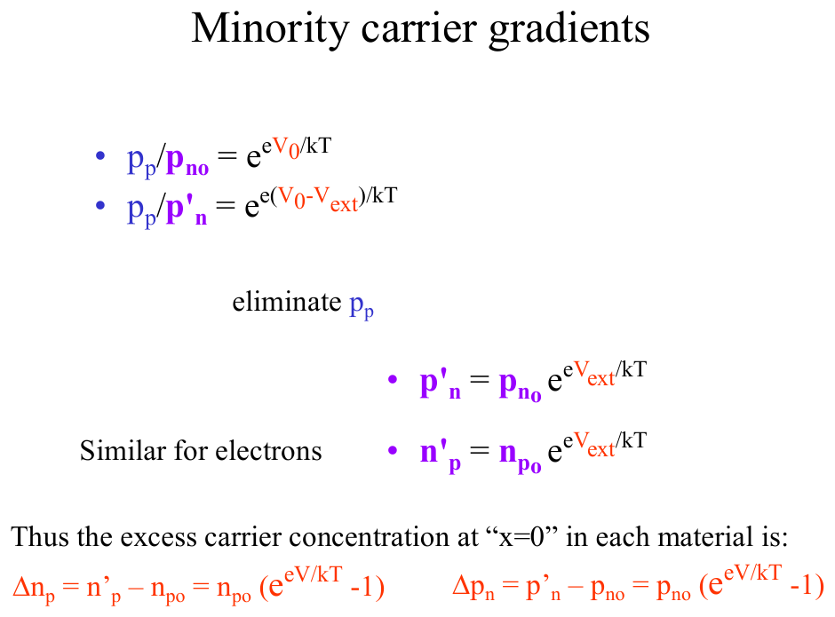
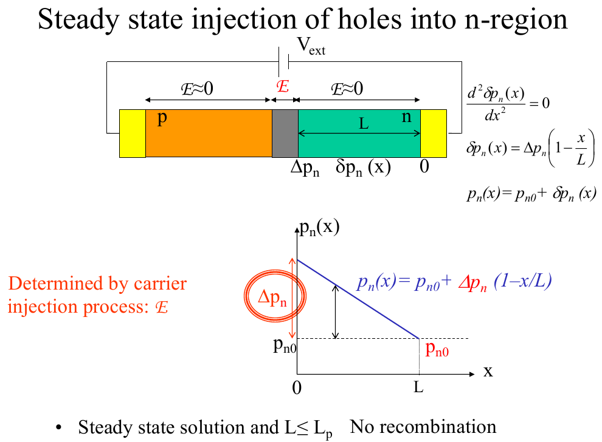
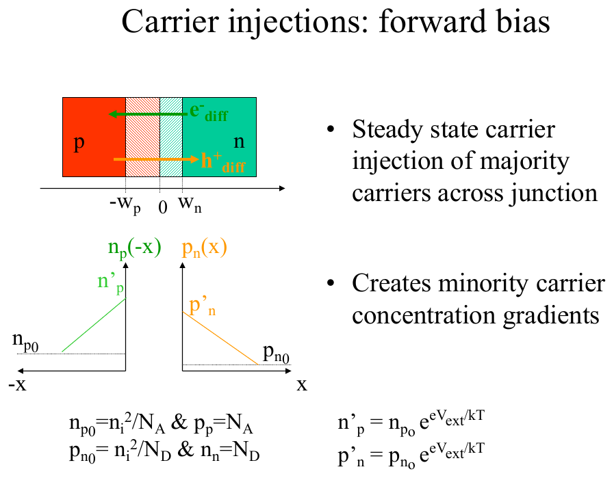
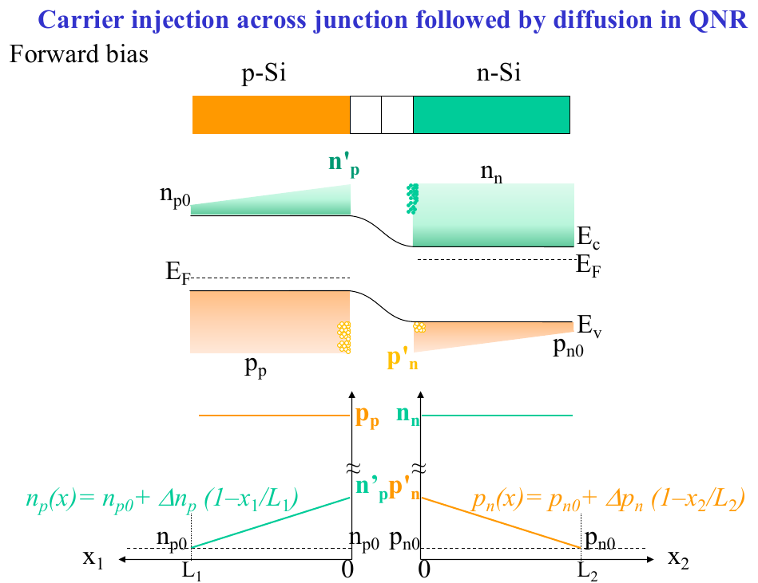
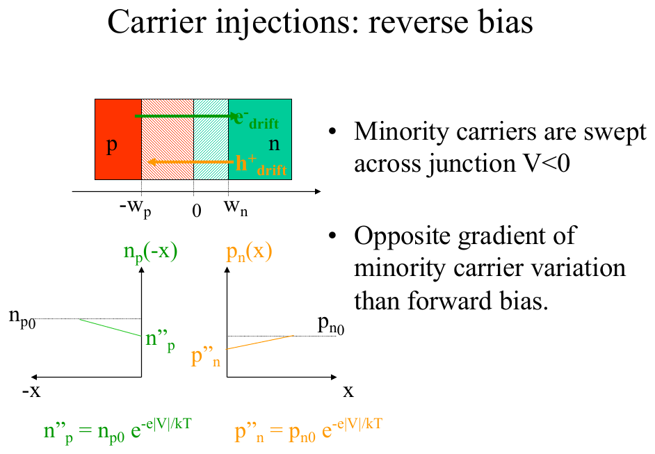

# Topic 12 — Minority carrier injection and concentration profiles

Tutorial questions: Ch2 Q9, Q10

Slides: SSD_2, pages 49 to 65. Booklet §3.2.4 (pages 49 to 53).

---

## The big idea

Forward bias lets majority carriers over the barrier. Once they're across, they're **minority carriers** on the other side.

Right at the edge of the depletion region, the minority concentration jumps up to:

$$n'_p = n_{p0}\, e^{V/V_T} \qquad p'_n = p_{n0}\, e^{V/V_T}$$

Then it falls in a **straight line** back to the normal value at the contact.

Everything in Topics 12 and 13 comes from this triangle.

---

**How to use these notes:**
When you see 🧠, stop.
Answer it on paper first.
Then click to check.

---

## 1. Names for the four concentrations

| Symbol | Means | Value at zero bias |
|---|---|---|
| **n_n** | electrons on the n-side (majority) | N_D |
| **p_p** | holes on the p-side (majority) | N_A |
| **n_p0** | electrons on the p-side (minority) | nᵢ² / N_A |
| **p_n0** | holes on the n-side (minority) | nᵢ² / N_D |

The 0 means "equilibrium, no bias".

Under bias, the minority values at the depletion edge get a **prime**: n'_p and p'_n.

The **excess** is the difference: Δn_p = n'_p − n_p0, Δp_n = p'_n − p_n0.

---

## 2. The jump at the depletion edge

**How to read this diagram:**

Start from Topic 10 §4: at zero bias, p_p / p_n0 = e^(eV₀/kT).

Under forward bias the barrier is V₀ − V_ext, so: p_p / p'_n = e^(e(V₀ − V_ext)/kT).

Divide one by the other. p_p cancels (majority barely changes). You get the red box:

**p'_n = p_n0 e^(eV_ext/kT)**, and the same for electrons.

Bottom line: the **excess** at x = 0 is Δp_n = p_n0 (e^(eV/kT) − 1).

---

### 📐 Equation 19: minority carrier injection (on the formula sheet as c = c₀ e^(eV/kT))

$$n'_p = n_{p0}\, e^{V/V_T} \qquad\qquad p'_n = p_{n0}\, e^{V/V_T}$$

| Symbol | Means | Value |
|---|---|---|
| n'_p | electrons at the edge of the p-side, under bias | cm⁻³ |
| n_p0 | electrons on the p-side at zero bias | nᵢ² / N_A |
| p'_n | holes at the edge of the n-side, under bias | cm⁻³ |
| p_n0 | holes on the n-side at zero bias | nᵢ² / N_D |
| V | applied voltage. **Positive** for forward, **negative** for reverse | V |
| V_T | kT/e | **0.026 V** |

**What it means:**
Forward bias (V > 0): the exponent is big and positive. Minority carriers at the edge shoot up.
Reverse bias (V < 0): the exponent is big and negative. Minority carriers at the edge drop to about **zero**.

**Use it when:**
You're asked for the minority concentration at the junction edge, the excess carriers, or to sketch the profile.

**Handy number:** e^(0.5/0.026) = e^19.2 = **2.25 × 10⁸**. And e^(−1/0.026) = e^(−38.5) = **2 × 10⁻¹⁷**.

---

### 🧠 Check
N_D = 10¹⁶. Forward bias 0.3 V. Find p'_n.

Answer

p_n0 = 2.1 × 10²⁰ ÷ 10¹⁶ = 2.1 × 10⁴

e^(0.3/0.026) = e^11.5 = 1.0 × 10⁵

p'_n = 2.1 × 10⁴ × 1.0 × 10⁵ = **2.1 × 10⁹ cm⁻³**

---

## 3. The straight-line profile (short diode)

**How to read this diagram:**

- Top: the bar. The n-region has length **L**, from the depletion edge (x = 0) to the contact.
- The field is ≈ 0 in the n-region. All the field is in the grey depletion strip. So in the n-region, holes only **diffuse**.
- Bottom: p_n(x). Starts at p'_n at x = 0. Falls in a **straight line** to p_n0 at x = L.

**Why a straight line?**
Short diode = no recombination on the way. Whatever goes in at x = 0 comes out at x = L. Steady flow with constant diffusion current means a constant gradient (Topic 4 §: short samples give linear profiles).

The equation:

$$p_n(x) = p_{n0} + \Delta p_n\left(1 - \frac{x}{L}\right)$$

The contact at x = L holds the concentration at its equilibrium value p_n0.

---

## 4. Both sides, forward bias

**How to read this diagram:**

- Junction at x = 0. p-side to the left (−x), n-side to the right.
- Green line on the left: electrons on the p-side. Starts at n'_p at the junction, falls to n_p0 at the contact (x = −L_n).
- Orange line on the right: holes on the n-side. Starts at p'_n, falls to p_n0 at x = L_p.
- Both are triangles sitting on top of the flat equilibrium value.
- Formulas in the corners: n_p0 = nᵢ²/N_A and p_n0 = nᵢ²/N_D (Topic 2), then multiply by e^(V/V_T).

 

**How to read this diagram:**

The same thing on the band diagram. The green wedge above E_C on the p-side is the injected electrons. The orange wedge below E_V on the n-side is the injected holes. Both taper to nothing at the contacts.

**The majority carriers barely change.** n_n stays ≈ N_D. A few 10¹³ extra holes don't matter next to 10¹⁸ electrons.

---

## 5. Reverse bias

**How to read this diagram:**

- V is negative, so e^(V/V_T) ≈ 0. The minority concentration at the junction edge drops to **zero**.
- The profile is the **opposite** slope: starts at ≈ 0 at the junction, rises to n_p0 (or p_n0) at the contact.
- Minority carriers near the junction get **swept across** (drift), which is what empties the edge.
- Tiny triangle, tiny gradient, tiny current.

---

## 6. Worked example: Tutorial Ch2 Q9

Short Si pn diode. N_A = 10¹⁵, N_D = 10¹⁸ cm⁻³. p-region length L_n = 5 × 10⁻³ cm. n-region length L_p = 8 × 10⁻³ cm.
Sketch minority and majority carriers vs distance for (a) no bias, (b) 0.5 V forward, (c) 1 V reverse.

**Step 1. Equilibrium values (Topic 2).**

| | p-region | n-region |
|---|---|---|
| majority | p_p = N_A = **10¹⁵** | n_n = N_D = **10¹⁸** |
| minority | n_p0 = 2.1 × 10²⁰ ÷ 10¹⁵ = **2.1 × 10⁵** | p_n0 = 2.1 × 10²⁰ ÷ 10¹⁸ = **210** |

**Step 2. (a) No bias.** Everything flat. Majority high, minority low. Depletion region empty.

**Step 3. (b) Forward 0.5 V.** e^(0.5/0.026) = 2.25 × 10⁸.

n'_p = 2.1 × 10⁵ × 2.25 × 10⁸ = **4.7 × 10¹³ cm⁻³**
p'_n = 210 × 2.25 × 10⁸ = **4.7 × 10¹⁰ cm⁻³**

Both are way above their equilibrium values (so you can ignore n_p0 and p_n0 in the gradient). Both are way below the majority (10¹⁵ and 10¹⁸), so the majority is unchanged.

Draw: triangles from the depletion edge down to the contact.

**Step 4. (c) Reverse 1 V.** e^(−1/0.026) = 2 × 10⁻¹⁷.

n''_p = 2.1 × 10⁵ × 2 × 10⁻¹⁷ = 4 × 10⁻¹² ≈ **0**
p''_n = 210 × 2 × 10⁻¹⁷ = 4 × 10⁻¹⁵ ≈ **0**

Draw: minority goes to zero at the junction, rises to equilibrium at the contact.

**Official answer:**

**How to read these diagrams:**
- Vertical axis is log scale (10⁵, 10¹⁰, 10¹⁵, 10¹⁸). So the "straight lines" look curved. On a linear axis they'd be straight.
- The contact is at the far ends. The depletion region is the gap in the middle, and it's "ignored" (no carriers drawn in it).
- Forward: the minority lines start high at the junction and drop to equilibrium at the contact.
- Reverse: the minority lines start at ≈ 0 at the junction and rise to equilibrium at the contact.

---

## 7. Excess charge: Tutorial Ch2 Q10

Calculate the **excess minority charge per area** in each region of the Q9 diode (forward 0.5 V).

The excess carriers form a **triangle** on the profile. Charge = e × area of the triangle.

---

### 📐 Equation 20: excess minority charge per area (NOT on the formula sheet)

$$Q = e \times \tfrac{1}{2} \times (c' - c_0) \times L$$

| Symbol | Means | Value |
|---|---|---|
| Q | excess charge per unit area | C/cm² |
| e | electron charge | 1.6 × 10⁻¹⁹ C |
| c' − c₀ | height of the triangle: injected minus equilibrium | cm⁻³ |
| L | length of that region | cm |

**What it means:** area of a triangle is ½ × height × base.

**Use it when:** asked for stored charge, excess charge, or charge per area in a region.

---

**n-region (holes):**

Q_p = 1.6 × 10⁻¹⁹ × ½ × (4.7 × 10¹⁰ − 210) × 8 × 10⁻³

Q_p = 1.6 × 10⁻¹⁹ × ½ × 4.7 × 10¹⁰ × 8 × 10⁻³ = **3.0 × 10⁻¹¹ C/cm²**

**p-region (electrons):**

Q_n = 1.6 × 10⁻¹⁹ × ½ × (4.7 × 10¹³ − 2.1 × 10⁵) × 5 × 10⁻³ = **1.9 × 10⁻⁸ C/cm²**

(Strictly Q_n is negative because electrons are negative. The question wants the size.)

**Official answer:**

---

### 🧠 Check
Why is Q_n about 600 times bigger than Q_p?

Answer

n'_p is 1000× bigger than p'_n, because N_A is 1000× smaller than N_D (fewer majority holes means more minority electrons: n_p0 = nᵢ²/N_A).

L_n is a bit shorter (5 vs 8), which brings it down to about 600×.

The lightly doped side always gets the bigger injection.

---

## Drawing checklist: carrier profile

1. Horizontal axis = distance. Mark the **junction** (depletion region) in the middle, **contacts** at both ends.
2. Vertical axis = concentration (log scale is fine, label 10⁵, 10¹⁰, 10¹⁵ etc.).
3. **Majority** carriers: flat lines. p_p = N_A on the left, n_n = N_D on the right.
4. **Minority at zero bias:** flat lines at nᵢ²/N.
5. **Forward bias:** minority jumps to c₀ e^(V/V_T) at the depletion edge. Straight line down to c₀ at the contact.
6. **Reverse bias:** minority ≈ 0 at the depletion edge. Straight line up to c₀ at the contact.
7. Write the numbers on.

---

## Method: injection questions

| You're asked for | Use |
|---|---|
| minority at the junction edge | Equation 19 |
| excess carriers | Δ = c₀ (e^(V/V_T) − 1) ≈ c₀ e^(V/V_T) in forward |
| the profile sketch | checklist above |
| excess charge per area | Equation 20, triangle |
| which side gets more injection | the lightly doped side |
| reverse bias profile | edge → 0, rises to c₀ at the contact |

---

Next: [End-of-topic test](../questions/12-minority-injection.md)
