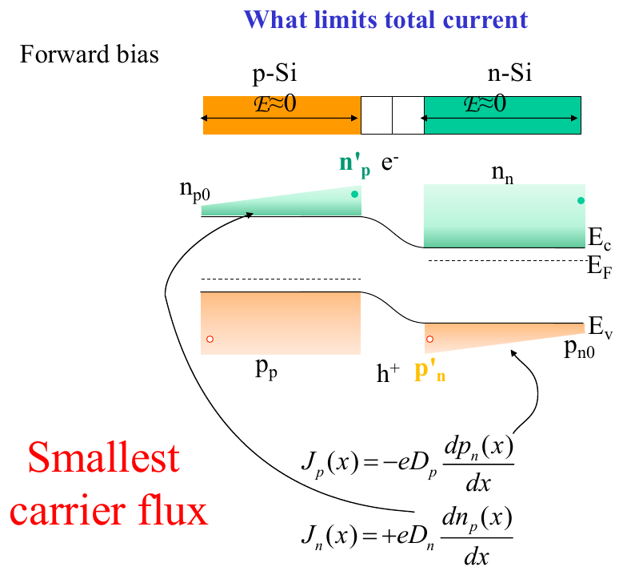
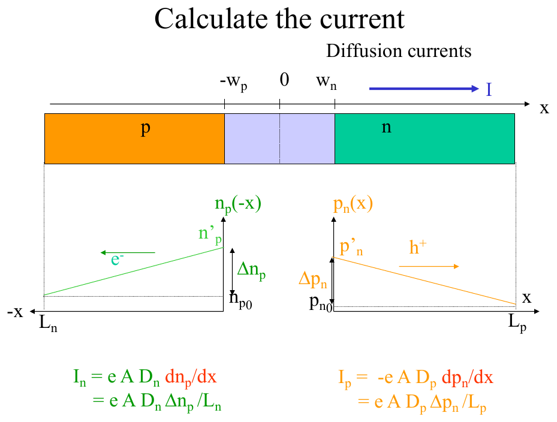
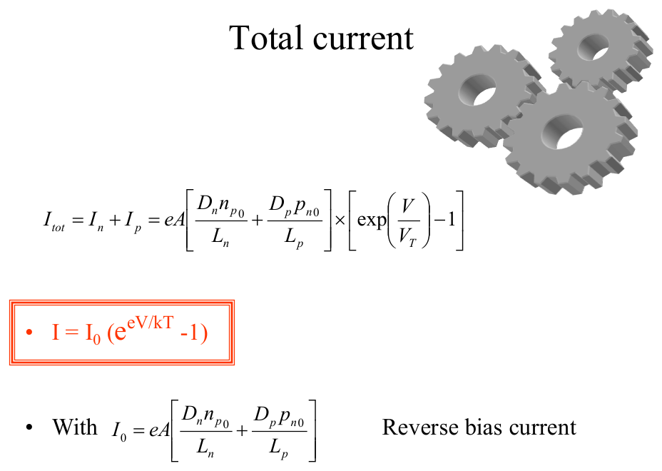
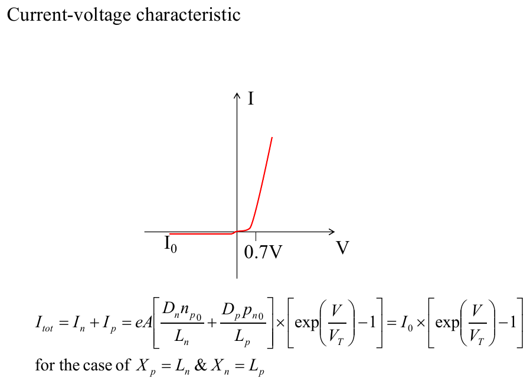
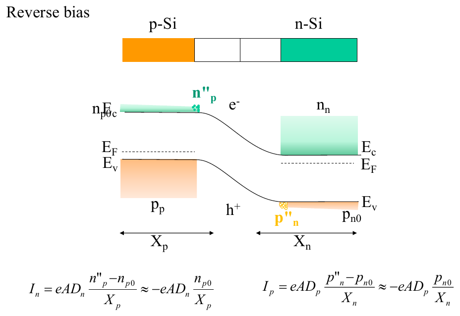

# Topic 13 — Diode current (short diode) and the I–V curve

Tutorial questions: Ch2 Q12, Q13

Slides: SSD_2, pages 66 to 73. Booklet §3.2.4 and summary (pages 53, 56).

---

## The big idea

The current in a pn diode is **minority carrier diffusion**.

Take the triangle from Topic 12. Its **slope** is the diffusion current (Topic 4 Equation 11).

$$J_n = eD_n\frac{\Delta n_p}{L_n} \qquad J_p = eD_p\frac{\Delta p_n}{L_p}$$

Add them, put in Δ = c₀(e^(V/V_T) − 1), and you get the diode equation:

$$I = I_0\left(e^{V/V_T} - 1\right)$$

---

**How to use these notes:**
When you see 🧠, stop.
Answer it on paper first.
Then click to check.

---

## 1. Why minority diffusion sets the current

**How to read this diagram:**

- In the neutral regions (outside the depletion strip) the field is ≈ 0. So there's no drift of minority carriers. They can only **diffuse**.
- The injected minority carriers form the wedges (green on the p-side, orange on the n-side). Their slope is the diffusion current.
- Red text: **"smallest carrier flux"**. The minority diffusion is the bottleneck. It sets the total current.
- The majority carriers just top up whatever the minority carries away. Their current is whatever's needed.

**Current is the same at every x** (nothing is lost in a short diode). So you can calculate it anywhere. Easiest place: in the neutral region, from the minority slope.

---

## 2. The calculation

**How to read this diagram:**

- Junction at 0. Depletion edges at −w_p and w_n.
- Green triangle on the left: electrons on the p-side, from n'_p at the edge down to n_p0 at the contact, length L_n.
- Orange triangle on the right: holes on the n-side, from p'_n down to p_n0, length L_p.
- Slope of the green line = Δn_p / L_n. Slope of the orange = Δp_n / L_p.
- The current formulas at the bottom are just e × D × slope × area A.

---

### 📐 Equation 21: diode current densities (on the formula sheet)

$$J_n = \frac{eD_n n_{p0}}{L_n}\left(e^{V/V_T} - 1\right) \qquad\qquad J_p = \frac{eD_p p_{n0}}{L_p}\left(e^{V/V_T} - 1\right)$$

| Symbol | Means | Value |
|---|---|---|
| J_n | electron current density (p-side minority) | A/cm² |
| J_p | hole current density (n-side minority) | A/cm² |
| D_n, D_p | diffusion constants | cm²/s, given in the question |
| n_p0, p_n0 | minority at zero bias | nᵢ²/N_A, nᵢ²/N_D |
| L_n, L_p | length of the p-region and n-region | cm |
| V | applied voltage, + for forward | V |
| V_T | kT/e | 0.026 V |

**What it means:**
n_p0 (e^(V/V_T) − 1) is just Δn_p, the height of the triangle. Divided by L_n is the slope. Times eD_n is the diffusion current.

**Use it when:**
Asked for the current, hole current, electron current, or total current in a diode.

**Shortcut in forward bias:** e^(V/V_T) ≫ 1, so drop the −1. And n'_p ≫ n_p0, so Δn_p ≈ n'_p. Then:

$$J_n \approx eD_n\frac{n'_p}{L_n} \qquad J_p \approx eD_p\frac{p'_n}{L_p}$$

That's what the official Q12 answer does.

---

### 🧠 Check
Which is bigger, J_n or J_p, in a diode with N_A ≪ N_D? Why?

Answer

**J_n.**

N_A small means n_p0 = nᵢ²/N_A is big. More electrons are injected into the p-side, so the electron triangle is taller, so its slope is bigger.

The lightly doped side carries the current.

---

## 3. Total current and the diode equation

Add the two:

$$I = I_n + I_p = eA\left[\frac{D_n n_{p0}}{L_n} + \frac{D_p p_{n0}}{L_p}\right]\left(e^{V/V_T} - 1\right)$$

The square bracket × eA is a constant for the diode. Call it **I₀**.

---

### 📐 Equation 22: the diode equation (NOT on the formula sheet, but it's Equation 21 added up)

$$I = I_0\left(e^{V/V_T} - 1\right) \qquad\qquad I_0 = eA\left[\frac{D_n n_{p0}}{L_n} + \frac{D_p p_{n0}}{L_p}\right]$$

| Symbol | Means |
|---|---|
| I | total diode current |
| I₀ | **saturation current**. The reverse current. Tiny, set by doping and geometry. |
| A | cross-section area of the diode |

**What it means:**
- Forward (V > 0): e^(V/V_T) is huge. I ≈ I₀ e^(V/V_T). Exponential rise.
- Reverse (V < 0): e^(V/V_T) ≈ 0. I ≈ −I₀. Flat and tiny.

**Use it when:**
Asked for the I–V curve, the reverse current, or how I changes with V.

---

**How to read this diagram:**

- Reverse side: flat at −I₀ (so close to zero you can't see it).
- Forward side: nothing much until about **0.7 V** for Si, then shoots up.
- The 0.7 V isn't a threshold in the equation. It's just where e^(V/V_T) gets big enough to notice.

---

## 4. Reverse bias current

**How to read this diagram:**

- Minority at the edge ≈ 0 (n''_p and p''_n). The triangles are flipped.
- Slope = (0 − n_p0) / X_p. Negative, and tiny because n_p0 is tiny.
- The formulas at the bottom: I_n ≈ −eAD_n n_p0 / X_p. That's −I₀. Doesn't depend on V.

---

## 5. Worked example: Tutorial Ch2 Q12

The Q9 diode (N_A = 10¹⁵, N_D = 10¹⁸, L_n = 5 × 10⁻³ cm, L_p = 8 × 10⁻³ cm) at 0.5 V forward. D_n = 35 cm²/s, D_p = 12.5 cm²/s. Find J_p, J_n, and the total. Why is J_n bigger?

**Step 1.** From Q9b: n'_p = 4.7 × 10¹³, p'_n = 4.7 × 10¹⁰. Both ≫ equilibrium, so use the shortcut.

**Step 2. Electron current (p-side):**

J_n ≈ e D_n n'_p / L_n = 1.6 × 10⁻¹⁹ × 35 × 4.7 × 10¹³ ÷ 5 × 10⁻³

J_n ≈ **5.3 × 10⁻² A/cm²**

**Step 3. Hole current (n-side):**

J_p ≈ e D_p p'_n / L_p = 1.6 × 10⁻¹⁹ × 12.5 × 4.7 × 10¹⁰ ÷ 8 × 10⁻³

J_p ≈ **1.2 × 10⁻⁵ A/cm²**

**Step 4. Why J_n > J_p?** N_A < N_D, so n'_p > p'_n. The lightly doped p-side gets far more injected electrons.

**Step 5. Total.** J = J_n + J_p ≈ **5.3 × 10⁻² A/cm²**. J_p is 4000× smaller, so J ≈ J_n.

The official answer calls this "a handy approximation for fast calculations".

---

## 6. Worked example: Tutorial Ch2 Q13

Halve the length of the n-region. What happens to the total current?

**Step 1.** The n-region carries **holes**. Halving L_p doubles the slope Δp_n / L_p.

**Step 2.** So J_p doubles: 1.2 × 10⁻⁵ → **2.4 × 10⁻⁵ A/cm²**.

**Step 3.** J_n is unchanged (the p-region didn't change).

**Step 4.** Total ≈ J_n, so **no real change**. J_p was negligible before and it's still negligible.

**Trap:** if the question had halved the **p**-region, J_n would double and the total would double.

---

### 🧠 Check
Same diode, but at 0.6 V instead of 0.5 V. By what factor does J_n go up?

Answer

e^(0.1/0.026) = e^3.85 ≈ **47×**.

Every extra 0.1 V multiplies the current by about 47. That's the exponential.

---

## Method: diode current questions

| You're asked for | Do |
|---|---|
| J_n or J_p | Topic 12 Equation 19 for n'_p, p'_n, then Equation 21 (shortcut: eD c'/L) |
| total current | add them. Usually one dominates. |
| which is bigger | the lightly doped side's minority current |
| effect of changing a length | that region's current scales as 1/L |
| effect of changing V | ×e^(ΔV/V_T) |
| reverse current | −I₀, flat |
| the I–V sketch | §3 image: flat at −I₀, then exponential from about 0.7 V |

---

Next: [End-of-topic test](../questions/13-diode-current.md)
