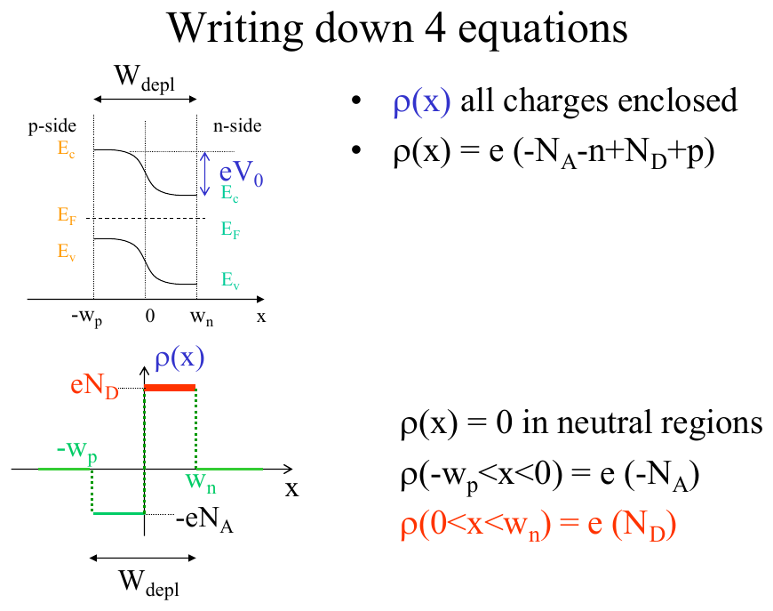
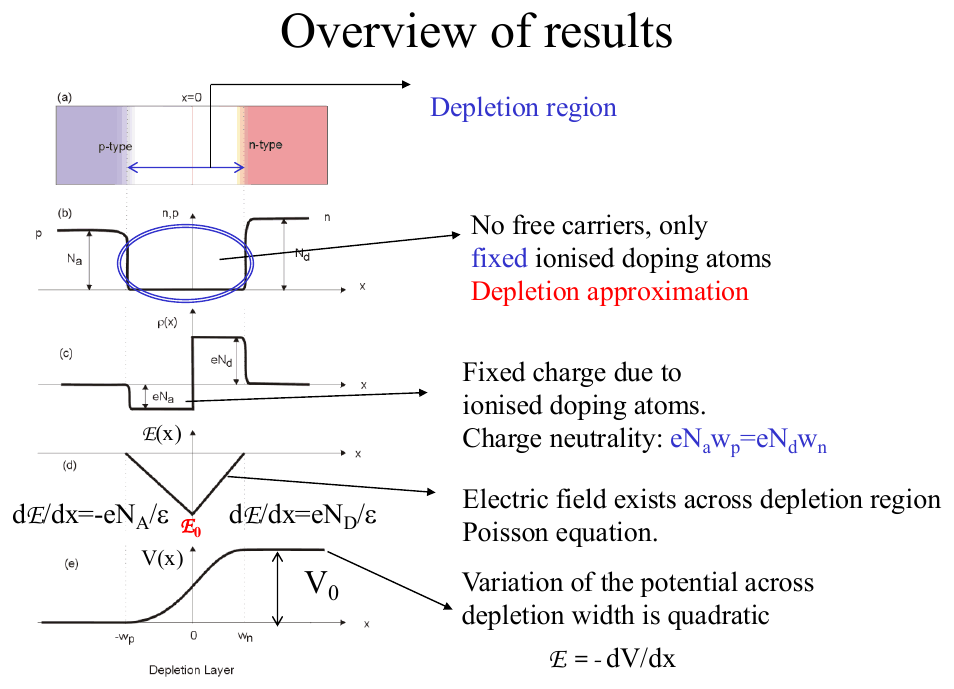
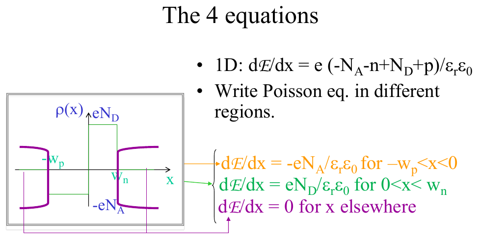
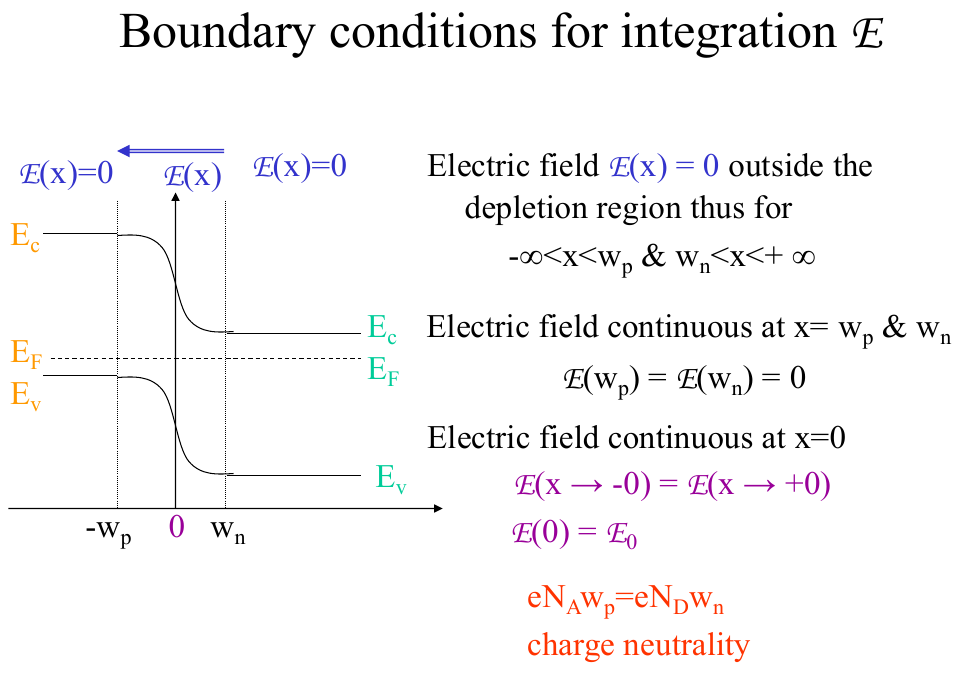
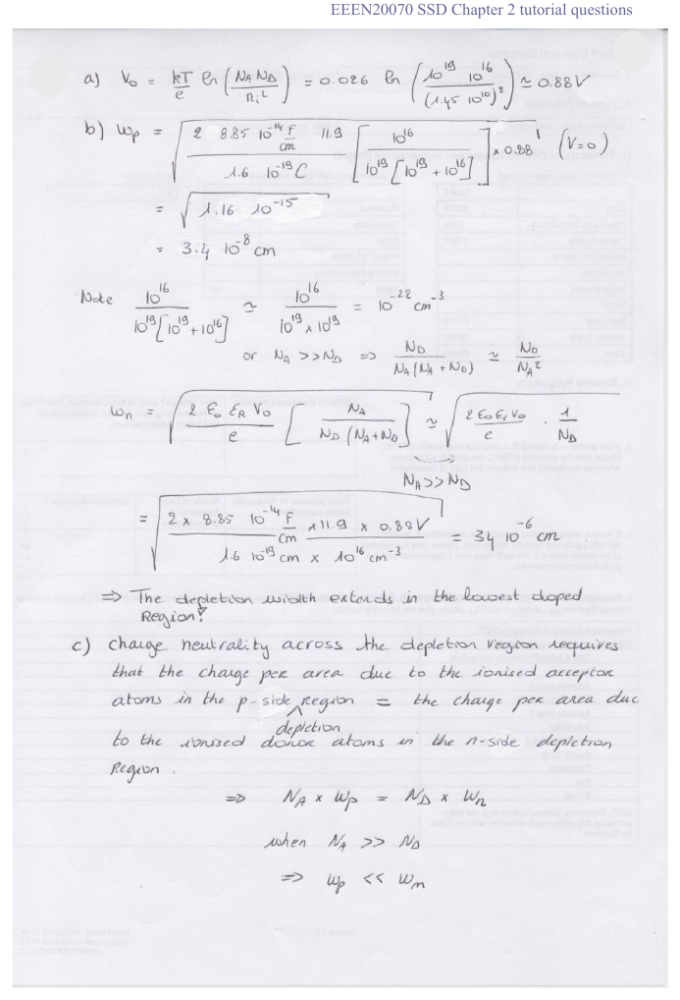
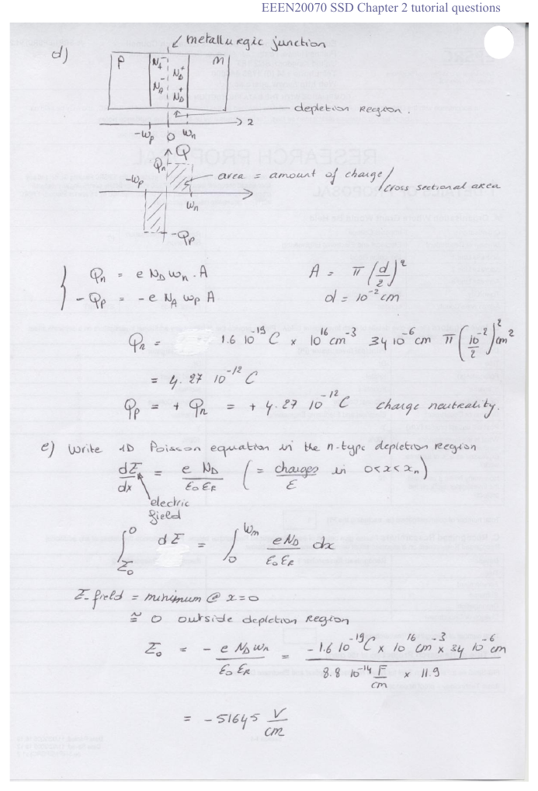

# Topic 14 — Depletion width, charge and electric field (Poisson)

Tutorial questions: Ch2 Q11 b–e

Slides: SSD_2, pages 74 to 87. Booklet §3.2.3 (pages 44 to 48).

---

## The big idea

In the depletion region there are only fixed ions (Topic 10).

- p-side: charge density **−eN_A** over a width **w_p**.
- n-side: charge density **+eN_D** over a width **w_n**.

Three facts give you everything:

1. **Charge balances:** N_A w_p = N_D w_n. So the **lightly doped side is wider**.
2. **Widths:** formula sheet, using V₀ − V.
3. **Field:** a triangle. Zero at the edges, biggest at the junction (x = 0).

---

**How to use these notes:**
When you see 🧠, stop.
Answer it on paper first.
Then click to check.

---

## 1. Why we bother

- It gives the **biggest electric field**. That's where breakdown happens.
- It gives the depletion width, which sets the diode's capacitance (speed).
- It shows the potential across the junction is a smooth quadratic curve.

---

## 2. Charge density ρ(x)

**How to read this diagram:**

- Top: the band diagram with the depletion region from −w_p to w_n. Junction at x = 0.
- Bottom: the charge density ρ(x).
  - Outside the depletion region: **ρ = 0** (neutral).
  - −w_p to 0 (p-side): **ρ = −eN_A**. A negative block.
  - 0 to w_n (n-side): **ρ = +eN_D**. A positive block.

The two blocks have **equal area**. That's charge balance.

---

### 📐 Equation 23: charge balance (NOT on the formula sheet, learn it)

$$N_A\, w_p = N_D\, w_n$$

| Symbol | Means | Units |
|---|---|---|
| N_A, N_D | doping on each side | cm⁻³ |
| w_p | depletion width into the p-side | cm |
| w_n | depletion width into the n-side | cm |

**What it means:**
The negative charge on the p-side equals the positive charge on the n-side. If N_A is 1000× bigger than N_D, then w_p is 1000× smaller than w_n.

**Use it when:**
Asked why one side is wider, or given one width and asked for the other.

---

### 🧠 Check
N_A = 10¹⁸, N_D = 10¹⁵. Which side is wider, and by how much?

Answer

**n-side**, by 10¹⁸ ÷ 10¹⁵ = **1000×**.

The depletion region extends into the lightly doped side.

---

## 3. The widths

---

### 📐 Equation 24: depletion widths (on the formula sheet)

$$w_n = \sqrt{\frac{2\varepsilon (V_0 - V)}{e}\cdot\frac{N_A}{N_D(N_A + N_D)}} \qquad\qquad w_p = \sqrt{\frac{2\varepsilon (V_0 - V)}{e}\cdot\frac{N_D}{N_A(N_A + N_D)}}$$

| Symbol | Means | Value |
|---|---|---|
| ε | ε₀ × ε_r | ε₀ = **8.85 × 10⁻¹⁴ F/cm**. ε_r = 11.9 (official answers) or 11 (formula sheet). Use what the question gives. |
| V₀ | built-in voltage | Topic 10 Equation 18 |
| V | applied voltage. **+ forward, − reverse** | V |
| e | | 1.6 × 10⁻¹⁹ C |
| N_A, N_D | | cm⁻³ |

**Units trap:** the formula sheet gives ε₀ = 8.85 × 10⁻¹² F/**m**. Doping is in cm⁻³. Use **8.85 × 10⁻¹⁴ F/cm** so you get w in cm.

**What it means:**
- Forward bias (V > 0): V₀ − V smaller, so **thinner** (Topic 11 §5).
- Reverse bias (V < 0): V₀ − V = V₀ + |V| bigger, so **wider**.
- W goes as the **square root** of the voltage.

**Total:** W = w_n + w_p.

**Shortcut when one side is much heavier** (say N_A ≫ N_D):

$$w_n \approx \sqrt{\frac{2\varepsilon (V_0 - V)}{e\,N_D}} \qquad w_p \approx 0$$

That's what the official Q11 answer does.

---

## 4. The electric field

**How to read this diagram:**

The Poisson equation (formula sheet, Topic 4) says:

$$\frac{d\mathcal{E}}{dx} = \frac{\rho(x)}{\varepsilon}$$

So the **slope** of ℰ(x) = the charge density ÷ ε. Region by region:

- −w_p < x < 0: slope = −eN_A/ε. A straight line going **down**.
- 0 < x < w_n: slope = +eN_D/ε. A straight line going **up**.
- Elsewhere: slope = 0, and ℰ = 0 (neutral).

Two straight lines meeting at x = 0. A **triangle**, pointing down (negative), deepest at x = 0.

 

**How to read this diagram:**

- ℰ = 0 outside the depletion region.
- ℰ is continuous at −w_p, at 0 and at w_n.
- At x = 0 it reaches its biggest size, **ℰ₀**.
- Bottom red text: the two sides of the triangle have to meet, which gives eN_A w_p = eN_D w_n. Charge balance again.

---

### 📐 Equation 25: peak field (NOT on the formula sheet, comes from integrating Poisson)

$$\mathcal{E}_0 = -\frac{e N_D\, w_n}{\varepsilon} = -\frac{e N_A\, w_p}{\varepsilon}$$

| Symbol | Means | Units |
|---|---|---|
| ℰ₀ | field at x = 0, the biggest (most negative) | V/cm |
| the minus sign | the field points from n to p, so in the −x direction | |

**What it means:**
Integrate the n-side slope from w_n (where ℰ = 0) back to 0: ℰ drops by eN_D w_n / ε.

**Use it when:**
Asked for the maximum field, the "minimum" field (the most negative), or the field at the junction.

---

### 🧠 Check
Where in the diode is the field strongest, and which way does it point?

Answer

At the junction, x = 0.

It points from n to p (from + ions to − ions), so in the −x direction. That's why it's negative.

---

## 5. The charge

The charge on one side = charge density × volume.

---

### 📐 Equation 26: depletion charge (NOT on the formula sheet, just ρ × volume)

$$Q_n = e N_D\, w_n\, A \qquad\qquad Q_p = -e N_A\, w_p\, A = -Q_n$$

| Symbol | Means | Units |
|---|---|---|
| Q_n | positive charge on the n-side | C |
| Q_p | negative charge on the p-side | C |
| A | diode area. For a circle of diameter d: A = π(d/2)² | cm² |

---

## 6. Worked example: Tutorial Ch2 Q11

pn diode, diameter 100 µm. N_A = 10¹⁹, N_D = 10¹⁶ cm⁻³. T = 300 K. ε_r = 11.9.

**a. V₀** (Topic 10): V₀ = 0.026 × ln(10³⁵ ÷ 2.1 × 10²⁰) = **0.88 V**

**b. Widths at V = 0.**

N_A ≫ N_D, so use the shortcut for w_n:

w_n = √(2 × 8.85 × 10⁻¹⁴ × 11.9 × 0.88 ÷ (1.6 × 10⁻¹⁹ × 10¹⁶))

w_n = √(1.16 × 10⁻⁹) = **3.4 × 10⁻⁵ cm** (0.34 µm)

w_p from charge balance: w_p = w_n × N_D / N_A = 3.4 × 10⁻⁵ × 10⁻³ = **3.4 × 10⁻⁸ cm**

**c. Why is w_n bigger?** Charge balance: N_A w_p = N_D w_n. N_A ≫ N_D, so w_p ≪ w_n. The depletion region extends into the **lightly doped** side.

**d. Charge.**

A = π × (50 × 10⁻⁴ cm)² = 7.85 × 10⁻⁵ cm²

Q_n = 1.6 × 10⁻¹⁹ × 10¹⁶ × 3.4 × 10⁻⁵ × 7.85 × 10⁻⁵ = **4.3 × 10⁻¹² C**

Q_p = **−4.3 × 10⁻¹² C**

**e. Minimum (peak) field.**

ℰ₀ = −eN_D w_n / ε = −1.6 × 10⁻¹⁹ × 10¹⁶ × 3.4 × 10⁻⁵ ÷ (8.85 × 10⁻¹⁴ × 11.9)

ℰ₀ ≈ **−5.2 × 10⁴ V/cm**

"Minimum" because it's the most negative value.

**Official answer:**

**How to read these:**
- First page: V₀ and both widths, then the reasoning for c.
- Second page: the sketch of ρ(x) with the shaded charge blocks, Q from ρ × w × A, then integrating Poisson from x = 0 to w_n to get ℰ₀ ≈ −51 645 V/cm.

---

## Drawing checklist: depletion region

1. **ρ(x):** negative block −eN_A from −w_p to 0. Positive block +eN_D from 0 to w_n. Equal areas. Lightly doped side wider and shorter.
2. **ℰ(x):** zero outside. Straight lines down from −w_p to x = 0, then back up to zero at w_n. A V-shaped triangle. Deepest point ℰ₀ at x = 0.
3. **V(x):** a smooth S-curve rising by V₀ from p to n. (It's the integral of a triangle, so it's two parabolas.)

---

## Method: depletion questions

| You're asked for | Use |
|---|---|
| V₀ | Topic 10 Equation 18 |
| w_n and w_p | Equation 24, or shortcut + Equation 23 |
| why one side is wider | Equation 23: lightly doped side is wider |
| charge | Equation 26 |
| max field | Equation 25 |
| effect of bias on W | V₀ − V: forward thinner, reverse wider, as √ |
| sketch ρ, ℰ, V | checklist above |

---

Next: [End-of-topic test](../questions/14-depletion-width.md)
