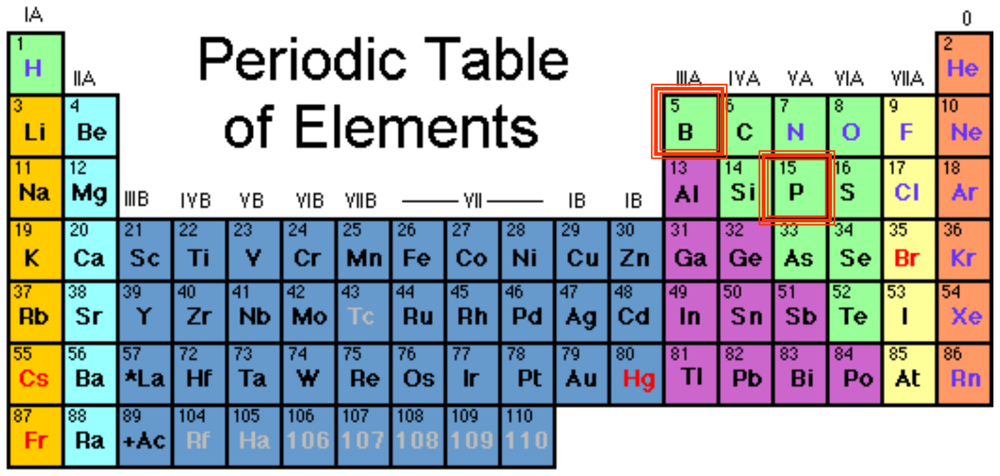

# Periodic table

From slide 51 of SSD_1.

The red boxes show the elements this module uses.

---

## The only part you need

| Group | Outer electrons | Elements | Role in Si |
|---|---|---|---|
| III | 3 | B, Al | acceptor, makes **p-type** |
| IV | 4 | C, **Si**, Ge | the semiconductor itself |
| V | 5 | P, As | donor, makes **n-type** |

 

**Rule:**
Same column = same number of outer electrons.

 

**Memory trick:**
**P**hosphorus has **P**lenty → n-type.
**B**oron is **B**roke → p-type.

 

See [Topic 1, §1 and §6](notes/01-bond-model.md).
