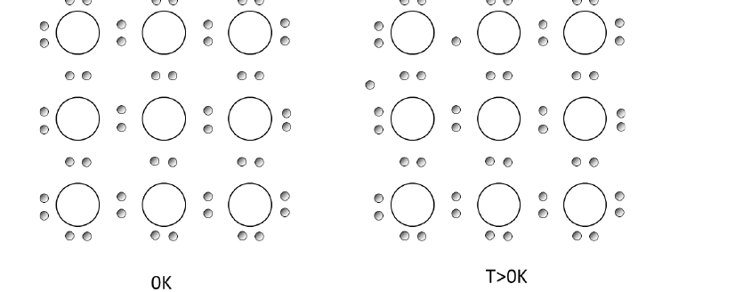
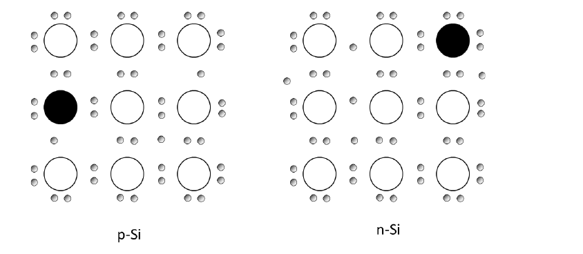

# Topic 1 — End-of-topic test

Try each question first.
Then click to check.

Each answer says which notes section (§) it comes from.

---

## Part A: Tutorial questions

### Q1 (Tutorial Ch1 Q1)

Sketch a 2D lattice of 9 Si atoms with their outer electrons at **0 K**.

How does it change at **300 K**?

Answer

**At 0 K:**
Every electron is locked in a bond.
No free carriers.
It is an insulator.

**At 300 K:**
A few bonds break.
Each break gives 1 free electron and 1 hole.

**Official answer sketch:**

From: §2, §3

---

### Q2 (Tutorial Ch1 Q2)

Repeat the 300 K sketch for:
1. p-type Si
2. n-type Si

Answer

**p-type:**
Put a B atom in the lattice.
B has 3 outer electrons.
One bond is missing an electron.
That gap is a hole.

**n-type:**
Put a P atom in the lattice.
P has 5 outer electrons.
4 bond, 1 is spare.
The spare one is a free electron.

**Official answer sketch:**
The black circle is the dopant atom.

From: §6

---

### Q3 (Tutorial Ch1 Q3)

Holes in semiconductors are:

1. Gaps in the lattice where an atom is missing
2. Positive carriers that can move freely through the lattice at 300 K
3. Protons in the nucleus

Answer

**Answer 2.**

A hole is a missing bond electron.
It is not a missing atom.
It is not a proton.

From: §4

---

## Part B: Midterm-style questions

These are in different formats from the tutorial.

---

### M1: True or false

1. At 0 K, pure Si is a good conductor.
2. A hole is a gap where a Si atom is missing.
3. In pure Si, n = p.
4. The donor ion in n-type Si can move and carry current.
5. Arsenic (group V) makes p-type Si.

Answer

1. **False.** No free carriers at 0 K. It is an insulator. (§3)
2. **False.** It is a missing bond electron. (§4)
3. **True.** Each broken bond makes one of each. (§5)
4. **False.** P⁺ is fixed in the lattice. (§6)
5. **False.** Group V has 5 outer electrons, so As makes n-type. (§1, §6)

---

### M2: Multiple choice

Silicon is doped with aluminium (group III).
The material is:

- A. n-type, with Al⁺ ions
- B. p-type, with Al⁻ ions
- C. p-type, with Al⁺ ions
- D. pure (intrinsic)

Answer

**B.**

Group III has 3 outer electrons.
One bond is missing an electron, so a hole forms.
That makes p-type.

Al takes an electron to finish its bond.
So it becomes Al⁻.

From: §1, §6

---

### M3: Explain

Why does a semiconductor's resistance go down when it heats up?

Why does a metal's resistance go up?

Answer

**Semiconductor:**
Heat breaks bonds.
Each break makes a free electron and a hole.
More carriers, so lower resistance.

**Metal:**
The number of carriers is already fixed.
Heat only makes the carriers bump into atoms more.
So resistance goes up.

From: §3

---

### M4: Calculation

Pure Si at a higher temperature has n = 10¹² cm⁻³.

Find p.

Find n × p.

Answer

It is pure, so use Equation 1:

p = n = **10¹² cm⁻³**

Then:

n × p = 10¹² × 10¹² = **10²⁴ cm⁻⁶**

From: §5

---

### M5: Sketch and label

Draw one lattice that shows:
- a thermal electron-hole pair
- a donor atom

Label every carrier and ion.

Answer

Draw the 3 × 3 grid of Si atoms.

**Donor:**
Make one atom P⁺.
Put a loose dot next to it.
Label it "free electron from donor".

**Thermal pair:**
Somewhere else, pull one dot out of a bond.
Label it "free electron".
Draw an empty circle where it was.
Label it "h⁺".

From: §3, §4, §6, and the drawing checklist at the end of the notes

