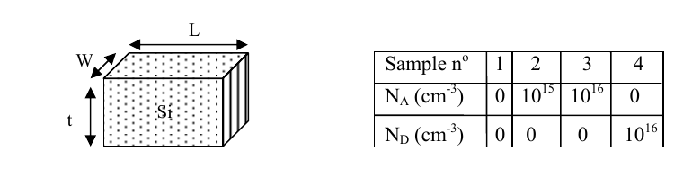

# Topic 3 — End-of-topic test

Try each question first.
Then click to check.

Each answer says which notes section (§) it comes from.

e = 1.6 × 10⁻¹⁹ C. nᵢ = 1.45 × 10¹⁰ cm⁻³.

---

## Part A: Tutorial questions

### Q6 (Tutorial Ch1 Q6)

The mobility of electrons and holes in Si depends on the doping concentration.

Explain why.

Answer

Mobility is

$$\mu = \frac{e\,\tau}{m}$$

where τ is the average time between scattering events.

Dopant atoms break up the regular pattern of the lattice.

So carriers scatter more often.

So τ goes down, and μ goes down.

From: §3

---

### Q7 (Tutorial Ch1 Q7)

Four Si resistors have the shape below. Only the doping changes.

W = 1 μm, t = 500 nm, L = 5 × 10⁻⁶ m.

Use the mobility graph in §4 of the notes.

1. Find the conductivity σ of each sample.
2. Find the resistance of each sample.

Answer

**Part 1: conductivity**

 

**Sample 1: intrinsic.** n = p = nᵢ. Keep both terms. Read μₙ = 1400, μₚ = 500.

σ = e nᵢ (μₙ + μₚ)

σ = 1.6 × 10⁻¹⁹ × 1.45 × 10¹⁰ × (1400 + 500)

σ = **4.41 × 10⁻⁶ (Ω·cm)⁻¹**

 

**Sample 2: p-type, N_A = 10¹⁵.** p = 10¹⁵. Read μₚ = 500.

σ ≈ e p μₚ = 1.6 × 10⁻¹⁹ × 10¹⁵ × 500

σ = **0.08 (Ω·cm)⁻¹**

 

**Sample 3: p-type, N_A = 10¹⁶.** p = 10¹⁶. Read μₚ = 400.

σ ≈ 1.6 × 10⁻¹⁹ × 10¹⁶ × 400

σ = **0.64 (Ω·cm)⁻¹**

 

**Sample 4: n-type, N_D = 10¹⁶.** n = 10¹⁶. Read μₙ = 1200.

σ ≈ 1.6 × 10⁻¹⁹ × 10¹⁶ × 1200

σ = **1.92 (Ω·cm)⁻¹**

 

**Order:** σ₁ < σ₂ < σ₃ < σ₄

Samples 3 and 4 have the same doping, but 4 wins because electrons are more mobile than holes.

 

**Part 2: resistance**

Convert to cm:
- W = 1 μm = 10⁻⁴ cm
- t = 500 nm = 5 × 10⁻⁵ cm
- L = 5 × 10⁻⁶ m = 5 × 10⁻⁴ cm

Area the current flows through: A = t × W = 5 × 10⁻⁵ × 10⁻⁴ = 5 × 10⁻⁹ cm²

$$R = \frac{L}{\sigma A} = \frac{5\times10^{-4}}{5\times10^{-9}} \times \frac{1}{\sigma} = \frac{10^5}{\sigma}$$

| Sample | σ | R = 10⁵ ÷ σ |
|---|---|---|
| 1 | 4.41 × 10⁻⁶ | **≈ 2 × 10¹⁰ Ω** |
| 2 | 0.08 | **≈ 1.3 × 10⁶ Ω** |
| 3 | 0.64 | **≈ 1.6 × 10⁵ Ω** |
| 4 | 1.92 | **≈ 5 × 10⁴ Ω** |

These match the official answers.

From: §4, §6, §7, and the method at the end of the notes

---

## Part B: Midterm-style questions

---

### M1: True or false

1. With no voltage applied, electrons in Si stand still.
2. Electrons drift in the same direction as the electric field.
3. Electron current and hole current add together.
4. More doping gives higher mobility.
5. In n-type Si, you can usually ignore the holes when finding σ.

Answer

1. **False.** They move randomly, but go nowhere on average. (§2)
2. **False.** Electrons are negative, so they move against E. (§5)
3. **True.** Both currents point along E. (§5)
4. **False.** More doping means more scattering, so lower mobility. (§3)
5. **True.** Holes are the minority carrier, so there are very few. (§6)

---

### M2: Multiple choice

Which sample conducts best?

- A. Intrinsic Si
- B. p-type, N_A = 10¹⁶ cm⁻³
- C. n-type, N_D = 10¹⁶ cm⁻³
- D. B and C are equal

Answer

**C.**

B and C have the same number of carriers.

But electrons have higher mobility than holes (1200 vs 400).

So the n-type sample conducts better.

From: §3, §4, §6

---

### M3: Calculation

n-type Si has N_D = 10¹⁸ cm⁻³. At this doping, μₙ = 300 cm²/(V·s).

1. Find σ.
2. Find the resistivity ρ.

Answer

**1.**
n = N_D = 10¹⁸

σ ≈ e n μₙ = 1.6 × 10⁻¹⁹ × 10¹⁸ × 300

σ = **48 (Ω·cm)⁻¹**

**2.**
ρ = 1 ÷ σ = 1 ÷ 48

ρ ≈ **0.021 Ω·cm**

From: §6, Equations 8 and 9

---

### M4: Current from a voltage

A p-type bar has σ = 0.64 (Ω·cm)⁻¹.

It is L = 0.1 cm long, with a cross-section of A = 10⁻⁴ cm².

1 V is applied across its length.

Find the current.

Answer

**Method 1: through J**

E = V ÷ L = 1 ÷ 0.1 = 10 V/cm

J = σ E = 0.64 × 10 = 6.4 A/cm²

I = J × A = 6.4 × 10⁻⁴ = **6.4 × 10⁻⁴ A**

 

**Method 2: through R** (same answer)

R = L ÷ (σ A) = 0.1 ÷ (0.64 × 10⁻⁴) ≈ 1560 Ω

I = V ÷ R = 1 ÷ 1560 = **6.4 × 10⁻⁴ A**

From: §3 (E = V/L), §6, Equations 9 and 10

---

### M5: Drift velocity

Electrons with μₙ = 1200 cm²/(V·s) are in a field of 10 V/cm.

Find their drift velocity.

Answer

v = μ E = 1200 × 10

v = **1.2 × 10⁴ cm/s**

From: §3, Equation 6

---

### M6: Explain

An electric field points to the right in a piece of Si.

Explain the direction electrons and holes move, and the direction of each current.

Answer

Holes are positive, so they move right, with E. Hole current points right.

Electrons are negative, so they move left, against E.

Moving negative charge left is the same as current to the right. So electron current also points right.

Both currents point the same way, so they add.

From: §5

