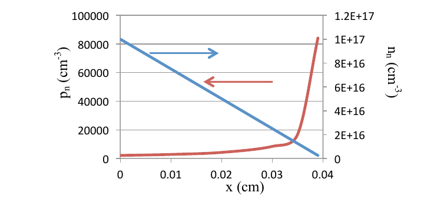

# Topic 4 — End-of-topic test

Try each question first.
Then click to check.

Each answer says which notes section (§) it comes from.

e = 1.6 × 10⁻¹⁹ C. kT/e = 0.026 V. nᵢ = 1.45 × 10¹⁰ cm⁻³.

---

## Part A: Tutorial questions

### Q8 (Tutorial Ch1 Q8)

In an n-Si layer at 300 K, the electron concentration falls in a straight line from 10¹⁸ cm⁻³ to 7 × 10¹⁷ cm⁻³ over 0.10 cm.

Dₙ = 50 cm²/s.

Find the diffusion current density.

Answer

**Step 1: gradient** (straight line)

Change in n = 10¹⁸ − 7 × 10¹⁷ = 3 × 10¹⁷ cm⁻³

Slope size = 3 × 10¹⁷ ÷ 0.1 = 3 × 10¹⁸ cm⁻⁴

**Step 2: equation for electrons**

Jₙ = e Dₙ dn/dx

**Step 3: multiply**

Jₙ = 1.6 × 10⁻¹⁹ × 50 × 3 × 10¹⁸

Jₙ = **24 A/cm²**

**Direction:** electrons flow towards the low end. Current points the other way, back towards the high end.

This matches the official answer.

From: §2, Equation 11

---

### Q9 (Tutorial Ch1 Q9)

n-type Si is 0.04 cm long. Its doping changes along x:

$$N(x) = 10^{17} - 2.5\times10^{18}\,x$$

(N in cm⁻³, x in cm)

1. Sketch how the electron and hole concentrations change along the layer, with no bias.
2. Derive the internal electric field. Your answer should only contain constants and x.
3. Draw the direction of the field.

Answer

**1. Sketch**

n-type, so the electrons follow the doping:

nₙ(x) ≈ N(x), which is a straight line falling from 10¹⁷.

Holes from mass action:

pₙ(x) = nᵢ² ÷ N(x)

As N falls, the holes rise. Near the end, N gets very small, so the holes shoot up.

**Official answer sketch:**

**How to read it:** the blue straight line is electrons, nₙ (right-hand axis). The red curve is holes, pₙ (left-hand axis). Each arrow points to the axis that line uses.

From: Topic 2 §3, §6 of these notes

 

**2. Field**

No bias and open circuit, so no current: Jₙ = 0

$$e\mu_n n E + eD_n\frac{dn}{dx} = 0$$

Rearrange:

$$E = -\frac{D_n}{\mu_n}\,\frac{1}{n}\,\frac{dn}{dx}$$

Einstein relation, D/μ = kT/e:

$$E = -\frac{kT}{e}\,\frac{1}{n}\,\frac{dn}{dx}$$

Put in n = N(x). Its slope is dn/dx = −2.5 × 10¹⁸.

$$E(x) = -0.026 \times \frac{-2.5\times10^{18}}{10^{17} - 2.5\times10^{18}x}$$

$$E(x) = \frac{0.065}{0.1 - 2.5x} \;\text{V/cm}$$

(To get the tidy form, divide the top and bottom by 10¹⁸.)

From: §5, §7

 

**3. Direction**

Doping is high on the left and low on the right.

Electrons diffuse right.

The field must push them back left.

Electrons move against E, so **E points right**, in the +x direction.

This matches the positive answer from Part 2.

From: §7

---

## Part B: Midterm-style questions

---

### M1: True or false

1. Diffusion current needs a voltage.
2. A bigger concentration always gives a bigger diffusion current.
3. Drift current is mostly carried by majority carriers.
4. In a short sample, injected minority carriers fall off in a straight line.
5. Electron diffusion current points the same way the electrons flow.

Answer

1. **False.** It only needs a gradient. (§1)
2. **False.** Only the slope matters, not the size. (§1)
3. **True.** (§4)
4. **True.** (§6)
5. **False.** Electrons are negative, so their current is opposite to their flow. (§2)

---

### M2: Multiple choice

Which equation links mobility and diffusion coefficient?

- A. σ = e n μ
- B. D = (kT/e) μ
- C. v = μ E
- D. n × p = nᵢ²

Answer

**B.** The Einstein relation.

From: §5

---

### M3: Hole diffusion current

In n-type Si, the hole concentration falls in a straight line from 10¹⁴ cm⁻³ to 0 over 10⁻³ cm.

Dₚ = 12 cm²/s.

Find the size and direction of the hole diffusion current.

Answer

**Gradient:**
Slope size = 10¹⁴ ÷ 10⁻³ = 10¹⁷ cm⁻⁴

**Size:**
Jₚ = e Dₚ × slope

Jₚ = 1.6 × 10⁻¹⁹ × 12 × 10¹⁷

Jₚ = **0.19 A/cm²**

**Direction:**
Holes flow from high to low, in the +x direction.
Holes are +, so the current is also in +x.

From: §2, Equation 11

---

### M4: Einstein relation

Holes in Si have μₚ = 500 cm²/(V·s).

Find Dₚ at 300 K.

Answer

Dₚ = (kT/e) × μₚ = 0.026 × 500

Dₚ = **13 cm²/s**

From: §5, Equation 12

---

### M5: Built-in field

In n-type Si, the doping falls in a straight line from 10¹⁷ cm⁻³ at x = 0 to 5 × 10¹⁶ cm⁻³ at x = 0.01 cm.

Find the size of the built-in field at x = 0.

Answer

**Slope:**
dn/dx = (5 × 10¹⁶ − 10¹⁷) ÷ 0.01 = −5 × 10¹⁸ cm⁻⁴

**At x = 0:** n = 10¹⁷

$$E = -\frac{kT}{e}\,\frac{1}{n}\,\frac{dn}{dx}$$

E = −0.026 × (−5 × 10¹⁸) ÷ 10¹⁷

E = 0.026 × 50

E = **1.3 V/cm**, pointing in +x (towards low doping)

From: §7

---

### M6: Explain

Explain the difference between drift current and diffusion current.

Say what causes each one and which carrier usually carries it.

Answer

**Drift:**
Caused by an electric field.
Depends on how many carriers there are.
Mostly majority carriers.

**Diffusion:**
Caused by a concentration gradient.
Depends on how steep the gradient is.
Mostly minority carriers.

From: §4

