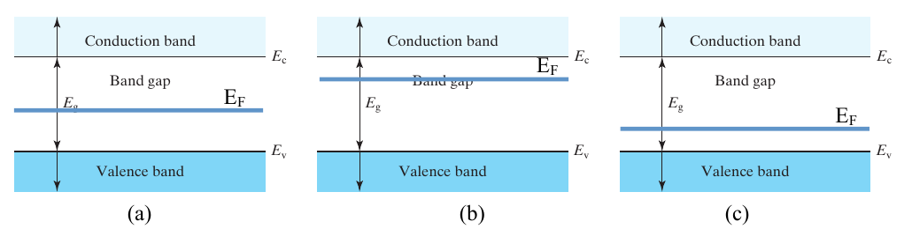
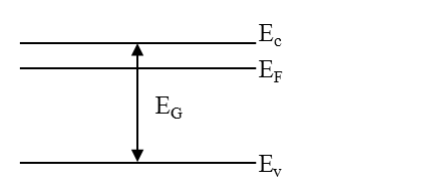

# Topic 5 — End-of-topic test

Try each question first.
Then click to check.

Each answer says which notes section (§) it comes from.

kT = 0.026 eV at 300 K. k = 8.62 × 10⁻⁵ eV/K. N_C = 3.2 × 10¹⁹ cm⁻³. N_V = 1.8 × 10¹⁹ cm⁻³. E_G = 1.12 eV. nᵢ = 1.45 × 10¹⁰ cm⁻³.

---

## Part A: Tutorial questions

### Q10 (Tutorial Ch1 Q10)

A material has its Fermi level at 6.25 eV.

At what temperature is there a 1% chance that a state 0.3 eV **below** the Fermi level is **empty**?

Answer

**Step 1: set up**

Probability empty = 1 − f(E) = 0.01

So f(E) = 0.99

E − E_F = −0.3 eV (below E_F)

**Step 2: put into f(E)**

$$0.99 = \frac{1}{1 + e^{-0.3/kT}}$$

**Step 3: solve**

$$1 + e^{-0.3/kT} = \frac{1}{0.99} = 1.0101$$

$$e^{-0.3/kT} = 0.0101$$

−0.3 ÷ kT = ln(0.0101) = −4.595

kT = 0.3 ÷ 4.595 = 0.0653 eV

**Step 4: temperature**

T = kT ÷ k = 0.0653 ÷ (8.62 × 10⁻⁵)

T ≈ **757 K** (about 484 °C)

The official answer gives 756 K. The small difference is just rounding.

From: §4, Equation 13

---

### Q11 (Tutorial Ch1 Q11)

What is the probability of finding an electron at E = E_F in each of these three cases?

Answer

**½ in all three.**

f(E_F) = ½ always. That's what defines the Fermi level.

It doesn't matter where E_F sits in the gap.

From: §4

---

### Q12 (Tutorial Ch1 Q12)

Draw the energy band diagram (E_C, E_V, E_F, E_G) of n-type Si.

Answer

n-type, so E_F goes near the top, just below E_C.

**Official answer sketch:**

From: §5, drawing checklist

---

### Q13 (Tutorial Ch1 Q13)

E_i is the Fermi level of intrinsic material.

Use this to write n in terms of nᵢ and E_F − E_i. Do the same for p.

Answer

Start with the formula sheet:

$$n = N_C\, e^{-(E_C - E_F)/kT}$$

For intrinsic Si, E_F = E_i and n = nᵢ:

$$n_i = N_C\, e^{-(E_C - E_i)/kT}$$

Divide the first by the second. N_C cancels:

$$\frac{n}{n_i} = e^{(E_F - E_i)/kT} \quad\Rightarrow\quad n = n_i\, e^{(E_F - E_i)/kT}$$

Same for holes, starting from:

$$p = N_V\, e^{-(E_F - E_V)/kT}$$

You get:

$$p = n_i\, e^{(E_i - E_F)/kT}$$

From: §7

---

### Q14 (Tutorial Ch1 Q14)

Sketch the band diagram for n-type Si and include E_i.

Answer

E_i dashed in the middle. E_F above it, closer to E_C.

**Official answer sketch:**

From: §7, drawing checklist

---

### Q15 (Tutorial Ch1 Q15)

Derive the position of E_i in terms of the band gap.

Answer

**Step 1.** Intrinsic means n = p, with E_F = E_i:

$$N_C\, e^{-(E_C - E_i)/kT} = N_V\, e^{-(E_i - E_V)/kT}$$

**Step 2.** Rearrange:

$$\frac{N_V}{N_C} = e^{(-E_C + 2E_i - E_V)/kT}$$

**Step 3.** Take E_V = 0, so E_C = E_G:

$$\frac{N_V}{N_C} = e^{(2E_i - E_G)/kT}$$

**Step 4.** Take logs and solve:

$$E_i = \frac{E_G}{2} + \frac{kT}{2}\ln\!\left(\frac{N_V}{N_C}\right)$$

**Numbers:** E_i ≈ 0.56 − 0.0075 ≈ **0.55 eV** above E_V, just below midgap.

From: §7

---

## Part B: Midterm-style questions

---

### M1: True or false

1. Electrons can sit inside the band gap.
2. In p-type Si, E_F is close to E_V.
3. f(E_F) = ½ only at room temperature.
4. E_i is almost exactly in the middle of the gap.
5. The closer E_F is to E_C, the more electrons there are.

Answer

1. **False.** There are no allowed energies in the gap. (§1)
2. **True.** (§5)
3. **False.** It's ½ at every temperature. (§4)
4. **True.** Just below the middle. (§7)
5. **True.** (§6)

---

### M2: Multiple choice

On a band diagram, E_F sits exactly on E_i. The material is:

- A. n-type
- B. p-type
- C. intrinsic
- D. a metal

Answer

**C.**

E_i is defined as the Fermi level of pure Si. If E_F = E_i, then n = p = nᵢ.

From: §5, §7

---

### M3: Find n from E_F

In Si at 300 K, E_F is 0.2 eV below E_C.

Find n.

Answer

$$n = N_C\, e^{-(E_C - E_F)/kT}$$

$$n = 3.2\times10^{19} \times e^{-0.2/0.026}$$

$$n = 3.2\times10^{19} \times e^{-7.69}$$

n = 3.2 × 10¹⁹ × 4.6 × 10⁻⁴

n ≈ **1.5 × 10¹⁶ cm⁻³**

From: §6, Equation 14

---

### M4: Place E_F

Si is doped with N_D = 10¹⁷ cm⁻³.

How far below E_C is the Fermi level?

Answer

n = N_D = 10¹⁷

E_C − E_F = kT ln(N_C ÷ n)

E_C − E_F = 0.026 × ln(3.2 × 10¹⁹ ÷ 10¹⁷)

E_C − E_F = 0.026 × ln(320)

E_C − E_F = 0.026 × 5.77 = **0.15 eV**

From: Topic 2 §3, then §6 (flipped Equation 14)

---

### M5: Probability empty

At 300 K, what is the chance that a state 0.05 eV below E_F is empty?

Answer

E − E_F = −0.05

(E − E_F) ÷ kT = −0.05 ÷ 0.026 = −1.92

$$e^{-1.92} = 0.146$$

f = 1 ÷ (1 + 0.146) = 0.873

Empty = 1 − f = **0.127**, so about 13%

From: §4, Equation 13

---

### M6: Explain

Explain why E_F moves towards E_C when Si is doped n-type.

Answer

n-type doping adds lots of electrons to the conduction band.

From

$$n = N_C\, e^{-(E_C - E_F)/kT}$$

a bigger n needs a smaller gap E_C − E_F.

So E_F must move up, closer to E_C.

From: §5, §6

---

### M7: Sketch

Sketch band diagrams for intrinsic, n-type and p-type Si side by side. Label E_C, E_V, E_i and E_F on each.

Answer

Each diagram has E_C at the top, E_V at the bottom and E_i dashed in the middle.

- **Intrinsic:** E_F on top of E_i.
- **n-type:** E_F between E_i and E_C.
- **p-type:** E_F between E_V and E_i.

Compare with the slide image in §5 of the notes.

From: §5, drawing checklist

