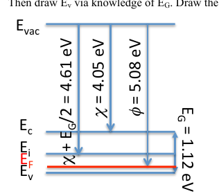
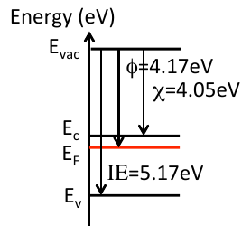

# Topic 6 — End-of-topic test

Try each question first.
Then click to check.

Each answer says which notes section (§) it comes from.

χ = 4.05 eV for Si. E_G = 1.12 eV. kT = 0.026 eV. N_C = 3.2 × 10¹⁹ cm⁻³. N_V = 1.8 × 10¹⁹ cm⁻³. nᵢ² ≈ 2.1 × 10²⁰ cm⁻⁶.

---

## Part A: Tutorial questions

### Q16 (Tutorial Ch1 Q16)

Calculate the doping density if the workfunction of a Si sample is φ = 5.08 eV.

Answer

**Step 1. Draw it first.** E_vac, then E_C (4.05 below), then E_V (1.12 further down), then E_F (5.08 below E_vac).

**Official sketch:**

**Step 2. Which type?**
χ + E_G/2 = 4.05 + 0.56 = 4.61 eV is midgap.
φ = 5.08 is bigger, so E_F is **below** midgap. So **p-type**.

**Step 3. How far is E_F above E_V?**

E_F − E_V = (χ + E_G) − φ = 4.05 + 1.12 − 5.08 = **0.09 eV**

**Step 4. Holes from the formula sheet:**

$$p = N_V\, e^{-(E_F - E_V)/kT} = 1.8\times10^{19} \times e^{-0.09/0.026}$$

p = 1.8 × 10¹⁹ × 0.0314 = **5.65 × 10¹⁷ cm⁻³**

So **N_A = 5.65 × 10¹⁷ cm⁻³**.

From: §1, §2, Equation 16, then Topic 5 Equation 14

---

### Q1 (Tutorial Ch2 Q1)

χ = 4.05 eV. Si is doped with P, N_D = 3 × 10¹⁷ cm⁻³.
Plot E_C, E_V, E_F, χ and φ with respect to E_vac.

Answer

E_C − E_F = 0.026 × ln(3.2 × 10¹⁹ ÷ 3 × 10¹⁷) = **0.12 eV**

φ = 4.05 + 0.12 = **4.17 eV**

From: §3 (the worked example)

---

## Part B: Midterm-style questions

---

### M1: True or false

1. χ changes when you dope the silicon.
2. φ changes when you dope the silicon.
3. For a metal, φ = χ.
4. p-type Si has a bigger φ than n-type Si.
5. E_vac is the top of the conduction band.

Answer

1. **False.** χ goes to E_C, which doesn't move. (§1)
2. **True.** φ goes to E_F, which moves with doping. (§1)
3. **True.** No gap in a metal. (§1)
4. **True.** E_F is lower in p-type, so further from E_vac. (§1)
5. **False.** E_vac is the energy of an electron pulled out of the material. It's above E_C by χ. (§1)

---

### M2: Multiple choice

Si with χ = 4.05 eV has φ = 4.30 eV. The material is:

- A. intrinsic
- B. n-type
- C. p-type
- D. a metal

Answer

**B.**

E_C − E_F = 4.30 − 4.05 = 0.25 eV. Midgap would be 0.56 eV.
E_F is in the top half, so n-type.

From: §1, §2

---

### M3: Reverse question

n-type Si has N_D = 10¹⁶ cm⁻³. Find φ.

Answer

E_C − E_F = 0.026 × ln(3.2 × 10¹⁹ ÷ 10¹⁶) = 0.026 × ln(3200) = 0.026 × 8.07 = **0.21 eV**

φ = 4.05 + 0.21 = **4.26 eV**

From: §2, Equation 16

---

### M4: Sketch

Draw n-Si and p-Si side by side with respect to E_vac. Which has the bigger φ? Label χ on both.

Answer

Same E_vac line across both. Same χ = 4.05 eV on both, so E_C is at the same height on both.

- n-Si: E_F near E_C, so **small φ**.
- p-Si: E_F near E_V, so **big φ**.

Compare with §4 slide image and the Ch2 Q2 official answer in Topic 8.

From: §4, drawing checklist

---

### M5: Explain

Why do we need the vacuum level at all?

Answer

Each material's band diagram is drawn on its own.

To put two materials on **one** diagram, you need a common reference line.
E_vac is that line. χ and φ tell you where to place E_C and E_F below it.

From: The big idea, §4

