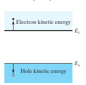
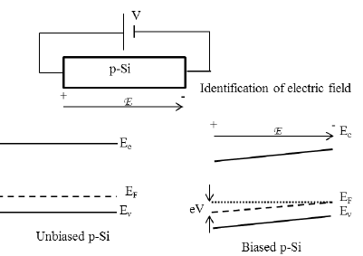

# Topic 7 — End-of-topic test

Try each question first.
Then click to check.

Each answer says which notes section (§) it comes from.

---

## Part A: Tutorial questions

### Q17 (Tutorial Ch1 Q17)

On a band diagram, where do electrons with higher energy sit? Where do holes with higher energy sit?

Answer

Electrons with more energy sit **higher up** in the conduction band, further above E_C.

Holes with more energy sit **deeper** in the valence band, further below E_V.

Both fall to their lowest energy: electrons sink to E_C, holes float up to E_V.

From: §1

---

### Q18 (Tutorial Ch1 Q18)

A homogeneously doped p-Si bar has a voltage across it, + on the left, − on the right. The contacts have no voltage drop. Draw the band diagram.

Answer

Field points left to right.

Bands tilt up towards the right (the − end). Total drop = eV.

E_F near E_V (p-type), tilted parallel.

Holes flow left to right.

From: §5, drawing checklist

---

## Part B: Midterm-style questions

---

### M1: True or false

1. Under an electric field, E_C and E_V tilt by different amounts.
2. Electrons roll downhill on E_C.
3. Holes roll downhill on E_V.
4. The field points in the direction E_C rises.
5. Flat bands mean zero field.

Answer

1. **False.** They tilt together. E_G is constant. (§2)
2. **True.** (§1, §2)
3. **False.** Holes float **up**hill. Their energy is upside down. (§1)
4. **True.** "Field points uphill for electrons." (§2, §4)
5. **True.** Tilt = field. No tilt = no field. (§2)

---

### M2: Multiple choice

A band diagram shows E_C higher on the left than on the right. Which is true?

- A. The field points left to right.
- B. Electrons move left to right.
- C. Holes move left to right.
- D. There is no field.

Answer

**B.**

E_C is higher on the left, so the field points right to left (uphill). Not A.

Electrons roll downhill, so left to right. B. ✓

Holes go uphill, so right to left. Not C.

From: §2, method table

---

### M3: Sketch

An n-Si bar has 2 V across it, + on the right.

1. Sketch E_C, E_V and E_F.
2. Label the energy drop across the bar.
3. Draw arrows for electron and hole movement.

Answer

1. Field points right to left (+ to −). Bands higher on the **left** (the − end). E_F near E_C (n-type), parallel.
2. Drop = eV = **2 eV** from left end to right end.
3. Electrons roll downhill: **left to right** (towards +). Holes float uphill: **right to left**.

From: drawing checklist

---

### M4: Explain

Why does the band diagram tilt when a voltage is applied, and why does E_G not change?

Answer

The band diagram plots **potential energy**. A voltage makes the potential change along the bar, so the energy changes along the bar. That's the tilt.

E_G is a property of the crystal. The voltage moves the whole band up or down at each point, but the gap between E_C and E_V is unchanged.

From: The big idea, §2

---

### M5: Link to Topic 3

Explain, using the tilted band diagram, why electrons and holes produce current in the **same** direction.

Answer

Electrons roll downhill, against the field.
Holes float uphill, with the field.

So they move in opposite directions. But electrons are negative, so their current is opposite to their motion.

Both currents end up pointing **with the field**. They add up.

From: §2, Topic 3

