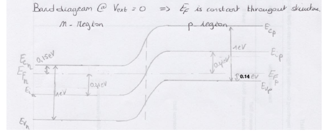

# Topic 10 — End-of-topic test

Try each question first.
Then click to check.

Each answer says which notes section (§) it comes from.

kT/e = 0.026 V. nᵢ² ≈ 2.1 × 10²⁰ cm⁻⁶. N_C = 3.2 × 10¹⁹. N_V = 1.8 × 10¹⁹ cm⁻³.

---

## Part A: Tutorial questions

### Q5 (Tutorial Ch2 Q5)

Si np diode, no bias. N_A = N_D = 10¹⁷ cm⁻³. E_G ≈ 1 eV.
Sketch the band diagram. Find E_C, E_F, E_i relative to E_V, and V₀.

Answer

**n-side:** E_C − E_F = **0.15 eV**. E_F − E_i = **0.41 eV**. So above E_V: E_F at 0.85, E_i at 0.44, E_C at 1.0 (using E_G = 1).

**p-side:** E_F − E_V = **0.14 eV**. E_i − E_F = **0.41 eV**. So above E_V: E_F at 0.14, E_i at 0.55, E_C at 1.0.

**V₀** = 0.026 × ln(10³⁴ ÷ 2.1 × 10²⁰) = **0.82 V** (= 0.41 + 0.41).

From: §5

---

### Q11a (Tutorial Ch2 Q11a)

pn diode, N_A = 10¹⁹ cm⁻³, N_D = 10¹⁶ cm⁻³, T = 300 K. Find V₀.

Answer

V₀ = 0.026 × ln(10¹⁹ × 10¹⁶ ÷ 2.1 × 10²⁰)

= 0.026 × ln(4.8 × 10¹⁴)

= 0.026 × 33.8 = **0.88 V**

Matches the official answer. (Parts b to e are Topic 14.)

From: §3, Equation 18

---

## Part B: Midterm-style questions

---

### M1: True or false

1. The depletion region contains no charge.
2. V₀ is on the formula sheet.
3. At zero bias, a tiny net current flows through the diode.
4. Doubling N_D doubles V₀.
5. The step in E_C across the junction equals eV₀.

Answer

1. **False.** No *free carriers*. It's full of fixed ion charge. (§2)
2. **True.** As V_bi. (§3)
3. **False.** Net current is exactly zero. Drift cancels diffusion. (§1)
4. **False.** It's a log. Doubling N_D adds only 0.026 × ln 2 = 0.018 V. (§3)
5. **True.** (§2)

---

### M2: Multiple choice

Which diode has the largest V₀?

- A. N_A = 10¹⁵, N_D = 10¹⁵
- B. N_A = 10¹⁸, N_D = 10¹⁵
- C. N_A = 10¹⁷, N_D = 10¹⁷
- D. N_A = 10¹⁹, N_D = 10¹⁶

Answer

**D.** Biggest product N_A × N_D = 10³⁵.

A: 10³⁰. B: 10³³. C: 10³⁴. D: 10³⁵.

From: §3, Equation 18

---

### M3: Calculate

N_A = 10¹⁸, N_D = 10¹⁵. Find V₀.

Answer

V₀ = 0.026 × ln(10³³ ÷ 2.1 × 10²⁰) = 0.026 × ln(4.8 × 10¹²) = 0.026 × 29.2 = **0.76 V**

From: §3, Equation 18

---

### M4: Explain

Explain in words why an electron on the n-side usually can't get to the p-side at zero bias.

Answer

The bands step up by eV₀ going from n to p.

Most electrons sit just above E_C on the n-side. To cross they'd need an extra eV₀ of energy. Only the few at the very top of the Fermi tail have that.

They can't tunnel straight across either, because the gap is forbidden.

From: §1, §4

---

### M5: Sketch

Sketch the charge density ρ(x) across a pn diode at zero bias, using the depletion approximation. N_A = 10¹⁷, N_D = 10¹⁶. Mark which side is wider.

Answer

- Outside the depletion region: ρ = 0.
- p-side of the depletion region: ρ = −eN_A, a flat negative block.
- n-side: ρ = +eN_D, a flat positive block.
- The blocks have equal **area** (equal total charge). N_D is 10× smaller, so the n-side block is 10× **wider**.

From: §2 (full treatment in Topic 14)

---

### M6: Link

Show that eV₀ equals the sum of (E_F − E_i) on the n-side and (E_i − E_F) on the p-side.

Answer

Topic 5 Equation 15 flipped:

n-side: E_F − E_i = kT ln(N_D/nᵢ)
p-side: E_i − E_F = kT ln(N_A/nᵢ)

Add: kT [ln(N_D/nᵢ) + ln(N_A/nᵢ)] = kT ln(N_A N_D / nᵢ²) = eV₀. ✓

From: §3

