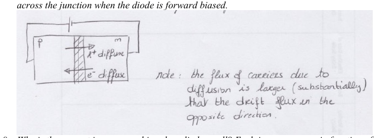
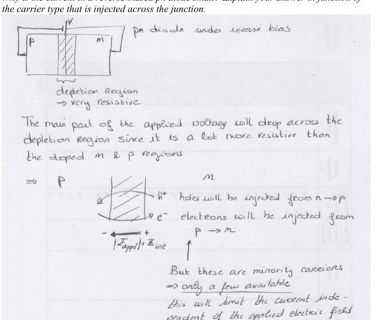

# Topic 11 — End-of-topic test

Try each question first.
Then click to check.

Each answer says which notes section (§) it comes from.

---

## Part A: Tutorial questions

### Q7 (Tutorial Ch2 Q7)

On a schematic diagram of a pn diode, draw the direction of hole and electron flow across the junction under forward bias.

Answer

Holes: p → n. Electrons: n → p. Both by diffusion over the lowered barrier.

From: §6

---

### Q8 (Tutorial Ch2 Q8)

Why is the current in a reverse-biased pn diode small? Explain in terms of the carrier type injected across the junction.

Answer

The voltage drops across the resistive depletion region. The field there sweeps **minority** carriers across: holes n → p, electrons p → n.

There are only nᵢ²/N minority carriers on each side, so very few are available. Tiny current, independent of voltage.

From: §7

---

## Part B: Midterm-style questions

---

### M1: True or false

1. Forward bias means + on the n-side.
2. Forward bias makes the depletion region thinner.
3. In reverse bias, majority carriers cross the junction by drift.
4. Under bias, E_F is still one flat line.
5. In forward bias the barrier becomes V₀ − V.

Answer

1. **False.** + on the **p**-side. (big idea)
2. **True.** (§5)
3. **False.** **Minority** carriers cross by drift. (§3)
4. **False.** It splits into E_Fp and E_Fn, separated by eV. (§2)
5. **True.** (§2)

---

### M2: Multiple choice

A diode with V₀ = 0.75 V has 0.3 V reverse bias. The step in E_C across the junction is:

- A. 0.45 eV
- B. 0.75 eV
- C. 1.05 eV
- D. 0.3 eV

Answer

**C.** Reverse bias raises the barrier: 0.75 + 0.3 = 1.05 eV.

From: §3

---

### M3: Sketch

Sketch the band diagram of a pn diode (a) at zero bias, (b) at 0.4 V forward bias, (c) at 1 V reverse bias. V₀ = 0.8 V. Label the step in each.

Answer

(a) Flat E_F. Step = **0.8 eV**.

(b) Step = 0.8 − 0.4 = **0.4 eV**. E_Fn above E_Fp by 0.4 eV. Depletion region narrower.

(c) Step = 0.8 + 1 = **1.8 eV**. E_Fn below E_Fp by 1 eV. Depletion region wider.

From: drawing checklist

---

### M4: Explain

In forward bias, why does the current increase so fast with voltage? (Hint: think about how many carriers can climb the barrier.)

Answer

The number of carriers with enough energy to clear a barrier of height E goes as e^(−E/kT) (Fermi tail, Topic 5).

Lower the barrier by V and the number goes up by e^(eV/kT). That's exponential. Every 0.026 V, the count multiplies by about 2.7.

So the current shoots up. (Topic 13 writes the equation.)

From: §2, Topic 10 §4

---

### M5: Fill in

| | Forward | Reverse |
|---|---|---|
| Battery + on | ? | ? |
| Barrier | ? | ? |
| Depletion width | ? | ? |
| Carriers crossing | ? | ? |
| Mechanism | ? | ? |
| Current | ? | ? |

Answer

| | Forward | Reverse |
|---|---|---|
| Battery + on | p | n |
| Barrier | V₀ − V | V₀ + \|V\| |
| Depletion width | thinner | wider |
| Carriers crossing | majority | minority |
| Mechanism | diffusion | drift |
| Current | large | tiny |

From: big idea, method table

