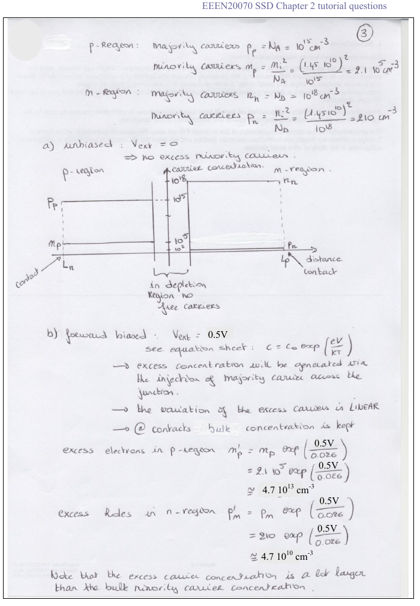
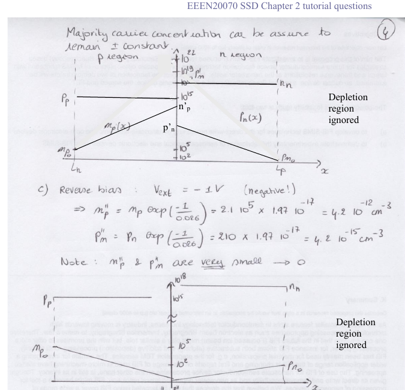
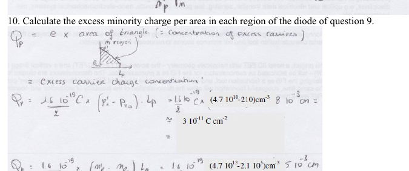

# Topic 12 — End-of-topic test

Try each question first.
Then click to check.

Each answer says which notes section (§) it comes from.

V_T = 0.026 V. nᵢ² ≈ 2.1 × 10²⁰ cm⁻⁶. e = 1.6 × 10⁻¹⁹ C. e^(0.5/0.026) ≈ 2.25 × 10⁸.

---

## Part A: Tutorial questions

### Q9 (Tutorial Ch2 Q9)

Short Si pn diode. N_A = 10¹⁵, N_D = 10¹⁸ cm⁻³. L_n = 5 × 10⁻³ cm, L_p = 8 × 10⁻³ cm.
Sketch minority and majority carriers vs distance for:
a. no bias
b. 0.5 V forward
c. 1 V reverse

Answer

Equilibrium: p_p = 10¹⁵, n_n = 10¹⁸, n_p0 = 2.1 × 10⁵, p_n0 = 210.

**a.** All flat.

**b.** n'_p = 2.1 × 10⁵ × 2.25 × 10⁸ = **4.7 × 10¹³**. p'_n = 210 × 2.25 × 10⁸ = **4.7 × 10¹⁰**. Straight lines down to equilibrium at the contacts. Majority unchanged.

**c.** Minority ≈ 0 at the junction, rising to equilibrium at the contacts.

From: §6

---

### Q10 (Tutorial Ch2 Q10)

Calculate the excess minority charge per area in each region of the Q9 diode at 0.5 V forward.

Answer

Triangle: Q = e × ½ × height × length.

n-region: Q_p = 1.6 × 10⁻¹⁹ × ½ × 4.7 × 10¹⁰ × 8 × 10⁻³ = **3.0 × 10⁻¹¹ C/cm²**

p-region: Q_n = 1.6 × 10⁻¹⁹ × ½ × 4.7 × 10¹³ × 5 × 10⁻³ = **1.9 × 10⁻⁸ C/cm²**

From: §7, Equation 20

---

## Part B: Midterm-style questions

---

### M1: True or false

1. In forward bias the majority carrier concentration changes a lot.
2. The minority profile in a short diode is a straight line.
3. In reverse bias the minority concentration at the junction edge is about zero.
4. The lightly doped side gets the larger minority injection.
5. The contact holds the minority concentration at its equilibrium value.

Answer

1. **False.** It barely changes. 10¹³ extra holes next to 10¹⁸ electrons is nothing. (§4)
2. **True.** No recombination, so constant gradient. (§3)
3. **True.** e^(V/V_T) with V negative ≈ 0. (§5)
4. **True.** Fewer majority means more minority (nᵢ²/N). (§7 check)
5. **True.** (§3)

---

### M2: Multiple choice

N_D = 10¹⁷. At 0.4 V forward, the hole concentration at the edge of the n-region is about:

- A. 2.1 × 10³ cm⁻³
- B. 10¹⁷ cm⁻³
- C. 10¹⁰ cm⁻³
- D. 4.8 × 10⁶ cm⁻³

Answer

**C.**

p_n0 = 2.1 × 10²⁰ ÷ 10¹⁷ = 2.1 × 10³. That's A, the zero-bias value.

e^(0.4/0.026) = e^15.4 = 4.8 × 10⁶. That's D, just the multiplier.

p'_n = 2.1 × 10³ × 4.8 × 10⁶ = 1.0 × 10¹⁰. **C.**

From: §2, Equation 19

---

### M3: Calculate

N_A = 10¹⁶, N_D = 10¹⁶. p-region length 2 × 10⁻³ cm. Forward bias 0.6 V.

1. Find n'_p.
2. Find the excess electron charge per area in the p-region.

Answer

**1.** n_p0 = 2.1 × 10²⁰ ÷ 10¹⁶ = 2.1 × 10⁴.

e^(0.6/0.026) = e^23.1 = 1.05 × 10¹⁰.

n'_p = 2.1 × 10⁴ × 1.05 × 10¹⁰ = **2.2 × 10¹⁴ cm⁻³**

**2.** Q = 1.6 × 10⁻¹⁹ × ½ × 2.2 × 10¹⁴ × 2 × 10⁻³ = **3.5 × 10⁻⁸ C/cm²**

From: Equation 19, Equation 20

---

### M4: Sketch

Sketch the hole concentration in the n-region of a short diode, on one graph, for V = 0, V = +0.3 V and V = −0.3 V. Linear axis. Label the junction edge and the contact.

Answer

- V = 0: flat line at p_n0.
- +0.3 V: starts at p_n0 × e^11.5 ≈ 10⁵ × p_n0 at the junction edge. Straight line down to p_n0 at the contact. A tall triangle.
- −0.3 V: starts at ≈ 0 at the junction edge. Straight line up to p_n0 at the contact. A tiny triangle below the flat line.

From: §3, §5, drawing checklist

---

### M5: Explain

Why is the minority carrier profile a straight line in a short diode, but curved (exponential) in a long one?

Answer

Short diode: no recombination. Every injected carrier makes it to the contact. The flow is the same at every x, so the gradient is constant. Straight line.

Long diode: carriers recombine on the way. The flow decreases with x, so the gradient decreases. Exponential decay.

This module uses the short diode.

From: §3, Topic 4

